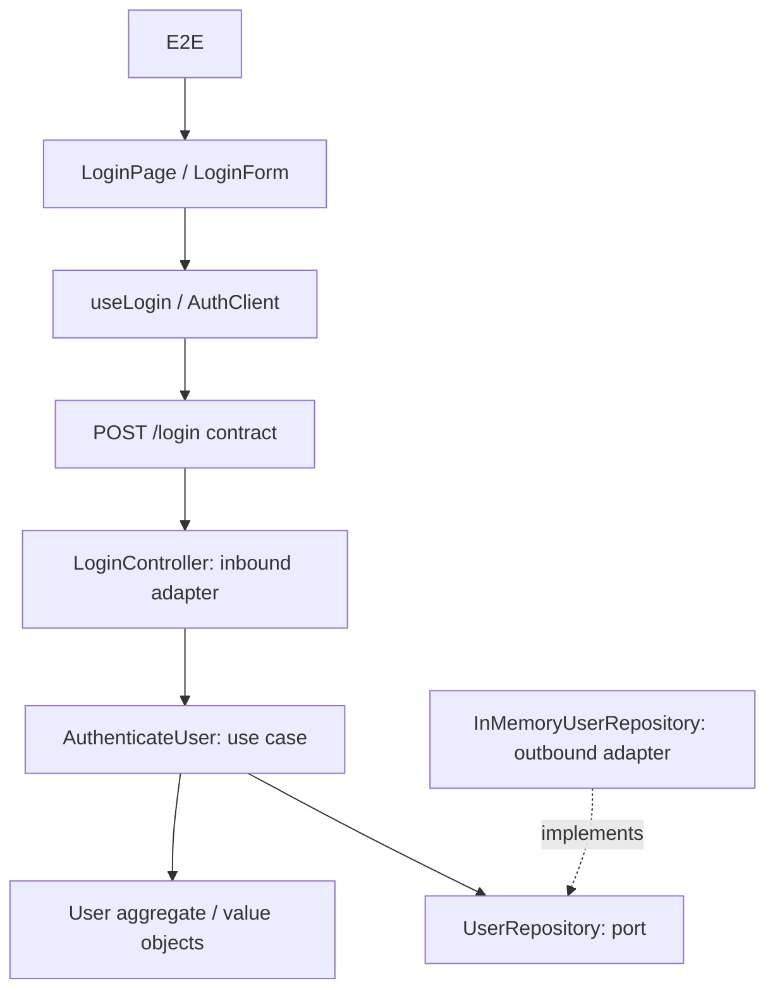

# Test Impact Lab

A planned, deterministic test-impact demonstration on a real TypeScript monorepo.
**Current milestone: Phase 0 — architecture only.** Login, impact analysis and test execution are not implemented yet.

The target stack is pnpm, React/Vite, Node.js, Vitest, Playwright, Monaco and React Flow. No AI participates in runtime selection.



Domain owns authentication invariants; application orchestrates ports; adapters handle HTTP and persistence. The composition root wires implementations. Runtime flow arrows in the diagram are not all TypeScript import directions.

Target catalogue: 1 E2E, 8 component, 4 frontend unit, 3 contract, 6 integration and 17 backend unit tests. Engine and architecture checks are separate from these 39 demo tests.

Selection will traverse versioned local evidence, stop implementation impact at unchanged contracts, and preserve journey-level E2E evidence. Every inclusion gets a path and every exclusion a reason. Results are sorted and reproducible for the same snapshot, edits, graph and catalogue.

## Available commands

Requires Node.js 22+ and pnpm 11.19.0.

```sh
pnpm install
pnpm validate:plan
```

Build, dev and test commands will be added with executable code in Phase 1; none currently claim to run an application.

## Design and continuation

- [Architecture and algorithm](docs/ARCHITECTURE.md)
- [Graph, catalogue and API types](packages/impact-engine/src/schema.ts)
- [Implementation state and next task](docs/IMPLEMENTATION_STATE.md)
- [Supplied SDD](docs/SDD.md)

To add a relationship later: register a stable entity ID and repository path, add a local dependency with evidence and an explicit propagation policy, bind a unique test ID to a real runner title, regenerate the graph and validate it. Never add scenario-to-test selection lists.
