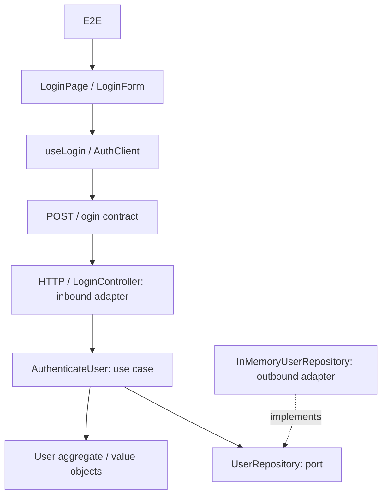

# Test Impact Lab

A real login and orders application with a deterministic test-impact engine in a TypeScript monorepo. The explorer guides source edits through versioned dependency discovery, deterministic impact analysis and physically measured selected/full regression runs. The reviewed login catalogue contains 39 tests. **G2–G6** add static discovery, immutable graph archives, evidence navigation, a separately materialized inventory HTTP provider, real RabbitMQ processing by independent consumers and distributed impact selection.

## Run

Use **Node.js 24.15+ (24.x) or 26+** and **pnpm 11.19.0** (pinned in `packageManager`).

```sh
pnpm install --frozen-lockfile
pnpm exec playwright install chromium
pnpm dev
```

Open [the interactive explorer](http://127.0.0.1:5175), [the login application](http://127.0.0.1:5173) or [the orders page](http://127.0.0.1:5173/orders). The product API listens on `127.0.0.1:3001`, the snapshot/analysis API on `127.0.0.1:3002`, and independent inventory on `127.0.0.1:3003`. Override `DEMO_PORT`, `DEMO_API_PORT`, `FRONTEND_PORT`, `BACKEND_PORT` or `INVENTORY_PORT` if occupied. `pnpm dev` creates a disposable independent Git repository for inventory outside the checkout and removes it after the launched services exit. This is a local demo, not a production order processor.

To inspect or edit a persistent external repository, first run `node scripts/inventory/materialize.mjs /absolute/empty/directory`. This creates and commits the template under that directory; use the returned `root` as `INVENTORY_ROOT` when invoking `pnpm dev`, `pnpm graph:discover`, `pnpm graph:check:v2` or `pnpm dev:demo-api`. Set `INVENTORY_ROOT` only to your own clean independent Git checkout. The demo never deletes a user-provided root. For an automatic disposable root, leave it unset with `pnpm dev`; a standalone `pnpm dev:inventory` also creates and cleans its own root but does not share it with separately launched services. Stop `pnpm dev` with Ctrl+C; do not delete a root while its server is running.

Without `INVENTORY_ROOT`, discovery enters **contract-only** mode: it can inspect the qualified client contract, but cannot open provider code or claim that external tests passed. Orders need a running inventory service to succeed. For an independent provider check, run `node --experimental-strip-types --test examples/external-inventory/test/inventory.test.ts` (1 test). With a pinned external source, the G6 runner can execute its reviewed provider suite in an isolated overlay. Without that source it marks the suite unavailable.

Credentials: `demo@example.com` / `impact-demo`. Wrong credentials produce an error; success navigates to `/home`. This is a credential-checking demo, without persistent sessions or protected pages.

### Optional local messaging profile (G5)

With Docker running, use `pnpm dev:events` **instead of** `pnpm dev`. It starts a pinned RabbitMQ 4.2.0 container, the existing applications and independent notification/preparation processes on ports 3004/3005. Create an order and use **Refresh processing status** to query their persisted effects over HTTP. Notifications are a local mailbox, not real email. Override `NOTIFICATIONS_PORT` and `PREPARATION_PORT`, together with the existing port settings, if occupied. No existing service is stopped by the launcher.

Ctrl+C closes launched services and removes only its broker (including its data volume), temporary databases and temporary inventory repository. A supplied `DATA_DIR` or `INVENTORY_ROOT` is retained. This profile is disposable: deleting its broker deliberately discards queued messages; retaining SQLite alone does not recover messages already marked published. For durable manual operation, retain both broker data and separate service databases. Plain `pnpm dev` needs no broker: it stores orders/outbox locally under the ignored `.impact-data/` directory and shows event processing as **not enabled**, not successfully delivered.

Run `pnpm test:messaging` for five real-broker integration/failure tests and four Chromium journeys. After `pnpm build`, `node scripts/verify-messaging.mjs --compiled` additionally repeats all five integration tests against the built executables. Verification creates its own broker, ports, databases and namespace and cleans them afterwards. Ordinary `pnpm validate` explicitly skips the five broker tests and one messaging journey when the profile is absent; it does not count them as passed. [G5 operations, exact versions and limitations](docs/G5-MESSAGING.md).

```sh
pnpm build                         # Typecheck, graph generation, production bundles
pnpm test                          # Vitest: product, engine and architecture checks
pnpm test:e2e                      # Chromium + real frontend/backend on free ports
pnpm test:execution                # Selected/full overlay execution verification
pnpm validate                      # Build, graph consistency, Vitest and E2E
pnpm impact LoginButton            # Explain a hypothetical entity change
pnpm impact 'User.authenticate'
pnpm impact 'POST /login'
pnpm test:selected LoginButton     # Physically run the computed subset
pnpm test:evidence-browser          # G3 Chromium evidence/navigation flow on ephemeral servers
pnpm test:discovery-browser         # G2 add/connect/delete browser flow
pnpm test:discovery-execution       # G2 CRUD overlay executes 39 real login tests
pnpm test:federated-execution       # G6 selected/full mutation across local and external suites
pnpm graph:legacy:check             # Historical login seed topology/policies
```

The explorer serves an immutable SHA-256-addressed snapshot of source files under [explicit product roots](impact/discovery.json), including disconnected files. Monaco edits stay in browser memory. **ADD FILE / DELETE FILE** operate only on that working copy; connect a new component with an import/JSX reference, then **CALCULATE REGRESSION**. The API rebuilds the edited graph and returns before/after IDs, node/edge delta and explicit unresolved-dependency diagnostics. Suggested changes modify source text and do not send scenario names or test IDs. **RELOAD SNAPSHOT** discards browser edits and loads current checkout inputs; old analyses cannot execute after those inputs change.

In **IMPACT GRAPH**, switch between system, configured source areas (not inferred runtime services) and code. Select a node or edge with the canvas or searchable keyboard buttons to inspect direction, policy, origin/revision, reason, dependencies and consumers. Filter by area, relation or evidence kind. Open exact archived UTF-16 ranges for static code or reviewed JSON configuration; **BACK TO PATH** returns to the inspector. Before/after and topology delta keep removed source navigable in its original revision. When source/range is unproven the UI reports that and offers no false code link. The canvas displays a legible bounded neighborhood; the index searches all filtered nodes. On narrow screens zoom or use the keyboard index. **CREATE GUIDED SCREEN** adds a component and links it from the login page *in the overlay only*; it does not claim a new route. Then calculate to see its new graph facts and archived source.

Discovery commands: `pnpm graph:generate` (also `graph:discover`) publishes v2; `pnpm graph:check` verifies it against a complete rebuild; `pnpm graph:watch` watches inputs and performs debounced **complete rebuilds**, not incremental AST indexing. To publish/check a snapshot with external code, pass the same clean `INVENTORY_ROOT` to both commands. The snapshot pins that repository's Git commit separately from the product's content revision; an uncommitted external source change is rejected. `pnpm test:discovery-browser` and `pnpm test:evidence-browser` run real Chromium flows on ephemeral servers; `pnpm test:discovery-execution` executes an added/connected component and deleted stylesheet against all 39 login tests. No running developer services are reused by verification.

In **TESTS**, the ID legend defines `BU` (backend unit), `FU` (frontend unit), `C` (component), `CT` (HTTP contract), `I` (integration) and `E` (browser E2E). Select any catalogue row or executed result to open its actual test file at that test's highlighted declaration and assertions, alongside the selection reason and runner output. **VIEW SOURCE CHANGE** opens the edited product file; **COMPARE** shows removed original lines in red and added edited lines in green. Use **EDIT** to return to the editable file. Test source is part of the immutable snapshot hash.

RUN SELECTED TESTS and RUN FULL SUITE execute browser edits in disposable source overlays. The browser sends only a snapshot ID, analysis ID and fixed mode; the server derives trusted catalogue IDs and maps them to fixed Vitest/Playwright commands. Results, failures and durations come from the runners, and audit reports are stored in `.impact-runs/`. `test:selected` remains the checkout-oriented CLI runner. `test:e2e` launches its own services and never reuses another running server.

G6 adds [reviewed federated suites](impact/evidence/federated-tests.json) for orders, inventory, notification, preparation and messaging paths. Impact uses the old and new v2 graphs and relation-specific propagation; each selected suite shows its causal path, and each excluded suite its reason. The runner executes fixed commands for available local and pinned external suites. Broker suites need a live G5 broker profile and are explicitly **unavailable** otherwise. Missing external source, skipped tests and missing runner reports never count as passes. `pnpm test:federated-execution` checks a controlled notification defect with selected and full runs on the same pinned source revisions.

This runner is a local, trusted-user tool. Edited TypeScript is executable code: the runner filters inherited environment variables, validates fixed test identities and removes its overlay, but it is not an OS sandbox and the edited code still runs with the current user's filesystem and network permissions. Keep the API bound to loopback and never expose it as a public execution service.

## Architecture



`User` owns authentication and locked-account invariants. `Email` normalizes and validates; `PasswordHash` performs salted scrypt verification. The application use case queries a domain-owned port; the composition root injects the repository. Domain/application cannot import adapters or transport contracts; automated import checks enforce this, including type imports and re-exports.

## Test catalogue and impact

The catalogue has **39 product tests**: 17 backend unit, 4 frontend unit, 8 component, 3 contract, 6 HTTP integration and 1 Playwright E2E. Engine and architecture checks sit outside the demo catalogue.

Graph edges point consumer → dependency. Normal impact travels in reverse. Explicit evidence paths reach API contracts; unchanged contracts permit contract and E2E journey evidence across the boundary while stopping implementation test propagation. Changed contracts expose relevant code on both sides. Every selected test has a causal path, and every excluded test has a reason. No AI runs in the engine.

Current graph-derived examples (not engine rules):

| Changed entity | Product tests selected |
| --- | ---: |
| `LoginButton` | 4 / 39: 3 component + E2E |
| `normalizeEmail` | 11 / 39: frontend unit/component + contract + E2E |
| `User.authenticate` | 13 / 39: 5 backend unit + 4 integration + 3 contract + E2E |
| `POST /login` | 29 / 39 across both sides of the boundary |

The CLI accepts explicit changed entity IDs. The explorer derives changed entities from real line diffs and the narrowest graph source ranges, backed by immutable source, graph and catalogue hashes. Unknown or unmapped changes conservatively select the full catalogue. Completeness depends on the reviewed graph evidence, not a claim of universal coverage.

[The legacy graph](impact/graph.json) and [catalogue](impact/catalogue.json) remain a frozen reviewed compatibility seed. Normal generation now publishes v2 from compiler-resolved imports, lexical symbols, direct calls/construction, JSX and the supported React Router pattern, plus [reviewed metadata](impact/evidence/architecture.json). The migration revalidates source locations/imports, preserves login policies and classifies manual test subjects as declarations, **not measured coverage**. The test selector still consumes a compatibility projection; the interactive inspector displays the full v2 graph and resolves locators by ID against immutable archived sources.

New product files do **not** require registration in legacy metadata. To change the reviewed test catalogue, register the test's stable ID/local subjects in metadata, add a real top-level test with a unique `[ID]` title, explicitly run the legacy generator with `--legacy-review`, then rebuild v2 and validate. `pnpm graph:legacy:check` audits this historical seed; it is not the production discovery gate. Never add scenario-to-test lists. TypeScript 5.9 is retained for its stable compiler API.

Archives include sources, tests, runner inputs, manifests and evidence. `GET /api/snapshots/:id` reads historical bytes, including when a current rebuild fails. Publication is atomic; failure retains the previous pointer and the API reports 503 rather than claiming freshness. Local archives/reports are ignored by Git and have no automatic retention policy; they can contain source code. Discovery supports UTF-8 text and the configured product roots plus the separately versioned inventory root. It rejects symlinks, binary input and path collisions. For HTTP it supports **only** the explicit local inventory `GET /v1/stock/:sku` v1 binding: service, environment, method, route template and version must agree with declarations and source occurrences. A matching URL alone gives no authoritative edge. Other HTTP transports, external libraries, runtime dispatch and unsupported route forms remain diagnostics; this is not universal TypeScript or distributed-system coverage. New topology or unproven scope selects the full **available login** catalogue, which does not include external tests.

- [Architecture and algorithm](docs/ARCHITECTURE.md)
- [Implementation state and optional Phase 7 handoff](docs/IMPLEMENTATION_STATE.md)
- [Graph, catalogue and API types](packages/impact-engine/src/schema.ts)
- [Supplied SDD](docs/SDD.md)

## Dependency discovery extension

The [dependency-graph SDD](docs/SDD-DEPENDENCY-GRAPH.md) is a separate, phase-gated extension. G1 defines the [v2 contract and migration](docs/GRAPH-V2-CONTRACT.md) and evaluates TypeScript/CodeGraphContext on a [reproducible corpus](impact/corpus/g1/README.md). G2 implements the TypeScript adapter selected by the [indexer ADR](docs/ADR-G1-INDEXER.md), preserving the reviewed login behavior. G3 implements the versioned evidence inspector and guided-screen browser flow. G4 implements orders, independent inventory HTTP, qualified graph evidence and navigation to pinned external source. G5 adds transactional outbox/inboxes, RabbitMQ, independent consumers, bounded retries/failed queues and source/configuration-backed messaging facts. G6 adds causal policies, federated suite selection and local cross-project execution. No consumer-to-consumer dependency is inferred from sharing a broker. See [phase status and validation evidence](docs/DEPENDENCY-GRAPH-STATE.md) before continuing. **G7 requires another human “sigue”**; no later phase is implicitly authorized.

Continuing on another machine or license? Start with the [G6 handoff](docs/G6-HANDOFF.md), then read the phase SDD and status log linked there.
