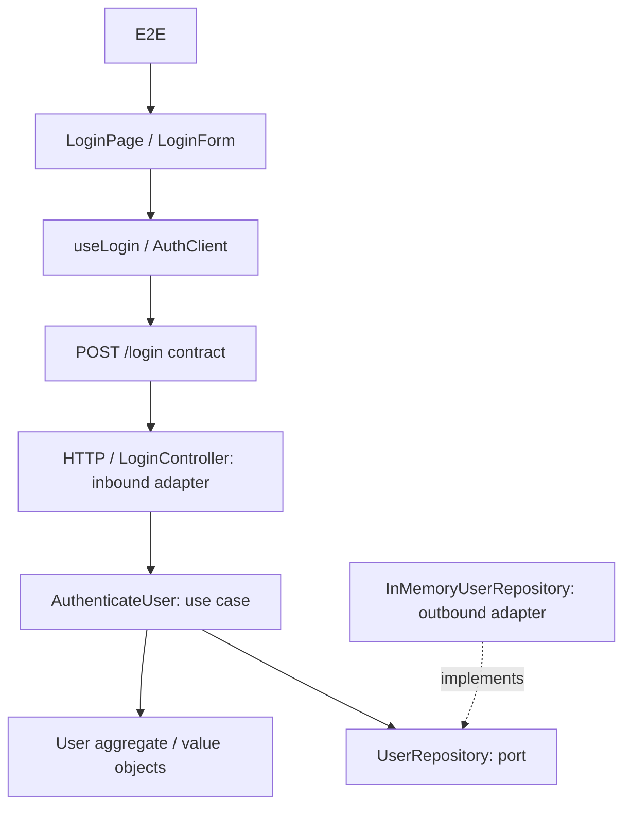

# Test Impact Lab

A real login application and deterministic test-impact engine in a TypeScript monorepo. **Phase 1 complete:** the vertical slice runs, its tests execute, and graph traversal selects explainable subsets. The Monaco/React Flow explorer and browser-triggered snapshot runner are later phases.

## Run

Use **Node.js 24.15+ (24.x) or 26+** and **pnpm 11.19.0** (pinned in `packageManager`).

```sh
pnpm install --frozen-lockfile
pnpm exec playwright install chromium
pnpm dev
```

Open [the login application](http://127.0.0.1:5173). The API listens on `127.0.0.1:3001`; Vite proxies `/login` to it. Override `FRONTEND_PORT` / `BACKEND_PORT` if occupied.

Credentials: `demo@example.com` / `impact-demo`. Wrong credentials produce an error; success navigates to `/home`. This is a credential-checking demo, without persistent sessions or protected pages.

```sh
pnpm build                         # Typecheck, graph generation, production bundles
pnpm test                          # Vitest: product, engine and architecture checks
pnpm test:e2e                      # Chromium + real frontend/backend on free ports
pnpm validate                      # Build, graph consistency, Vitest and E2E
pnpm impact LoginButton            # Explain a hypothetical entity change
pnpm impact User
pnpm impact 'POST /login'
pnpm test:selected LoginButton     # Physically run the computed subset
```

`test:selected` executes the **current checkout**, not a browser edit or a mutation. It validates actual reporter results against selected IDs and stores selection, raw reports and measured durations in `.impact-runs/`. The source-overlay runner and selected/full comparison UI are not implemented yet. `test:e2e` launches its own services and never reuses another running server. See [Playwright's web-server configuration](https://playwright.dev/docs/test-webserver) for the underlying service lifecycle.

## Architecture



`User` owns authentication and locked-account invariants. `Email` normalizes and validates; `PasswordHash` performs salted scrypt verification. The application use case queries a domain-owned port; the composition root injects the repository. Domain/application cannot import adapters or transport contracts; automated import checks enforce this, including type imports and re-exports.

## Test catalogue and impact

The vertical slice has **12 product tests**: 5 backend unit, 1 frontend unit, 2 component, 1 contract, 2 HTTP integration, 1 Playwright E2E. There are also 10 engine and 2 architecture checks; these are quality checks, outside the demo catalogue. Phase 2 expands the product catalogue toward 39 meaningful cases.

Graph edges point consumer → dependency. Normal impact travels in reverse. Explicit evidence paths reach API contracts; unchanged contracts permit contract and E2E journey evidence across the boundary while stopping implementation test propagation. Changed contracts expose relevant code on both sides. Every selected test has a causal path, and every excluded test has a reason. No AI runs in the engine.

Current graph-derived examples (not engine rules):

| Changed entity | Product tests selected |
| --- | ---: |
| `LoginButton` | 3 / 12 |
| `normalizeEmail` | 4 / 12 |
| `User` | 9 / 12 |
| `POST /login` | 11 / 12 |

Inputs currently use explicit changed entity IDs. File ranges are coarse, covering each entity's source module; automatic diff-to-entity mapping and snapshot hashes are pending. Unknown entities conservatively select the full catalogue. Completeness depends on the reviewed graph evidence, not a claim of universal coverage.

`impact/graph.json` and `impact/catalogue.json` are generated from TypeScript imports, literal test titles and [reviewed metadata](impact/evidence/architecture.json). Metadata edges explain HTTP routing, repository injection and locally exercised test subjects. These are explicit relationships, not measured runtime coverage.

To add a node/test: register its stable ID, file, architectural layer and local subjects in the metadata; add a real top-level test with a unique `[ID]` title; run `pnpm graph:generate`, `pnpm graph:check`, and relevant tests. Never add scenario-to-test lists. TypeScript 5.9 is retained for its stable compiler API.

- [Architecture and algorithm](docs/ARCHITECTURE.md)
- [Implementation state and Phase 2 handoff](docs/IMPLEMENTATION_STATE.md)
- [Graph, catalogue and planned API types](packages/impact-engine/src/schema.ts)
- [Supplied SDD](docs/SDD.md)
