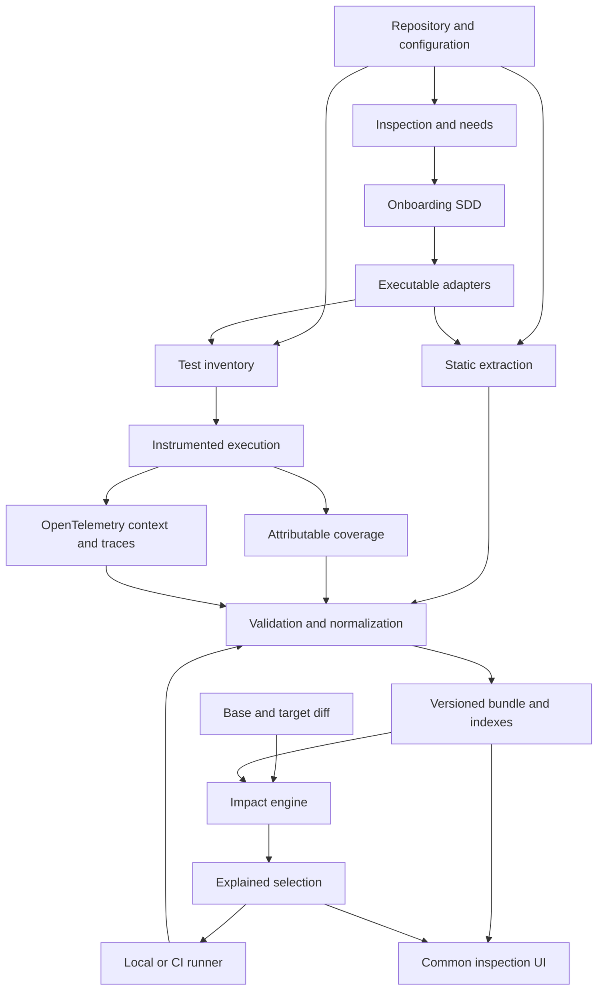

# SDD — Portable graph generation and test selection

Date: **2026-10-19**. Design version: **0.2**. Status: **E0 extraction implemented; P1–P8 development pending**.

This SDD defines a system that a skill can adapt to each project after inspecting it. The output is executable code and configuration in the repository, a deterministic CLI, and common artifacts also consumed by an inspection UI. It covers different test types and supports both local and CI operation.

The design is independent of language, framework, repository topology, and CI provider. Each adapter declares a specific scope; this independence of the contract does not imply implemented support for every technology.

Execution log: [IMPLEMENTATION-STATE.md](IMPLEMENTATION-STATE.md). The lab's provenance is documented in [ORIGIN.md](ORIGIN.md). Phases P0–P8 and extraction E0 in this document have their own status.

The initial distribution implements `inspect`, `validate`, `import-v2`, `view`, and `info`, together with an onboarding skill. The experimental `test-impact-view/1` format supports visual inspection and does not replace P2's complete bundle contract. Baseline creation, impact checking, selected execution, and CI integration remain planned. See the [README](../README.md) for the available and planned usage.

## Contents

1. [Objective and outcomes](#1-objective-and-outcomes)
2. [Decisions and requirements](#2-decisions-and-requirements)
3. [Scope and limitations](#3-scope-and-limitations)
4. [Determinism and the meaning of evidence](#4-determinism-and-the-meaning-of-evidence)
5. [Standards and reuse](#5-standards-and-reuse)
6. [Architecture](#6-architecture)
7. [Project inspection and needs](#7-project-inspection-and-needs)
8. [Adapter contract](#8-adapter-contract)
9. [Identity and data model](#9-identity-and-data-model)
10. [Portable artifacts](#10-portable-artifacts)
11. [Linking different test types](#11-linking-different-test-types)
12. [Coverage capture per execution unit](#12-coverage-capture-per-execution-unit)
13. [OpenTelemetry and distributed correlation](#13-opentelemetry-and-distributed-correlation)
14. [Contracts as boundaries](#14-contracts-as-boundaries)
15. [Initial baseline and maintenance](#15-initial-baseline-and-maintenance)
16. [Validity and invalidation](#16-validity-and-invalidation)
17. [Impact algorithm](#17-impact-algorithm)
18. [Incremental updates and performance](#18-incremental-updates-and-performance)
19. [CLI experience](#19-cli-experience)
20. [CI and artifact provenance](#20-ci-and-artifact-provenance)
21. [Common UI and large graphs](#21-common-ui-and-large-graphs)
22. [Skill and onboarding SDD](#22-skill-and-onboarding-sdd)
23. [Diagnostics and failure behavior](#23-diagnostics-and-failure-behavior)
24. [Validation and measurement](#24-validation-and-measurement)
25. [Relationship to the current implementation](#25-relationship-to-the-current-implementation)
26. [Development phases and reasoning level](#26-development-phases-and-reasoning-level)
27. [Overall acceptance](#27-overall-acceptance)
28. [Open decisions and risks](#28-open-decisions-and-risks)
29. [Operation and recovery](#29-operation-and-recovery)
30. [Glossary](#30-glossary)
31. [Official references](#31-official-references)

## 1. Objective and outcomes

A user must be able to onboard a repository without drawing its graph beforehand or maintaining manual lists of which tests correspond to each change. Onboarding inspects the project, identifies needs, implements scoped adapters, and leaves a system that works without consulting an LLM on each run.

The system must answer:

- Which files, symbols, packages, resources, and contracts exist within the analyzed scope.
- Which dependencies are demonstrated and by what evidence.
- Which code each identifiable test or test group executed.
- What changes between two code states, including their dependencies before and after the change.
- Which tests must run and which rules allow others to be excluded.
- Where evidence is missing, what additional selection that causes, and which execution could improve it.

The initial build may be expensive: full inventory, static extraction, and instrumented execution of the planned suites. Subsequent impact queries must reuse the baseline and update only what is necessary, without requiring the full suite to run before calculating a selection.

The UI shares its input format across projects. It must make relationships and areas without evidence understandable without rendering every node at once.

The deliverable comprises four parts: a common contract, a deterministic core, executable adapters, and an onboarding skill. CLI, CI, and UI consume the same core.

## 2. Decisions and requirements

These decisions capture the agreement reached during definition. Their identifiers make implementation traceable.

| ID | Requirement |
| --- | --- |
| R01 | Inspect the project and identify its needs before choosing and implementing adapters. |
| R02 | Keep the SDD general: do not assume a frontend, backend, monorepo, language, runner, or CI. |
| R03 | Prioritize deterministic, verifiable, regenerable relationships. |
| R04 | Use AI for analysis and development; authoritative generation and runtime selection must work without an LLM. |
| R05 | Include unit, component, contract, integration, E2E, and any additional detected test categories. |
| R06 | Create E2E-to-code coverage relationships exclusively through attributable instrumentation. |
| R07 | Combine static analysis and coverage per identifiable unit for other tests, distinguishing their meaning. |
| R08 | Use per-test coverage for code execution and OpenTelemetry for context and correlation, where appropriate. |
| R09 | Prefer ecosystem standards and tools to custom protocols and instrumentation. |
| R10 | Emit stable, documented, validated artifacts consumable by a common UI. |
| R11 | Separate expensive bootstrap, fast impact queries, and execution of the selection. |
| R12 | Integrate the workflow into CI and share artifacts across jobs with verifiable identity and provenance. |
| R13 | Model contracts as explicit boundaries, even without access to the other repository. |
| R14 | Broaden selection under uncertainty; identify unknown or inaccessible tests as such. |
| R15 | Provide filtering, aggregation, and navigation that work for large projects. |
| R16 | Recommend reasoning levels per phase without prescribing models, taking cost into account. |
| R17 | Avoid manual maintenance of change→test lists and associations based only on opinion. |
| R18 | Publish actual validation results and support limitations; do not claim universal correctness. |

QA or development knowledge can contribute scenarios, data, suite classification, and corpus cases. That information does not authorize test exclusion or establish demonstrated coverage by itself. A policy may add mandatory tests and broaden selection, and must be presented as a policy.

## 3. Scope and limitations

### 3.1 Project scopes

The contract supports a library repository, client application, service, monolith, monorepo, or an explicitly registered set of repositories. A project can contain multiple languages and runners, provided support is declared by each adapter.

An external repository may be visible through pinned code, visible only through a contract, or inaccessible. Frontend and backend code do not need to be available together. Results must distinguish completeness within the registered scope from visibility into external systems.

Non-executable files also matter: styles, templates, assets, migrations, schemas, configuration, lockfiles, code generation, translations, and test data. Extract their dependencies when a validated adapter exists; otherwise, trigger conservative scope rules.

### 3.2 Required initial delivery

- A portable contract with validators and examples independent of the demo project.
- A core for normalization, diagnostics, impact, and validity.
- A first adapter chosen after inspection, rather than prescribed by this SDD.
- Test inventory and attributable capture for runners included in that scope.
- Baseline creation, impact checking, execution, updates, and diagnostics through the CLI.
- CI integration through neutral commands and artifacts.
- A common inspection UI with filtering and aggregation.
- A skill that inspects, produces an onboarding SDD, and implements the adapter within the agreed scope.
- Validation on a real project and a second onboarding to assess portability.

The second onboarding may use the same language with a different structure or runner. It does not justify advertising support for multiple languages if only adapters for one language have been implemented.

### 3.3 Subsequent extensions

Other languages, protocols, CI providers, remote storage, and cross-repository execution are permitted. Each extension needs its own capability matrix and tests. A hosted multiuser service, billing, commercial distribution, and organization management require a subsequent scope.

The initial delivery does not require a graph database, Kubernetes, service mesh, or a hosted observability platform. Adding them must address a measured project need.

## 4. Determinism and the meaning of evidence

### 4.1 Three different properties

**Deterministic static extraction:** the same bytes, configuration, toolchain, and adapters generate the same normalized graph.

**Attributable execution capture:** the mechanism records what happened under a specific identity and conditions. Paths may vary with data, concurrency, environment, randomness, or external services.

**Deterministic selection:** the same snapshots, diff, evidence set, and policies generate the same selection and explanations.

The requirement therefore does not demand identical timing, trace IDs, or coverage from two physical runs. It requires preserving each measurement's inputs and processing them deterministically. Absence of observed execution does not demonstrate absence of dependency.

### 4.2 Evidence classes

| Class | Permitted claim | Limitation |
| --- | --- | --- |
| `static` | A specific construct resolves to a dependency using the declared analyzer. | An import does not prove execution or assertions. |
| `configuration` | Registered configuration establishes a binding or scope. | A matching URL does not establish a provider or implementation. |
| `measured-coverage` | An identified unit executed certain code points during a capture. | It does not prove all possible branches or which behavior is checked. |
| `observation` | An interaction, span, or correlated resource was observed. | It is not instruction coverage. |
| `declaration` | A human or tool declaration describes intent or classification. | It does not authorize exclusions or automatically become coverage. |

Each evidence record includes method, version, inputs, scope, locator, status, and limitations. A relationship may accumulate multiple evidence records without changing its meaning.

Generic scores such as “95% confidence” must not authorize exclusions. Use verifiable conditions: unique resolution, complete capture for the declared scope, valid source mapping, and current validity.

### 4.3 Invariants

1. Every authoritative edge has verifiable evidence.
2. Assistant suggestions remain hypotheses until an adapter demonstrates them or a diagnostic preserves them as pending.
3. Every included file is registered in the inventory, even if disconnected.
4. Resolution follows the compiler/runtime and build conditions; matching names are insufficient.
5. Changes are interpreted against both the previous and subsequent states.
6. Unknown information does not become “no impact.”
7. Weaker evidence cannot permit a narrower selection under the same policy.
8. Adding a UI filter does not modify the graph or selection.
9. A timeout, skip, cancellation, or missing report never counts as a passed test.
10. Combining runs only merges evidence with demonstrated compatibility of inputs and context.
11. Positive observed evidence may broaden selection; exclusion also requires justification of scope and validity.
12. Version-dependent decisions are pinned and reproducible.

### 4.4 Integrity and operational variation

The static graph hash excludes timestamps, absolute paths, execution order, and duration. A raw artifact's hash verifies all its bytes, even when it contains variable values.

A bundle distinguishes the semantic graph hash, evidence-set hash, and operational metadata hash. Variable data must not be removed from an original report to pretend that two captures were identical.

## 5. Standards and reuse

An adapter must provide a short ADR justifying any custom mechanism that duplicates an available interoperable capability. “Available” means compatible with the project's versions and conditions, tested against the corpus, and operational within its budget.

| Need | Preferred design | Application and limitation |
| --- | --- | --- |
| Dependency resolution | Compiler API or official ecosystem resolver | Respect actual aliases, exports, conditions, and project options. |
| Traces and propagation | OpenTelemetry and W3C Trace Context | Correlate activity within and across processes. |
| Telemetry transport | OTLP | Preserve compatibility with Collector and backends; do not require a hosted backend. |
| Coverage | Ecosystem coverage engine and format | Verify per-test attribution; an aggregate format does not guarantee it. |
| Transformed sources | Standard source maps when the stack uses them | Validate against the exact build and original bytes. |
| Artifact validation | JSON Schema with a pinned dialect | Initial proposal: Draft 2020-12. |
| Serialization for hashes | JSON Canonicalization Scheme, RFC 8785 | Also order semantic arrays according to the contract. |
| Code identity | Git plus captured-content hashes | A Git SHA alone does not identify local changes. |
| Contracts | Existing project formats | These may include OpenAPI, AsyncAPI, GraphQL, protobuf, or consumer contracts. |
| Test results | Native runner report and common normalization | Preserve semantics; do not assume a single universal JUnit XML dialect. |

OpenTelemetry documents [context propagation](https://opentelemetry.io/docs/concepts/context-propagation/), W3C specifies [Trace Context](https://www.w3.org/TR/trace-context/), and OTLP defines the [telemetry protocol](https://opentelemetry.io/docs/specs/otlp/). These capabilities underpin correlation in the design.

The artifact contract will pin a [JSON Schema](https://json-schema.org/draft/2020-12) dialect and canonicalization rules based on [RFC 8785](https://www.rfc-editor.org/rfc/rfc8785.html). JCS does not determine which arrays represent sets; that decision belongs to this contract.

For transformed JavaScript, the mapping reference is the [ECMA-426 specification](https://tc39.es/ecma426/). Using it does not automatically demonstrate a unique mapping for every instrumented point.

Versions of standards, SDKs, conventions, and dependencies will be pinned when each adapter is implemented. A `latest` or `main` branch must not be used as a reproducible identity.

## 6. Architecture



### 6.1 Responsibilities

- **Skill:** inspects, drafts the plan, writes or adapts code, and documents unresolved needs.
- **Static adapter:** emits located facts and diagnostics; it does not decide which tests run.
- **Runner adapter:** enumerates cases, preserves identity, and translates a selection into supported execution.
- **Coverage adapter:** captures and normalizes execution with demonstrable attribution.
- **Correlation adapter:** connects context, spans, and resources to verified identities.
- **Core:** validates, normalizes, versions, determines validity, and propagates impact.
- **Storage:** preserves immutable bundles and replaceable derived indexes.
- **CLI/CI/UI:** present or execute core decisions using the same rules.

### 6.2 Separation of operations

Initial inspection reads files and manifests. Some runners execute code when loading configuration or enumerating cases; this operation is identified as execution of project code and performed within its intended working environment.

The fast check does not need to start the application, run tests, download tools, or consult an LLM. It may use prepared indexes; if a dynamic inventory cannot be updated without executing the runner, selection must broaden or an explicit update operation must be requested.

Adapters run as project tools, with documented time, memory, and output limits. Declaring an adapter does not establish operating-system isolation.

## 7. Project inspection and needs

### 7.1 Input inventory

Inspection must collect at least:

- Roots, submodules, workspaces, nested projects, and ownership boundaries.
- Languages, versions, compilers, module resolution, and build tools.
- Application entry points, internal libraries, shared packages, and generated code.
- Runners, suites, variants, parameterization, fixtures, mocks, and test services.
- Existing commands, lifecycle hooks, and environment setup/cleanup.
- Available coverage, actual granularity, isolation, parallelism, and source mapping.
- Contracts, generated clients, bindings, accessible services, and external revisions.
- Current CI: checkout, base reference, matrices, shards, caches, artifacts, and effective permissions.
- Shared configuration, flags, behavior-affecting variables, datasets, and mock versions.
- Project sizes, current test duration, and available resources.
- Explicit exclusions and existing files outside every known scope.

Secrets are represented by references or safe environment versions; their values are not copied into reports or published as easily guessed hashes.

### 7.2 Capability report

Each capability is classified as `supported`, `partial`, `unsupported`, or `unknown`, with inspection evidence and a conservative action.

| Capability | Question it must answer |
| --- | --- |
| Complete inventory | Are all included roots and exclusions known? |
| Resolution | Does it reproduce effective build resolution? |
| Dynamic dependencies | Which patterns can be resolved and which remain open? |
| Test identity | Are cases, parameters, variants, and groups distinguished? |
| Execution selection | Can the runner execute exact cases, or only files/suites? |
| Coverage | Is it available per case, group, process, or only in aggregate? |
| Attribution | Can concurrent tests or late work contaminate each other? |
| Sources | Can each range be linked to verified original bytes? |
| Contracts | Which boundary is known and which side can be verified? |
| Distributed context | Which processes preserve identity and which lose it? |
| Incrementality | What can be invalidated locally and what requires rebuilding? |

A missing capability becomes an implementation need or a declared limitation. The matrix must not be filled with capabilities inferred from a dependency's name.

### 7.3 Onboarding SDD

Before implementation, produce a project-specific SDD containing:

1. Observed state, revision, and known commands.
2. Code scope and runner catalogue.
3. Needs and differences from existing adapters.
4. Static resolution and instrumentation matrix.
5. Reproducible environment, variants, and minimum execution units.
6. Contract and uncertainty policies.
7. Baseline, cache, and CI integration design.
8. Performance and storage budget.
9. Corpus, acceptance criteria, and comparative validation.
10. Files to create/modify, phases, and recommended reasoning level.

If a material decision is missing, document it and ask the user. Continue independent work. The user is not required to design the graph or provide manual test→code associations.

## 8. Adapter contract

### 8.1 Manifest

Each adapter must declare:

- Identifier, version, and executable/configuration hash.
- Supported languages, framework, compilers, and runners, with tested version ranges.
- Relationships it can emit and exact patterns it resolves.
- Coverage and test-selection granularities.
- Handling of mocks, hooks, processes, navigation, and concurrency.
- Tool dependencies and native formats.
- Unsupported patterns, resource limits, and required invalidation.
- Produced portable-contract version and corpus tests passed.

A local adapter generated for a project must also satisfy this contract. Hidden exceptions in the core that recognize specific file names or scenarios are not accepted.

### 8.2 Conceptual operations

```text
inspect(inputs)                       -> capabilities, needs, diagnostics
inventory(sourceSet, configuration)    -> files, packages, resources
discover(inventory, toolchain)         -> facts, locators, diagnostics
listTests(runnerConfiguration)         -> catalogue, executionUnits
planCapture(executionUnits, variants)  -> instrumentationPlan
collect(instrumentationPlan)           -> rawCoverage, results, traceReferences
normalize(rawArtifacts, sourceSet)     -> evidence, completeness, diagnostics
resolveExecution(selection, catalogue) -> argvPlans, expectedResults
invalidation(changeSet, fingerprints)  -> affectedScopes, rebuildRequirements
```

These are design interfaces, not a requirement to implement all adapters in a common language. Transport between core and adapter must be validatable and independent of shared UI memory.

### 8.3 Static resolution

Prioritize compiler APIs and actual resolvers for imports, exports, inheritance, direct calls, and supported constructs. Frameworks with templates, injection, routes, or plugins require explicit rules and tests.

A literal dynamic import may be resolvable. A computed string or open registry only permits a bounded relationship when the complete target set is demonstrated. If multiple candidates exist, retain them as a diagnostic or conservative set, without choosing one by similarity.

### 8.4 Conformance

To be incorporated, each adapter must pass positive and negative corpus cases: aliases, reexports, namesakes, cycles, disconnected modules, configuration, additions/deletions, mocks, dynamic cases, and unsupported conditions. Output must be identical with cold and warm caches.

If incremental extraction is not implemented, the adapter declares a complete rebuild and publishes actual measurements. A watcher that rebuilds everything must not be described as incremental.

## 9. Identity and data model

### 9.1 Project and code identity

`projectId` and `repositoryId` are configured stable namespaces. They are not derived from the checkout basename or absolute paths.

A source state includes the Git revision when available, captured-tree hash, and hashes of all relevant files/configurations. Uncommitted local content is represented by that hash and an explicit working-tree marker.

Files use relative POSIX paths. Collisions, paths escaping roots, and ambiguous case differences in the environment must be rejected. The symbolic-link policy must resolve links within allowed roots or reject them with a diagnostic.

Symbols use a qualified key derived from their declaration and scope. Positions are locators, not the sole identity. If continuity after a rename cannot be demonstrated, represent a deletion and addition.

### 9.2 Test identity

Identity comes from the runner when stable, or from a normalized key:

```text
repository + runnerProject + testFile + suitePath + caseKey + parameterKey + variant
```

Appearance order and line number are insufficient for stable identity. Parameterization must provide a reproducible key; otherwise, use a group unit. Duplicate titles require validated disambiguation or a diagnostic.

An explicitly annotated ID is optional and establishes identity, never coverage. Rewriting every title to match the legacy catalogue's ID pattern is not required.

**Selection units** may be cases, files, or suites. **Measurement units** may differ. If the runner executes an entire file to select a case, the plan must expose the expansion and require results for every executed case.

### 9.3 Nodes and relationships

Common nodes: repository, package, file, symbol, asset, test, test group, contract, and resource. Endpoints, services, events, and consumers are typed extensions with explicit identity.

| Relationship | Semantic direction | Impact use |
| --- | --- | --- |
| `imports`, `calls`, `renders`, `reads-resource` | Consumer → dependency | Reverse propagation according to adapter conditions. |
| `resolves-to`, `injects` | Use/binding → target | Apply the complete candidate set or broaden scope. |
| `contains` | Container → contents | Grouping; does not automatically propagate throughout the container. |
| `test-depends-on` | Test/group → static dependency | Conservative candidates; does not assert measured execution. |
| `executes` | Test/group → code point | Positive evidence of attributable coverage. |
| `uses-contract` | Consumer → contract | Explicit propagation and boundary evaluation. |
| `implements-contract` | Implementation → contract | Requires evidence from the accessible side. |
| `observed-interaction` | Actor → resource/actor | Contextual evidence; does not remove unobserved dependencies. |

Propagation policies are versioned per relationship. Sharing a file, package, broker, or name does not itself establish a call or coverage.

### 9.4 Minimum entities

| Entity | Conceptually required fields |
| --- | --- |
| `Node` | ID, type, namespace, logical key, attributes, locators. |
| `Edge` | ID, type, source, target, qualifiers, evidence and policy references. |
| `Evidence` | ID, class, producer/version, inputs, scope, locator, status, limitations. |
| `TestCase` | ID, runner, locator, variant, selectable unit, availability, fingerprint. |
| `CoverageRecord` | Unit, attempt, context, code/build, executed points, capture integrity, provenance. |
| `Diagnostic` | Code, cause, affected scope, conservative action, evidence, possible recovery. |
| `Analysis` | Base/target, baseline used, inputs/policies, selected, excluded, unavailable, reasons. |
| `RunResult` | Plan, unit, attempt, status, native results, coverage, timing, infrastructure errors. |

The common schema must separate logical test type—unit, contract, and so on—from its runner. One runner may execute multiple categories.

### 9.5 Locators

A source is identified by path, hash, and revision/tree. A range specifies its base, column unit, and whether its end is exclusive. Preserve the native unit when necessary and normalize it through a tested adapter.

JSON Pointers locate configuration; coverage maps identify original execution points; spans are referenced by dataset and trace/span ID. Do not link a current line to explain historical evidence from different bytes.

### 9.6 Evidence status

Resolution may be `resolved`, `ambiguous`, or `unresolved`; validity may be `current`, `inherited-valid`, `stale`, or `incompatible`; capture may be `complete`, `partial`, or `unknown`.

These are different dimensions. A complete capture means the scope promised by the plan was collected; it does not mean every possible application branch was executed.

## 10. Portable artifacts

### 10.1 Proposed structure

Onboarding configuration is versioned in Git. Large data and captures are stored as immutable artifacts outside normal code history.

```text
test-impact.config.json
test-impact/
  project-profile.json
  adapters.lock.json
  policies.json
  adapters/                         # local adapters, when present
  docs/
    ONBOARDING-SDD.md
    IMPLEMENTATION-STATE.md

.test-impact/                       # generated data; normally ignored by Git
  bundles/<bundle-id>/
    manifest.json
    graph.json
    catalogue.json
    evidence.json
    diagnostics.json
    coverage/
      index.json
      records/<partition-id>.json
    observations/
      index.json
    sources/
      index.json
    raw/
      index.json
    indexes/
      index.json
  analyses/<analysis-id>/
    impact.json
    execution-plan.json
    summary.md
  runs/<run-id>/
    results.json
    capture-manifest.json
  refs/
    baseline.json
```

These names are the proposed P2 interface; they are not files or commands implemented by creating this SDD. A contract revision may adjust them before version 1 is published.

Required index files exist even when their lists are empty. Referenced payloads are materialized according to the manifest. “Not captured” is distinguished from a valid capture with zero executed points.

### 10.2 Manifest

It must contain:

- Schema and producer versions.
- Project, repository, and source-tree identity.
- Adapter, policy, configuration, and toolchain versions/hashes.
- Variant matrix and environment affecting the result.
- Hash, size, type, and path of each artifact.
- Semantic graph hash and an exact reference to the evidence set.
- Catalogue and capture status per scope.
- Parents and reuse certificates when evidence is inherited.
- CI or local execution provenance, separate from byte integrity.
- Minimum capabilities required of the reader.

The bundle ID is calculated over a canonical manifest excluding its own ID field. Artifacts are hashed first. Self-referential hash cycles are prohibited.

Code metadata preserves original bytes and line endings. Canonicalization applies to contract JSON; it does not modify sources to make their hashes match.

### 10.3 Reader compatibility

Each file includes its schema version or belongs to a bundle version that pins it unambiguously. Readers reject incompatible major versions and unknown relationships or policies affecting exclusion.

Additional fields are introduced through namespaced extensions. A UI may indicate that it cannot represent an extension; the engine cannot silently ignore it if it changes propagation or validity.

Schemas, minimum fixtures, and examples using multiple technologies will be published. The UI must not import project-specific metadata to understand a file's meaning.

### 10.4 Raw data and indexes

Preserve native coverage and results alongside their normalization when feasible. Inverted indexes—point→tests, dependency→consumers, and test→closure—are rebuildable and do not replace original evidence.

Sources may be archived completely, partially, or made available from a checkout by hash. The manifest declares which mode is used. If historical source is missing, the inspector shows the locator and limitation.

Telemetry exported in JSONL retains its exporter's declared format; it must not be advertised as a universal OTLP JSONL format.

### 10.5 Publication

Build in a temporary location, validate hashes, schema, and references, then publish atomically. Update the baseline pointer only when the bundle is complete and satisfies its promotion policy.

A failure preserves the previous baseline and visibly indicates that it does not represent the current inputs. The latest existing artifact is not automatically the appropriate baseline.

## 11. Linking different test types

| Logical type | Evidence before execution | Execution evidence | Initial rule |
| --- | --- | --- | --- |
| Unit | Resolvable imports, calls, fixtures, mocks, and configuration. | Attributable coverage of the body and hooks. | Static dependencies may select tests; measurement explains execution and refines selection within tested limits. |
| Component | Mounted component, modules, templates, assets, and configuration. | Executed renders, events, hooks, and branches. | Account for resources and framework dependencies; an import does not demonstrate a render. |
| Contract | Association with a contract through the actual test, verified client, schema, and binding. | Executed operations/cases and verifier results. | Distinguish the consumed contract, real provider, and simulated provider. |
| Integration | Composition and explicit fixture, module, and resource dependencies. | Instrumented-process coverage plus correlated interactions. | Select the suite when identity is available only per suite. |
| E2E | Test-infrastructure dependencies; no inferred association with product code. | Attributed browser and accessible-process coverage. | Create E2E→product-code links only through instrumentation. |
| Architecture, snapshot, visual, or other | Declared inputs and demonstrable runner access. | Observed reads/execution where supported. | Select broadly or always when a narrow scope cannot be demonstrated. |

### 11.1 Static test dependencies

The graph may show that a unit test imports a module or a test uses a fixture. This does not justify assuming that every imported symbol is exercised or that a mock executes the real implementation.

The initial selector uses file/package dependencies as an overapproximation when no demonstrated finer analysis exists. Instrumentation supplies evidence of the points actually reached.

E2E tests may link to their own infrastructure, such as a helper or runner configuration. Those links do not become product coverage or associations inferred from DOM selectors, titles, URLs, or similar names.

### 11.2 Limited attribution

If the only demonstrable claim is “this suite executed this code,” the evidence node is the suite. All its cases may be included through the execution unit without artificially distributing coverage between them.

An aggregate report for an entire suite serves overall coverage and diagnostics. It is not heuristically split into supposed per-test reports.

### 11.3 Categories and variants

Classify using runner configuration, verified location, or metadata with explicit provenance. The system must support unknown classifications. Category alone does not determine precision.

Browsers, runtimes, platforms, flags, and datasets are variants when they affect paths or compatibility. Coverage from one variant must not be applied to another without justification.

## 12. Coverage capture per execution unit

### 12.1 Selection strategy

Choose, in practical order:

1. Native ecosystem support for contexts or per-case coverage, if it meets isolation and granularity requirements.
2. Isolated execution per case, file, or suite, collecting coverage from the process and its children.
3. Additional instrumentation with execution context, only if the adapter demonstrates attribution.
4. Group coverage and selection of the entire group when individual precision is not feasible.

The choice does not mandate a single coverage provider. Examples of ecosystem capabilities include [Vitest's V8 and Istanbul providers](https://vitest.dev/guide/coverage.html) and [Coverage.py's measurement contexts](https://coverage.readthedocs.io/en/latest/contexts.html). Chosen versions and hooks must be tested; having coverage does not automatically guarantee per-case capture.

### 12.2 Capture protocol

Each execution must:

1. Pin catalogue, code, build, variants, fixtures, and instrumentation plan.
2. Declare which processes, pages, workers, and resources are in scope.
3. Create unit, run, shard, and attempt identities.
4. Prepare context and coverage before the relevant setup stages.
5. Record the body, hooks, and derived work within the defined scope.
6. Wait for an observable completion condition or mark pending work.
7. Flush coverage and close processes/targets with confirmation or explicit failure.
8. Validate expected reports, integrity, and attribution.
9. Map to original sources and emit capture status.

If a process terminates before flushing or a target disappears, the result is partial or unknown even if the runner reports a passed test.

### 12.3 Concurrency

Propagating a test ID through context does not itself make global coverage counters contextual. Two concurrent tests may increment the same counter and mix evidence.

The adapter must choose process/instance isolation or a context-associated counter mechanism validated with interleaving tests. If it cannot demonstrate attribution, it groups the measurement unit or disables concurrency only for the affected capture.

Do not attribute coverage by subtracting global snapshots between `beforeEach` and `afterEach` when concurrency, unreliable resets, accumulation, or late asynchronous work are present. Do not infer it from matching time windows either.

### 12.4 Hooks and shared resources

Import and bootstrap code executed before a case is recorded as initialization coverage or coverage of its group. Selection preserves that group's dependencies.

Shared hooks are not arbitrarily assigned to the first test. A case that does not run does not inherit another case's coverage. If the environment reuses order-dependent state, capture must reproduce that group or declare the limitation.

### 12.5 Retries and failures

Separate attempts, results, and datasets. The union of points observed across compatible attempts may serve as positive evidence without concealing that the test is flaky.

A failed attempt's capture may preserve observed execution, but cannot certify through absence what a complete attempt would not execute. Failures do not remove valid historical links. A successful attempt does not erase an earlier failure from the report.

### 12.6 Browser

The adapter must handle full navigation, SPAs, iframes, popups, workers, and page closure according to its actual support. It must not assume that a new context guarantees backend or worker isolation.

The [Playwright coverage API](https://playwright.dev/docs/api/class-coverage) is limited to Chromium-based browsers and documents navigation and script/style limitations. The project SDD must choose that approach or other compatible instrumentation and validate every included target. Its results are not extrapolated to Firefox or WebKit without evidence.

### 12.7 Sources, styles, and other resources

Coverage is associated with the instrumented build and exact original source. If a source map mixes sources, omits content, or produces ambiguous ranges, degrade to file/package granularity or broaden scope.

Lines, instructions, functions, and branches are distinct metrics. If only functions are observed, branch coverage must not be reported.

CSS, templates, and assets may be product dependencies without offering equivalent coverage. Static dependencies, loaded resources, and measured execution remain separate evidence classes. A style not observed along a path remains a possible dependency.

### 12.8 Mocks and data

Record mock bindings, fixtures, and relevant data. Executing a mock function does not link coverage to the replaced implementation.

A change in a fixture, mock configuration, data generator, or seed selects its consumers; if scope cannot be resolved, broaden to the corresponding group/runner.

## 13. OpenTelemetry and distributed correlation

### 13.1 Role in the system

OpenTelemetry correlates the test, its requests, processes, and services. Coverage comes from a runtime mechanism or specific instrumentation, identified separately.

An endpoint span may be associated with the endpoint resource. Function or range execution is associated only when instrumentation/location evidence demonstrates it. Coverage for an entire service must not be invented from an HTTP span.

### 13.2 Identities

Each attempt creates a reference to the catalogue unit. Context includes or references project, source tree, run, attempt, and variant. Prefer one root span per attempt and correlation through trace/span IDs.

Use existing semantic conventions where applicable. The [OpenTelemetry test attribute registry](https://opentelemetry.io/docs/specs/semconv/registry/attributes/test/) includes attributes in Development status; versions and stability must be pinned. Missing custom identifiers use a documented namespace, such as `testimpact.*`, without being presented as standard.

Code identity per process is not inferred from the service name. It must link to the build or image and the instrumented source tree.

### 13.3 Propagation

Use W3C-compatible OTel propagators for HTTP and available messaging carriers. Propagate context through transport metadata where possible, preserving the message's functional contract.

For asynchronous work and fan-out, preserve parents or links according to the pattern and its conventions. Sharing a broker or time window does not identify which test caused a handler to run. Correlations with multiple possible causes are retained as multiple when demonstrated, or as ambiguous.

Baggage is optional. Do not assume it is automatically copied into span attributes; implement and validate that behavior when required. Document its scope and exposure according to the characteristics described by [OpenTelemetry Baggage](https://opentelemetry.io/docs/concepts/signals/baggage/).

### 13.4 Shared backend coverage

If multiple E2E tests use the same backend process, OTel may separate traces while global process coverage remains mixed.

Capture must isolate instances, use validated contextual coverage instrumentation, or measure the entire group. Per-E2E backend coverage must not be claimed merely because traces carry different identities.

### 13.5 Sampling and loss

If the trace set is to support reasoning about capture integrity, the capture environment must avoid sampling and verify receipt/closure of expected signals. Data may still be lost without sampling.

Sampled or incomplete traces serve as positive evidence. Their absence does not authorize exclusion. A Collector failure does not break the product's functional flow, but may invalidate the capture certificate and broaden test selection.

Sampler and export decisions will follow the [Tracing SDK specification](https://opentelemetry.io/docs/specs/otel/trace/sdk/) and be recorded in the plan. The system does not need to trace every function when the coverage provider already captures that information.

## 14. Contracts as boundaries

### 14.1 Identity and visibility

A boundary identifies consumer, contract, version, operations, and binding. It may exist without provider code. The report will indicate that visibility ends at that boundary.

A provider mock verifies what the mock models; it does not certify the deployed provider. Consumer and provider verification are recorded separately, with their versions and availability.

### 14.2 Conditions for bounding propagation

The policy must declare:

- Which operation or contractual surface is covered.
- Which versions and variants are compared.
- Which compatibility checks exist: structure, types, generation, examples, verifiable semantics, or consumer contracts.
- Which evidence allows propagation to be bounded to one side and which checks remain mandatory.
- Which uncertainty invalidates the bound.

An unchanged schema does not demonstrate behavioral compatibility. The system may stop propagation into inaccessible external code as an analysis boundary, but must describe that as lack of visibility, not demonstrated absence of external impact.

### 14.3 Initial rules

1. Internal local change: select through local graph and coverage; run reached or policy-required local contracts.
2. Contract or generated-client change: select its tests and consumers; broaden to relevant variants and issue an external compatibility notice when no verifiable provider is available.
3. Binding, route, authentication, timeout, or serialization change: evaluate the boundary even when the schema is unchanged.
4. Missing or stale contract evidence: do not use the boundary to exclude potentially affected local tests.
5. Inaccessible provider: record verification as unavailable; do not count its tests as executed.

A frontend-only project can therefore be analyzed up to its contracts. Its local E2E tests retain observed client coverage; they do not inherit internal backend coverage.

## 15. Initial baseline and maintenance

### 15.1 Bootstrap

```text
Inspection → onboarding SDD → adapters/configuration
    → inventory + static graph → catalogue/variants
    → instrumented suite → capture validation
    → immutable bundle → baseline reference
```

The bulk run covers all planned units of registered suites and variants. “The full suite” means that entire catalogue, not every possible product test or all its paths.

Capture may be distributed across shards, with unique identifiers and a manifest of expected units. The aggregator checks missing units, duplicates, and input compatibility.

### 15.2 Baseline states

- `building`: construction without publication.
- `partial`: uncaptured scopes, unavailable tests, or invalid captures exist.
- `reference`: required catalogue and captures are complete, and required checks passed for the declared scope.
- `superseded`: replaced as the active reference; retained for historical analysis.

A partial baseline may display evidence and broaden selection. It does not authorize exclusions based on missing scopes.

Promotion to reference records which tests were omitted due to availability and which scopes remain open. If a suite required to certify a scope does not run or fails, that scope is not certified. Global status does not conceal per-suite statuses.

### 15.3 Subsequent updates

An ordinary change does not require repeating the full capture before checking impact. Extract its new graph and use previous evidence for conservative selection.

After execution, incorporate new evidence under target identity. Evidence for unexecuted units is inherited only when compatibility of their inputs and closure is demonstrated. The inheritance certificate explains that check.

A collection of selected runs does not automatically become a complete baseline. The required catalogue must be covered or inheritance justified for every outstanding unit.

### 15.4 Frequency

During adoption, full suites on the main branch and PR checks in shadow mode are recommended. Later, updates for relevant changes, periodic full sweeps, and full execution for broad changes may be configured.

Frequency is set using project measurements and accepted risk. A bulk rebuild is not mandated for every commit, and an older capture is not assumed valid merely because its timestamp is recent.

## 16. Validity and invalidation

### 16.1 Fingerprints

The per-unit fingerprint includes, as applicable: test source, shared hooks/fixtures, mock resolution, variants, relevant data, runner configuration, instrumentation, build, runtime, and demonstrated dependency closure.

Covered-code hashes are stored with their ranges. If those bytes change, historical coverage may select consumers, but its positions must not be presented as current coverage.

Validity is structural as well as temporal. Age may trigger a sweep by policy; it does not establish compatibility or incompatibility by itself.

### 16.2 Minimum matrix

| Change | Initial action |
| --- | --- |
| Local implementation with resolvable scope | Select before/after consumers and observed tests; recapture executed units. |
| Dependency, export, injection, or route | Update consumers/resolution; consider new paths and broaden beyond old hits. |
| New connected file | Analyze its connection and consumers; do not require previous coverage. |
| New disconnected file | Inventory it and mark scope unknown; broaden to demonstrated scope or available catalogue. |
| Deletion | Use base graph/coverage; do not lose tests because the target node is absent. |
| Ambiguous rename | Deletion plus addition with corresponding expansions. |
| New or modified test | Execute it and review its group/fixtures; obtain new evidence. |
| Deleted test | Update catalogue and flag loss of evidence; do not execute a nonexistent identity. |
| Runner/setup configuration or instrumentation | Invalidate and broaden to suites using it. |
| Lockfile, resolver, compiler, or build | Apply demonstrated dependency diff; without that analysis, invalidate the entire affected scope. |
| Contract or client generation | Select contracts and consumers; rebuild generated artifacts reproducibly. |
| Flags, dataset, or test services | Invalidate dependent variants; broaden if they are unknown. |
| Source maps, targets, or unattributable coverage | Preserve raw positive evidence; do not use it for precise exclusion. |
| Policy/core change | Recalculate and require validation or recapture if evidence interpretation changes. |
| Unknown base or ancestor identity | Do not assume equivalence; recover the appropriate base or run the full available suite. |

### 16.3 Reusing evidence for unexecuted units

An inheritance certificate includes parent bundle, unit, compared fingerprints, closure used, matching hashes, and evaluated diagnostics.

If the adapter cannot demonstrate a sufficiently complete closure, it does not inherit evidence as current for exclusion. It may inherit the measurement as historical and preserve broader selection.

The inheritance fingerprint does not depend only on files appearing in coverage. A dependency not previously executed may alter a future path.

### 16.4 Contracts and external evidence

Pin provider revision, consumer revision, and contract separately. Do not combine another provider's results merely because its name or URL matches.

A baseline from another branch is not valid merely because it is the newest. Verify the relationship between base, target, and artifact using Git/content and compatibility rules.

## 17. Impact algorithm

### 17.1 Inputs and output

Inputs: base and target snapshots, captured diff, before/after catalogue, reference baseline, inheritable evidence, policies, and adapter capabilities.

Output: selection by actual execution units, causal reasons, exclusions justified within scope, conservative expansions, unavailable tests, operational confidence status, and a pinned plan.

Do not label a subset “universally safe.” The report explains its supported scope and the conditions under which it was calculated.

### 17.2 Steps

1. Validate integrity, required provenance, compatibility, and the baseline's relationship to the base.
2. Capture the complete diff: additions, modifications, deletions, relevant permissions, and configuration; include local changes when working-tree mode was requested.
3. Update inventory and resolve affected dependencies in the target.
4. Map changes to ranges/symbols in both states; broaden to file or package when precision cannot be demonstrated.
5. Form an impact view preserving base and target relationships without claiming that their union exists as a graph in a single revision.
6. Propagate by relationship type and policy, preserving path and temporal origin.
7. Select tests reached through static evidence or positive coverage; always include new/modified tests and consumers of changed infrastructure.
8. Evaluate new targets, dynamic behavior, resources, and variants that historical coverage may not have observed.
9. Apply diagnostics: broaden to verifiable scope or the full available catalogue.
10. Apply valid contract boundaries and policies adding mandatory checks.
11. Convert cases into units the runner actually executes, expanding files/suites when necessary.
12. Emit exclusions only when all scope, resolution, and validity conditions hold.
13. Order and hash the result together with its execution plan and inputs.

### 17.3 Initial precision and refinements

The default policy combines static and observed evidence conservatively. Symbol analysis does not automatically eliminate every other test in a file when module effects, shared closures, or unmodeled conditions exist.

For E2E tests, historical coverage supplies positive links; it does not inventory all future paths. If a change introduces routes, bindings, or dispatch that the model cannot bound, select E2E tests in the verified scope or all available E2E tests.

An optimization based only on “tests that covered modified lines” may exist as an experimental measurement mode, separate from conservative mode and without replacing its CI gate.

### 17.4 Exclusion rule

Excluding a test requires identifying its unit, variants, and change scope, demonstrating validity of dependencies used to bound scope, resolving relevant diagnostics, and checking sufficient validity.

When any condition is missing, include the test through expansion or mark it as required but unavailable. “There is no path in the graph” justifies exclusion only if the graph demonstrates sufficient representation of its scope.

### 17.5 Reference cases

| Case | Expected behavior |
| --- | --- |
| Local change to a function used by a unit test | Selection by dependency/coverage and explanation to symbol or file. |
| Change to an indirectly called function | Follow demonstrated dependency; broaden if dispatch remains open. |
| New branch redirecting to another module | Use subsequent topology and consumers; do not rely only on previous coverage. |
| E2E without attributable capture | Broaden to relevant or all E2E tests; do not link by title. |
| Component CSS change | Follow resource dependency or broaden package/suite. |
| Incompatible external contract | Select local contracts and consumers; expose unavailable provider. |
| Test-only change | Execute test/group and review shared infrastructure. |
| Apparently documentary change | Exclude only if rules verify it is not a build input, executable documentation, or test input. |
| No effective change | Empty result is valid when inputs, catalogue, and baseline are verified. |
| Changed file without demonstrated scope | Full available selection, with a reason. |

### 17.6 Engine properties

Input order, equivalent duplicate evidence, and shard order do not change selection. Cycles terminate. Explanations preserve at least one complete causal path and allow the others to be inspected.

With a fixed catalogue and policy, removing evidence needed for exclusion cannot reduce selection. Incremental and full rebuild versions must have equivalent normalized output.

### 17.7 Conditions for using absence of hits

The project must declare the assumptions under which a previous measurement can bound future execution: identifiable inputs, sufficient isolation, coverage of relevant code units, and handling of structural changes.

If a test depends on unpinned external state, time, uncontrolled randomness, or unmodeled concurrent effects, “it did not execute this before” cannot justify precise exclusion. Accumulate positive evidence and broaden the unit or scope.

Changes inserted at positions without previous coverage are mapped to the relevant executable container or dependency, not to an assumed empty hit set. Module loading, initialization, resource reads, and build preparation must be modeled or trigger expansion.

Changes may break compilation, resolution, or loading without reaching a measured instruction. The check does not replace build, type, or architecture gates already required by the project.

## 18. Incremental updates and performance

### 18.1 Three levels of reuse

- **Immutable artifacts:** reuse bundles and results by hash.
- **Static extraction:** recalculate modified files and consumers whose resolution/semantics may change.
- **Test evidence:** recapture executed units and inherit others only when demonstrable.

Invalidating one file may affect unedited files: reexports, configuration-based resolution, public APIs, types, and code generation. The adapter must model that scope.

### 18.2 Indexes

Maintain indexes of file hashes, inverse graph, package membership, locators, inverted coverage, and configuration dependencies.

Indexes include schema, extractor, and policy versions affecting their interpretation. Discard incompatible caches; never turn them into a valid empty graph.

### 18.3 Fast path

The objective is for a check with a local baseline, warm cache, and bounded change to use reads/hashing, affected resolution, and index traversal. It requires neither physical instrumentation nor external services.

Measure remote artifact synchronization and cache preparation separately from core processing time. The CLI must indicate whether it rebuilt everything and why.

### 18.4 Budget and measurements

P1 sets a measurable pilot budget: size, variants, hardware, check latency, memory, capture overhead, and storage. As an initial product objective, evaluate warm checks for small changes within a few seconds; this is not a demonstrated performance figure.

Experiments publish median, p95, input size, cold/warm cache status, and I/O time. Include a large project or a synthetic corpus clearly identified as such.

If the analysis budget is exhausted, broaden selection or report a recoverable error depending on whether correctness can be preserved. Do not return a truncated subset.

## 19. CLI experience

### 19.1 Proposed command contract

`impact` is a conceptual CLI name. Its distribution and final name are decided in P6. These commands describe future behavior and must not be confused with commands in the current demo.

| Command | Function |
| --- | --- |
| `impact inspect` | Read the project and emit its profile, capabilities, needs, and open decisions. |
| `impact init` | Materialize configuration from the profile and implemented adapters; do not execute AI. |
| `impact doctor` | Check tools, versions, catalogue, evidence, operational permissions, and baseline. |
| `impact graph build` | Build the complete static graph. |
| `impact baseline create` | Enumerate and execute the planned instrumented matrix, validate it, and build the baseline. |
| `impact check` | Calculate impact and plan; do not run tests. |
| `impact explain` | Show why a unit was selected/excluded or a diagnostic was emitted. |
| `impact run` | Validate and execute a pinned analysis with declared runners. |
| `impact baseline update` | Incorporate run results and verify inheritance for other units. |
| `impact baseline publish` | Promote a policy-compliant bundle; no implicit remote transport. |
| `impact artifacts export/import` | Transport bundles while verifying schema, hashes, and required provenance. |
| `impact view` | Open the inspection UI for a bundle/analysis. |
| `impact gc` | Apply retention without deleting artifacts referenced by preservation policies. |

### 19.2 Initial onboarding

The skill begins with inspection and an onboarding SDD. Once the adapter is implemented:

```sh
impact doctor
impact graph build
impact baseline create
impact view
```

The baseline explicitly prepares its environment; it does not invisibly reuse a development server whose code or data it cannot verify.

### 19.3 Daily local use

```sh
impact check --base origin/main --working-tree
impact explain --analysis <analysis-id> --test <test-id>
impact run --analysis <analysis-id> --collect-coverage
impact baseline update --run <run-id>
```

Working-tree mode includes staged changes, unstaged changes, and new files within registered roots without counting a change twice. Relevant exclusions and ignored files are shown according to inventory policy.

An analysis pins the bytes used. If the user modifies the tree between check and run, recalculate or execute captured bytes in an isolated environment; never silently apply the previous plan to new code.

### 19.4 Commit use

```sh
impact check --base <base-sha> --head <target-sha> --baseline auto
impact run --analysis <analysis-id> --collect-coverage
```

Resolve symbolic references to SHAs before analysis. `auto` selects only artifacts with demonstrated compatibility; it does not choose the most recent file in a directory.

### 19.5 Result

Human-readable output must summarize base/target, known and available tests, selected tests, additional units due to granularity, justified exclusions, fallback, and required unavailable tests. Counts come from the actual catalogue.

JSON output preserves IDs, paths, fingerprints, diagnostics, and the plan. A conceptual summary example is:

```text
Base/target: pinned states
Baseline: compatible reference or fallback reason
Selection: cases and actual execution units
Expansions: scope and triggering diagnostic
Unavailable: required units and gate consequence
Next operation: execute the identified analysis
```

### 19.6 Statuses and exit codes

Check results distinguish `selective`, `expanded`, `full`, `no-change`, and `blocked`. Diagnostics expose the cause of expansion.

Minimum contract for P6 to assign numeric codes:

- Valid analysis, including full fallback: technical success and explicit mode.
- Invalid configuration, unreadable input, or incompatible artifact without recovery: analysis error.
- Empty selection is valid only when it is demonstrated why no tests are affected within scope.
- Required unavailable test: acceptance-blocking status unless an explicit exception is recorded by the project.
- Execution: distinguish test failure, infrastructure failure, incomplete result, and stale plan.

A zero exit code from the runner process is insufficient when expected cases or reports are missing. The adapter compares plan and results.

## 20. CI and artifact provenance

### 20.1 Neutral core

Integration uses the CLI, files, and exit codes. The first wrapper is chosen after inspecting the actual CI. Wrappers do not contain a second selector implementation.

The pipeline must be able to operate in GitHub Actions, GitLab, Jenkins, or other systems providing checkout, execution, and artifacts. Contractual portability does not mean every wrapper is delivered in P6.

### 20.2 Reference-branch bootstrap

1. Check out the pinned revision and prepare the environment reproducibly.
2. Install using the lockfile and recorded versions.
3. Restore a compatible tool cache, separate from baseline authority.
4. Build inventory, graph, and catalogue.
5. Capture required suites/variants with instrumentation and shards where appropriate.
6. Aggregate and validate results and evidence.
7. Publish an immutable bundle as an artifact.
8. Promote the reference only when criteria are met.

### 20.3 Pull request

1. Resolve base/target commits and the comparison strategy.
2. Retrieve an authorized baseline compatible with the base.
3. Check hashes, provenance, versions, and catalogue.
4. Run the check against target code.
5. Execute the expanded selection if necessary; capture results and coverage of executed units.
6. Verify that everything required ran.
7. Publish report, analysis, and evidence as job artifacts.

Publishing comments or statuses through an API requires project integration and permissions; it is not necessary for a useful report. JSON and a job summary suffice for the first wrapper.

### 20.4 Base, merge, and races

P1 must establish whether analysis compares against the merge base, current target-branch tip, or a simulated merge commit. The report preserves that choice and the SHAs.

If the target branch advances after analysis, the gate must recalculate on the new merge or explicitly indicate that it validated a different combination. Repositories with a merge queue integrate the check on the state the queue will merge.

If shallow history prevents finding the base, explicitly deepen the fetch in CI or run the full suite on the target. Do not declare an empty diff.

### 20.5 Fallback

When no usable baseline exists but catalogue/execution configuration are reliable, execute the entire required available suite and collect evidence. Absence of a baseline does not pass the gate by omission.

If the required catalogue cannot even be determined or executed, the job fails with a diagnostic. Do not attempt to “save” the pipeline by running an old partial list as though it were complete.

### 20.6 Refresh after integration

The main-branch job may perform a complete capture or an update with demonstrated inheritance, according to adoption policy. It publishes a reference for the commit actually merged.

A PR result is not promoted merely by relabeling it `main`. A merge may change code, resolution, or context; verify tree/input equivalence or rerun.

Long-lived branches and releases may maintain their own references. Retention and baseline selection respect that namespace.

### 20.7 Integrity and trust

A hash establishes that bytes have not changed relative to the manifest; it does not establish who produced them or whether the evidence is honest.

Artifacts authorized to exclude tests must originate from the configured reference channel: for example, protected-branch jobs with verified workflow identity and revision. Policy must prevent a PR from replacing the shared baseline with an arbitrary dataset.

Adapter or policy changes affecting exclusions require their conformance checks and the review mechanism already used by the project. PR checks may generate candidate bundles separate from promoted references.

### 20.8 Concurrency and shards

Each job has its own directory, namespace, ports, and datasets when starting services. It does not clean another job's resources.

The aggregator verifies that every shard corresponds to the same sources/configuration and covers expected units. A missing, duplicate, or different-revision shard prevents scope certification.

Pointer updates use compare-and-swap or an equivalent mechanism to prevent an older job from overwriting a newer branch reference.

### 20.9 Progressive adoption

- **Observation:** build evidence and measure without changing the tests required by CI.
- **Shadow:** calculate selection, run the full suite, and compare results/affected cases.
- **Enforcement:** execute conservative selection, fallback, and full sweeps according to policy.

Moving to enforcement requires P8 criteria. A successful result from a single PR is insufficient. Returning to the full suite must be possible through configuration without deleting history.

### 20.10 Illustrative neutral sequence

```text
prepare:
  checkout(pinned base and target)
  prepare(pinned toolchain and dependencies)
  restore(authorized reference bundle)

analyze:
  impact check --base BASE_SHA --head TARGET_SHA --baseline auto
  export(analysis-id and execution-plan)

execute:
  impact run --analysis ANALYSIS_ID --collect-coverage
  assert(complete expected results)

report:
  upload(impact, results, coverage, diagnostics)

refresh-on-reference-branch:
  verify(promotion and merged-state compatibility)
  update-or-rebuild(baseline)
  publish(artifact and reference)
```

This is responsibility pseudocode. Implementation will pin syntax, versions, and the chosen provider's download mechanism.

### 20.11 Checks independent of selection

Inspection identifies existing build, type, lint, security, architecture, and other global gates. The first integration preserves their execution according to project policy.

Reducing those gates requires an adapter or dedicated scope analysis and specific acceptance. Their absence from test coverage does not permit omitting them.

Rules requiring a suite or gate to always run are visible expansion policies. They are not presented as coverage or inferred associations.

## 21. Common UI and large graphs

### 21.1 Function and source

The UI queries bundles and analyses. It reuses the contract; it does not recalculate impact using different rules or need knowledge of the project's stack.

It may be served locally or packaged as a CI report. A report containing sources or execution data must respect configured artifact visibility. The initial mode is read-only.

### 21.2 Minimum views

1. **Summary:** scope, revision, capabilities, baseline status, missing evidence, and available tests.
2. **Dependencies:** graph by package/file and navigation to symbols, resources, and contracts.
3. **Tests and coverage:** known units, observed code, and areas without evidence.
4. **Impact:** diff, selected/excluded tests, reasons, and expansions.
5. **Evidence:** fragment/locator, revision, producer, capture, validity, and diagnostics.

The current explorer's presentation may be reused if it meets compatibility and scaling requirements. Its fixed catalogue and demo-scenario workflow are not imported.

### 21.3 Filters and aggregation

Filter by repository, workspace/package, path, language, node type, relationship type, test category, runner, variant, evidence class, validity, changes, and uncertainty.

The graph opens at a readable package/scope aggregation level. It allows expansion of neighbors to a limited depth, search for any node, isolation of a causal path, and return to the previous view.

Aggregation shows how many nodes/edges it represents and allows its members to be inspected. A filter indicates how many facts it hides. Limiting the canvas never deletes model facts.

### 21.4 Data and performance

The browser must not download all raw captures or lay out an entire large graph to display a summary. Use indexes, search, pagination, and neighborhood queries with explicit limits.

A local server may read the full bundle or maintain indexes; the UI receives only what is requested. A static report may include precomputed partitions and a search index.

Tables containing many tests are virtualized. Layouts are derived and do not affect IDs or semantic hashes. Preserve zoom, selection, and filters during navigation.

### 21.5 Coverage presentation

Distinguish:

- Line/instruction, function, and branch coverage where measured.
- Coverage attributable to a case versus a suite.
- Files/points without observed execution.
- Files outside scope or without instrumentation.
- Historical, inherited, current, partial, or incompatible evidence.
- Static dependencies that do not constitute measured execution.

A coverage percentage uses a known denominator of instrumentable points, not merely files appearing in a report. If the denominator is unknown, indicate that and do not display “100%” for the whole project.

### 21.6 Accessibility and acceptance

Every relationship and reason must be inspectable through a table or list as well as the canvas. Support keyboard navigation, understandable labels, and communication that does not rely solely on color.

Acceptance includes a bundle unrelated to the demo, combined filters, searching for unrendered nodes, historical locators, a partial capture, and a graph of the size agreed in P1.

## 22. Skill and onboarding SDD

### 22.1 Skill responsibility

The skill applies this method to a project and produces repeatable tools. AI may write a new extractor or fixture, but the correctness of its facts is demonstrated through the corpus and checks.

The installed result works through CLI and CI without a chat session, model access, or skill intervention on every commit.

### 22.2 Onboarding workflow

1. Read repository rules and locate its working state.
2. Inspect without assuming technology or modifying the product.
3. Reuse compatible adapters and document differences.
4. Create a needs profile and onboarding SDD.
5. Ask only about material decisions the repository does not resolve.
6. Implement adapters/configuration in phases, with conformance evidence.
7. Run the baseline in the intended environment and review integrity/attribution.
8. Add the CLI, CI wrapper, and common UI.
9. Validate selection against full execution and controlled changes.
10. Deliver operation, limitations, updates, and resumable state.

If the user authorizes the entire onboarding, that authorization may span its phases. If the instruction is limited to one phase, respect that scope. The onboarding SDD must state the chosen mode.

### 22.3 Package contents

`SKILL.md` with workflow and invariants; ecosystem references loaded on demand; bundle schemas and examples; SDD/profile/state templates; common corpus; adapter generation or validation tools; CI and recovery guidance.

Do not load every reference on every turn. The skill first identifies the stack and reads only relevant resources. Core/UI distribution is established in P8 and must support updates without copying divergent implementations into each project.

### 22.4 Assisted-generation limits

- Do not replace an unknown construct with a plausible link.
- Do not create a fixed list of expected tests to make a demo look correct.
- Do not modify product logic to obtain a smaller selection.
- Do not introduce functionally intrusive instrumentation without justification and equivalence checks.
- Do not declare version support merely because the package was installed.
- Do not reduce fallback to meet a savings target.

The same captured inspection must feed the core deterministically. Free-form report wording or code proposed by the skill may vary; that variation is not part of the authoritative production algorithm.

### 22.5 Maintenance

A new adapter, schema, or policy version publishes its migration, passed corpus, and invalidation rule. Projects pin their versions; behavior must not change through silent skill updates.

Repeated installation must recognize managed files and local changes. If they diverge, produce a diff and concrete migration; do not blindly overwrite others' work.

## 23. Diagnostics and failure behavior

Every diagnostic must include a stable code, message, locator where available, affected capability, scope, selection action, and suggested recovery.

| Conceptual code | Example | Consequence |
| --- | --- | --- |
| `unsupported-pattern` | Unsupported dynamic registry. | Broaden demonstrated scope or catalogue. |
| `ambiguous-resolution` | Multiple targets without a closed set. | Do not choose one; broaden. |
| `parse-failed` | File the adapter cannot analyze. | Do not silently preserve old extraction as current. |
| `source-unavailable` | Missing provider or historical source. | Declare the boundary and unavailable tests. |
| `catalogue-incomplete` | Partial enumeration or unidentifiable parameterization. | Use a larger group or full runner execution. |
| `capture-incomplete` | Missing worker, shard, or flush. | Do not certify exclusions for that scope. |
| `attribution-ambiguous` | Shared counters across cases. | Measure/select a group or isolate capture. |
| `source-map-invalid` | Build and source map do not match. | Coverage lacks source precision; broaden. |
| `stale-evidence` | Relevant test/setup/dependency changed. | Historical selection plus expansion; recapture. |
| `baseline-incompatible` | Different base, version, or environment. | Recover a compatible baseline or run the full suite. |
| `artifact-untrusted` | Provenance not authorized for exclusion. | Do not use as reference; fallback or error. |
| `required-test-unavailable` | Selected suite lacks a required service. | Incomplete gate, never passed. |
| `execution-mismatch` | Results do not match the plan. | Invalid execution. |
| `resource-limit` | Analysis budget exhausted. | Broaden if correctness can be preserved, or fail. |

A diagnostic may be scoped to a node, package, suite, runner, repository, or catalogue. Bounding it requires evidence; a convenient subset size is not justification.

Operational failures are also retained in reports. A successful retry does not remove the failed attempt's explanation.

## 24. Validation and measurement

### 24.1 Three layers

**Adapter conformance:** verify that emitted facts and diagnostics match the corpus and declared versions.

**Core correctness:** invariants, normalization, validity, temporal union, propagation, and incremental/full equivalence.

**Empirical project validation:** compare selection and full suite on the same inputs and conditions, using real or controlled changes.

No layer alone proves that tests cover every product behavior.

### 24.2 Required corpus

At minimum: imports and reexports; aliases/conditional exports; namesake symbols; cycles; disconnected files; additions/deletions/renames; parse errors; dynamic calls; module effects; resources; fixtures; mocks; parameterized tests; duplicate identities; variants; code generation; contract boundaries.

Instrumentation adds: shared hooks, interleaved concurrency, child processes, late workers, retries, failure before flush, telemetry loss, navigation, invalid source maps, and suite grouping.

Each case defines the expected fact or conservative diagnostic. A negative case cannot pass because the extractor invented a link that happens to select more tests.

### 24.3 Selected/full comparison

For each experimental change:

1. Pin base, target, baseline, catalogue, variants, and environment.
2. Calculate selection before seeing full-suite results.
3. Execute selected and full runs on the same code, using independent equivalent data environments.
4. Compare results per unit and preserve reports.
5. Investigate differences, flakiness, and pre-existing failures.

A relevant failure found by full whose test was excluded from selected is an omission that prevents acceptance until the system is corrected or scope broadened. Infrastructure failures are classified and do not become correctness evidence.

### 24.4 Controlled changes

Use mutations or defects representative of behavior, resolution, and configuration. Include changes affecting previously unobserved paths, deletions, contracts, styles/resources, and dynamic conditions.

Record mutants that full does not detect: they reveal test limitations, not selector successes. Evaluate selector results on defects detectable by the full suite.

Do not design only trivial mutants within lines already present in coverage or introduce production rules for their names.

### 24.5 Metrics

- Known, available, and measured tests/cases/units.
- Evidence by class, validity, and completeness.
- Unresolved references and percentage of changes causing fallback.
- Observed omissions and full-detected failures that selected would miss.
- Selected tests and duration versus full.
- Total cost: analysis, download, preparation, execution, capture, and refresh.
- Instrumentation overhead and behavioral variation.
- Check latency, memory, artifact size, and cache.
- Instrumentable areas without observed execution and uninstrumented areas.

Percentages must show denominators and scope. “Zero omissions” is reported for a specific corpus and period, with its size; it is not a universal guarantee.

### 24.6 Equivalence and reproducibility

Two rebuilds from the same inputs produce the same normalized graph. Replaying the same artifacts produces the same analysis. Warm/cold cache and shard order do not change results.

Compare incremental updates with complete rebuilds across edit sequences. If they differ, block that optimization and use full rebuilding until resolved.

### 24.7 UI and CI validation

UI: global search, filters, hidden counts, historical locators, keyboard access, and performance at the agreed size.

CI: missing baseline, incompatible artifact, invalid provenance, missing merge base, advanced target, lost shard, partial result, and required unavailable test.

Each phase runs checks relevant to its changes; it does not repeat every suite for a documentation edit.

## 25. Relationship to the current implementation

The source lab provides patterns to evaluate before reuse. These paths describe the antecedent and are not distribution dependencies:

- `packages/impact-engine/src/schema-v2.ts`: evidence classes, locators, snapshots, and diagnostics.
- `scripts/graph`: inventory/extraction, normalization, files, and persistence.
- `scripts/graph/analyze.ts`: before/after analysis and conservative fallback.
- `packages/impact-engine/src/index.ts`: propagation and explanations.
- `packages/telemetry/src`: context and spans.
- `apps/demo/src/components/DiscoveryExplorer.tsx`: evidence navigation.
- `docs/G9-FINAL-AUDIT.md`: demo limitations and evidence.

The current architecture uses a compatibility projection and reviewed test subjects. The schema permits coverage, but that representation does not prove that per-test capture is implemented. G7 describes traces and explicitly states that they are not coverage.

The portable design removes mandatory dependence on the login catalogue, its ID-bearing titles, and manual subject relationships as an exclusion basis. New catalogue identities derive from the runner or reproducible keys.

P1 will determine which components can be reused without carrying demo assumptions; P2 will establish whether the portable contract evolves the existing format or introduces a new one with an importer. Writing this specification does not modify `impact/graph.json` or relabel its declarations as measured coverage.

The UI may reuse design and components, retaining only what works with common artifacts and filters. Demo-SDD presentation or size restrictions do not automatically transfer to the portable product.

E0 extracts canonicalization/hashing and adds an independent inspection interface. The v2 importer preserves evidence and locators but does not import legacy policies as selection guarantees. The selection engine and full discoverer have not yet been extracted because they depend on reviewed subjects and lab-specific configuration.

## 26. Development phases and reasoning level

### 26.1 Working protocol

The initial request authorized drafting the SDD and its initial state. The subsequent instruction to package it on the available branch authorizes E0: prepare an independent exportable root, a common interface, and its usage. P1–P8 run when the user specifies a phase or broader scope.

An instruction to “continue” without another scope starts the next pending phase, including corrections, validation, and documentation. Broader user authorization takes precedence and allows work within that scope. Do not repeat permission requests for already authorized work.

Each phase must:

1. Read this SDD and current state, identifying inputs and dependencies.
2. Record decisions, files, limitations, and specific scope criteria.
3. Implement and verify authorized work.
4. Record actual commands and results, including failures and incidents.
5. Declare completion only when acceptance is met; document pending work without presenting it as success.
6. Deliver changes, evidence, limitations, and the next action.

The log must allow continuation in another thread without relying on chat history. Corrections to a phase belong to that phase.

The agent does not automatically change models or create subagents. The user chooses the tool and its capability. The following levels are reasoning recommendations, not provider requirements.

### 26.2 Cost and levels

- **Low:** mechanical changes with an established contract and examples: documentation, templates, simple filters, and wiring.
- **Medium:** scoped implementation, documented APIs, adapting a known runner, and corrections with an available corpus.
- **High:** decisions on identity/validity, concurrent attribution, test-exclusion rules, and omission diagnosis.

Use medium as the implementation starting point. Reserve high reasoning for the specific decision or review requiring it; this does not mean maintaining it throughout the phase. Limit context to relevant interfaces, evidence, and files.

| Phase | Delivery | Recommended level |
| --- | --- | --- |
| P0 | This SDD and initial state | Medium; targeted high-level invariant review. |
| E0 | Exportable root, inspection CLI, viewer, and initial skill | Medium; low for mechanical packaging. |
| P1 | Inspection, needs, and first-scope selection | Medium. |
| P2 | Portable contract, corpus, and validation core | Medium; high for identity, validity, and compatibility. |
| P3 | First adapter's static graph and catalogue | Medium. |
| P4 | Attributable coverage and necessary OTel correlation | Medium; high for concurrent/distributed attribution. |
| P5 | Impact engine, exclusion, and incrementality | Medium; targeted high-level review of exclusion conditions. |
| P6 | Operational CLI, maintenance, and first CI wrapper | Medium; low for established templates. |
| P7 | Common UI, filters, and scale | Medium; low for mechanical presentation changes. |
| P8 | Skill, second onboarding, and exit audit | Medium; high-level review of omissions and limitations before enforcement. |

There is no need to increase capability for syntax errors, formatting adjustments, or tasks with known solutions. Escalate for unresolved semantic ambiguity, contradictory results, a new exclusion policy, or an omission the corpus cannot explain.

### P0 — General specification

**Input:** definition conversation and authorization to generate the SDD.

**Work:** capture decisions, standards, invariants, interfaces, local/CI operation, phases, and acceptance. Review background and relevant official documentation.

**Deliverables:** this document, initial log, and a README link.

**Acceptance:** traceable R01–R18 requirements; distinguished determinism and limitations; defined baseline/check/CI workflow; phases recommending reasoning levels without specific models. Implementation is not required to close P0.

**Next:** P1 needs one or more accessible reference repositories. The proposal does not assume them.

### E0 — Independent extraction and packaging

**Input:** authorization after P0 to prepare an exportable base from the working branch.

**Work:** create a self-contained root, move SDD/state, document final usage, separate generic UI from scenarios/services, add a v2 data bridge, and package an initial skill. Add an exporter to an empty directory and verify the copy works without the lab.

**Deliverables:** Node package without demo dependencies, inspection/query CLI, viewer with filters and pagination, skill, and exporter. Unimplemented commands must fail explicitly.

**Acceptance:** complete export to an empty directory; no runtime imports outside the root; sample clearly marked illustrative; v2 declarations preserved as declarations; UI without lab services; self-contained documentation and skill. Validate export, API/CLI, filters, and integrity contracts.

**Level:** medium for separating interfaces; low for structure and documentation. This does not authorize declaring P1–P8 complete.

### P1 — Inspection and needs

**Input:** P0 and a repository/checkout designated by the user. If unavailable, internal reuse can be audited, but inspection of a nonexistent pilot cannot be completed.

**Work:**

- Audit actual capabilities of current code considered for reuse.
- Inspect the pilot repository according to section 7.
- Identify static paths, dynamic areas, test categories, and variants.
- Verify how each runner enumerates, selects, and reports.
- Evaluate native coverage mechanisms and attribution possibilities.
- Identify contracts and provider availability.
- Measure the operational duration/size baseline using authorized checks.
- Choose the first adapter and define its supported scope.
- Agree on a performance and storage budget.
- Draft the onboarding SDD, capability matrix, and tool ADR.

**Deliverables:** project profile, needs, scope, adapter plan, environment design, and quantifiable criteria.

**Acceptance:**

- Capabilities are supported by files/documentation or identified experiments.
- Per-case versus group-level measurement possibilities are known.
- There is no mandatory dependency on this conversation's frontend example.
- Tool choices are justified by compatibility, precision, and cost.
- Pending material questions have explicit effects and next actions.

**Level:** medium; targeted high reasoning if alternatives require changing exclusion guarantees.

### P2 — Contract, corpus, and validation

**Input:** P1, except common-contract parts that can be developed without pilot details.

**Work:**

- Publish bundle, graph, catalogue, evidence, diagnostic, analysis, and result schemas.
- Pin identity, ranges, canonicalization, and hash calculation.
- Define versioning, extensions, compatibility, and rejection of unknown capabilities.
- Implement validation of hashes, references, duplicates, and statuses.
- Create the common corpus and initial adapter corpus, including negatives.
- Establish capture and inheritance certificates.
- Define propagation by relationship type and exclusion preconditions.
- Decide through an ADR whether to evolve the v2 contract or introduce a portable format with explicit import.
- Create example bundles independent of login, including at least one with partial coverage and one with an external boundary.

**Deliverables:** schemas, normalizer/validator, fixtures, adapter contract, and ADR.

**Acceptance:**

- A valid bundle can be read without knowledge of its project.
- Collisions, incorrect hashes, dangling references, and incompatible versions are rejected.
- Equivalent artifacts produce equal semantic identity.
- A human declaration cannot be presented as measured coverage.
- An observation set cannot masquerade as a complete capture without its checks.
- Execution units coarser than cases have an explicit representation.

**Level:** medium for schemas and mechanical code; high to finalize identity, inheritance, and compatibility conditions.

### P3 — Static graph and catalogue

**Input:** a validatable contract and chosen adapter.

**Work:**

- Inventory every root, including disconnected files.
- Implement resolution with stack tools, preserving locators.
- Emit supported module/symbol/resource relationships and diagnostics for the rest.
- Discover tests through the runner or a verified mechanism.
- Model parameterization, groups, mocks, hooks, and variants.
- Associate static test dependencies without turning them into execution.
- Implement reproducible full rebuilding and content-based caching.
- Measure construction; declare whether initial updates are full or incremental.

**Deliverables:** first static adapter, catalogue, snapshots, and corpus results.

**Acceptance:**

- Additions, deletions, reexports, aliases, and disconnected files are represented.
- Negatives emit diagnostics without false authoritative links.
- Manual test-subject lists and login IDs are unnecessary.
- An E2E test does not acquire product coverage by reading its title/selectors/URL.
- Equivalent rebuilds produce the same graph.
- Facts allow navigation to verifiable bytes/ranges or configuration.

**Level:** medium. Escalate only resolution decisions affecting guarantees.

### P4 — Instrumentation and per-test evidence

**Input:** catalogue and identifiable sources/build.

**Work:**

- Implement capture with a native mechanism or justified minimal instrumentation.
- Pin the protocol for units, attempts, hooks, processes, and closure.
- Verify attribution with interleaved cases and late work.
- Implement isolation or grouping without reliable contextual counters.
- Normalize points and source maps, preserving original reports.
- Link coverage to the catalogue and exact revision.
- Add OTel where there is a real context/observation need.
- Validate context loss, export loss, and incompatible external revisions.
- Generate an instrumented baseline with complete/partial states per scope.
- Measure overhead and functional equivalence against the normal environment.

**Deliverables:** capture/runner adapters, real datasets, attribution report, and baseline.

**Acceptance:**

- Code exclusive to either of two tests is not attributed to the other in the isolation corpus.
- A mixed global capture degrades to a group or emits a diagnostic.
- Retry, skip, failure, and missing flush have distinct statuses.
- Coverage points to the correct original or declares degradation.
- Traces are not presented as function coverage without additional evidence.
- Present and supported test types have actual measurements; the remainder has visible fallback.
- Distributed infrastructure is not required if the pilot does not need it.

**Level:** medium. High for designing or reviewing concurrent/distributed attribution not resolved by the ecosystem.

### P5 — Impact and incrementality

**Input:** available graph, catalogue, evidence, and invariants.

**Work:**

- Implement commit and working-tree diffing.
- Analyze base/target ranges, new dependencies, and deletions.
- Implement propagation, expansions, boundaries, and explanations.
- Include modified/new tests and fixture/configuration dependencies.
- Validate exclusions with scope and validity.
- Implement inheritance with certificates.
- Add indexes and incremental extraction when the adapter can demonstrate its invalidation.
- Retain full rebuilding as the equivalence reference.
- Validate control-flow changes not observed by previous coverage.

**Deliverables:** impact core, indexes, reproducible analyses, and initial selected/full validation.

**Acceptance:**

- Every selected unit has an explicit cause or conservative rule.
- Every exclusion identifies the conditions permitting it.
- Evidence loss does not improperly reduce selection.
- Deletions and rewiring do not lose previous consumers.
- A change without demonstrated scope does not return an empty result.
- Check runs no tests and requires no model/services.
- Incremental and full versions produce the same result across edit sequences.
- Performance measurements against the P1 budget are published.

**Level:** medium for implementation; high for reviewing exclusion logic and any omission.

### P6 — CLI, baseline lifecycle, and CI

**Input:** operational core and adapters.

**Work:**

- Materialize section 19's commands and exit codes.
- Pin plans, inputs, and validation against changes between check/run.
- Translate selection into runner argv with exact matching or explicit expansion.
- Implement shard aggregation and expected-result verification.
- Implement create/update/publish, export/import, provenance, and retention.
- Add a first CI wrapper chosen using P1 evidence.
- Resolve merge bases, simulated merges, missing baselines, and publication races.
- Preserve observation/shadow/enforcement modes.
- Document local and CI operation in a clean checkout.

**Deliverables:** distributable CLI, wrapper, pilot example pipeline, and operational guide.

**Acceptance:**

- The user obtains a baseline, calculates impact, and executes the plan without an AI session.
- The plan does not run on different bytes without recalculation/capture.
- A runner executing more cases than requested exposes that and validates their results.
- A missing/incompatible baseline leads to full fallback or explained failure.
- A missing shard or report prevents false success.
- Candidate artifacts do not replace an authorized reference.
- The complete job has run on the chosen provider or remains explicitly pending acceptance; unexecuted YAML is not validated integration.

**Level:** medium; low for templates and documentation under a finalized contract.

### P7 — Common UI

**Input:** bundle/analysis and access to its sources or locators.

**Work:**

- Implement summary, graph, test/coverage table, and impact views.
- Add evidence and cause inspection.
- Add section 21's filters and aggregation.
- Implement paginated/neighborhood queries and global-search indexes.
- Reuse demo components only if they consume the common contract.
- Measure agreed size, navigation, and accessibility.
- Generate local mode and CI report format according to scope.

**Deliverables:** minimum portable UI and navigation/performance evidence.

**Acceptance:**

- Bundles from at least two project structures open without changing UI code.
- Unrendered nodes are discoverable and filtered counts are explained.
- Measured coverage, static scope, observation, and stale evidence are distinguished.
- Total coverage is not displayed when the denominator or instrumentation is unknown.
- Filters and layout do not alter engine results.
- Keyboard inspection and performance meet the budget.

**Level:** medium; low for mechanical visual adjustments. High reasoning is unnecessary by default.

### P8 — Skill, second onboarding, and audit

**Input:** CLI/UI/adapter and functional pilot validation.

**Work:**

- Package the skill, references, templates, and shared tools.
- Test onboarding from inspection to CI on another designated project.
- Document new needs and generalize without project-name rules.
- Run the final corpus and selected/full cases with controlled defects.
- Measure latency, savings, fallback, overhead, and maintenance cost.
- Review omissions, provenance, validity, and support claims.
- Publish the actual compatibility matrix and criteria for entering enforcement.
- Deliver update, rollback, and recovery guides.

**Deliverables:** reusable skill, portability report, audit, and per-project adoption decision.

**Acceptance:**

- The skill starts with a repository without a predefined graph and generates a specific plan.
- Output satisfies the same schemas and is consumed by the common UI.
- The resulting system works without AI in CI.
- No unresolved omissions are found in the agreed corpus and experiments.
- Defects undetected by full are separated from selector evaluation.
- Limitations of the stacks actually implemented are known.
- There is an operational way to always run full if selection is disabled.
- Without a second onboarding or real CI, those phase criteria remain incomplete.

**Level:** medium for packaging/a familiar second project; high for the final omission and limitation review.

P8 closes this scope. New technologies or a hosted service require a new instruction and extension plan.

## 27. Overall acceptance

### 27.1 Traceability

| Requirements | Main phases | Closure evidence |
| --- | --- | --- |
| R01–R02 | P1, P8 | Onboarding profiles/SDDs and a second project. |
| R03–R04 | P2, P3, P5 | Deterministic replay, corpus, and CI without an LLM. |
| R05–R07 | P1, P3, P4 | Catalogue by category, attribution, and explicit grouping. |
| R08–R09 | P1, P4 | Tool ADRs, coverage, and correlation with tested limitations. |
| R10 | P2, P7 | Validators and bundles opened by the common UI. |
| R11 | P5, P6 | Separate bootstrap/check/run and latency measurements. |
| R12 | P6 | Real job, authorized artifacts, and fallbacks. |
| R13 | P3, P5 | Contract-only cases and bounded compatibility verification. |
| R14 | P2, P5, P6 | Negatives, degradation, and unavailable tests. |
| R15 | P7 | Filters, aggregation, and measurement at the agreed scale. |
| R16 | P0–P8 | Recommended levels and decision-specific escalation without prescribed models. |
| R17 | P3, P5, P8 | Generation without manual subject lists or hardcoded scenarios. |
| R18 | P4, P6, P8 | Real data and experiments, incidents, and support matrix. |

### 27.2 Exit conditions

The scope is considered implemented when a user can:

1. Supply a repository without a predefined graph.
2. Obtain verifiable inspection, needs, and an onboarding SDD.
3. Generate a static graph and catalogue through adapters with documented support.
4. Obtain attributable coverage for included categories/variants or see an explicit conservative boundary.
5. Calculate impact quickly without running tests to determine selection.
6. Execute the actual plan without simulated results or ambiguous identities.
7. Integrate it into CI with reproducible references and operational fallback.
8. Inspect the same artifacts through the common UI.
9. Onboard a second project using the same interfaces.
10. Understand evidence limitations and return to full execution without redesigning the pipeline.

No minimum savings target justifies closure with known omissions. Selection precision and savings are assessed within the tested scope and presented together.

## 28. Open decisions and risks

### 28.1 Decisions P1 must resolve

| Decision | Initial assumption | When to reconsider |
| --- | --- | --- |
| First stack/pilot | Chosen after inspecting a designated repository. | If its coverage/runner cannot support a reasonably priced pilot. |
| Coverage unit | Case when demonstrable; group otherwise. | If isolation or overhead makes individual granularity infeasible. |
| Core distribution | Versioned local tool with common formats. | When preparing installation and updates in P6/P8. |
| First CI wrapper | The pilot's provider. | If it cannot validate provenance, artifacts, or base. |
| v2 reuse | Evaluate before migration. | If legacy compatibility prevents portable identity or evidence. |
| Refresh policy | Full on the main branch during adoption. | After measuring inheritance, cost, and omissions in shadow mode. |
| Source retention | Configurable; local/CI with intended access. | If project policies prohibit attaching code. |
| Initial storage | File bundles and rebuildable indexes. | If measured size and timing justify another backend. |
| External repositories | Contract-only or explicitly pinned code/revision. | If coordinated cross-repository execution is requested. |

These decisions do not block drafting the general SDD; they may limit completion of implementation phases.

### 28.2 Risks and response

- **Incomplete historical coverage:** complement with dependencies, invalidation, and fallback; validate path changes.
- **False attribution from concurrency:** isolation or grouping; never assume a trace ID separates counters.
- **Resolution differing from the build:** use actual tools/configuration and compare against the corpus.
- **Invisible configuration and resources:** inventory inputs and broaden where no extractor exists.
- **Contracts treated as semantic guarantees:** declare checks and limitations; preserve unknown external scope.
- **Wrong or manipulated baseline:** verify its relationship to the base, fingerprints, and provenance.
- **Overly expensive instrumentation:** measure units and variants, group when needed, and avoid tracing every function if coverage already measures it.
- **Skill copying too much logic:** shared core/schemas, versioned adapters, and migrations.
- **Overloaded UI:** initial aggregation and bounded queries, with search over the complete set.
- **Universal promise:** publish support matrix and experiment sizes; new patterns begin as diagnostics.

## 29. Operation and recovery

### 29.1 Diagnostic information

`doctor` must explain effective configuration, versions, selected reference, root/base/target, catalogue, variants, capture status, incompatibilities, and possible recovery.

Reports distinguish “this suite must be recaptured” from “everything must be rebuilt.” When that distinction cannot be bounded, indicate it and use the conservative action.

### 29.2 Recovery

| Incident | Action |
| --- | --- |
| Corrupt cache | Remove the derived index and rebuild from verified artifacts. |
| Incomplete bundle | Preserve it as a capture failure; keep the previous reference without calling it current. |
| Missing baseline | Recover an authorized reference or execute full and create evidence. |
| Defective extractor | Pin a compatible previous version or disable the affected optimization. |
| Schema change | Explicit migration with a validator or rebuilding. |
| Detected omission | Return to full within scope; add a corpus case and fix before re-enabling selection. |
| Excessive capture cost | Measure grouping/shards/variants; keep attribution limits visible. |

### 29.3 Retention

Bundles are immutable; active pointers and analysis manifests retain their references. Garbage collection must not delete evidence required by an analysis preserved under policy.

Define per-project retention period, quota, failure preservation, and release baselines. Retention never changes a historical result to point at the current baseline.

### 29.4 Reproducible execution

Runner commands are built as executable plus argv, with pinned cwd and environment. Identifiers and filters are escaped according to the runner; ambiguous matches expand to a verifiable group or fail.

Preserve build inputs, pinned dependencies, and service preparation. The tool executes repository code with the capabilities of its CI/local environment; any additional isolation must be supplied by that environment and documented.

Local collection or query endpoints are restricted to their intended use. UI-triggered execution, if added, would require a subsequent scope; this SDD's minimum UI is for inspection.

## 30. Glossary

| Term | Meaning in this SDD |
| --- | --- |
| Static graph | Dependencies obtained without measuring a test run. |
| Coverage | Evidence of code points executed under a specific plan. |
| Assertion | A check performed by a test; coverage does not demonstrate its sensitivity. |
| Observation | Measured activity, such as a span or requested resource. |
| Baseline | Reference bundle with pinned scope, catalogue, and evidence. |
| Bundle | Portable, immutable unit of verifiable artifacts. |
| Closure | Transitive set of relevant inputs/dependencies under the supported model. |
| Execution unit | Smallest set the runner can execute and report reliably. |
| Variant | Environment, platform, browser, flags, or data changing relevant conditions. |
| Complete capture | Signals promised by the plan for its scope were received; not exhaustiveness over possible paths. |
| Validity | Demonstrated compatibility between evidence and analyzed inputs. |
| Fallback | Broader selection due to insufficient evidence. |
| Contract-only | Contract visibility without verifiable access to the external implementation. |
| Shadow mode | Calculate selection and execute full for comparison without reducing the gate. |
| Determinism | Equal normalized output given identical pinned inputs. |

## 31. Official references

Consulted when drafting this version on 2026-10-19. Implementations must recheck relevant pages/versions and pin the dependencies they use.

- [OpenTelemetry specification](https://opentelemetry.io/docs/specs/otel/): architecture and APIs.
- [OpenTelemetry context propagation](https://opentelemetry.io/docs/concepts/context-propagation/): correlation between components.
- [W3C Trace Context](https://www.w3.org/TR/trace-context/): trace-context format and processing.
- [OpenTelemetry Protocol](https://opentelemetry.io/docs/specs/otlp/): interoperable transport.
- [OpenTelemetry Tracing SDK](https://opentelemetry.io/docs/specs/otel/trace/sdk/): sampling and span processing.
- [OpenTelemetry Baggage](https://opentelemetry.io/docs/concepts/signals/baggage/): context-value propagation and its limitations.
- [OpenTelemetry test attributes](https://opentelemetry.io/docs/specs/semconv/registry/attributes/test/): conventions and declared stability.
- [Vitest coverage](https://vitest.dev/guide/coverage.html): native and instrumented JavaScript ecosystem providers.
- [Playwright Coverage](https://playwright.dev/docs/api/class-coverage): JS/CSS capture and browser/target limitations.
- [Coverage.py measurement contexts](https://coverage.readthedocs.io/en/latest/contexts.html): measurement contexts in the Python ecosystem.
- [JSON Schema Draft 2020-12](https://json-schema.org/draft/2020-12): proposed artifact dialect.
- [RFC 8785 JSON Canonicalization Scheme](https://www.rfc-editor.org/rfc/rfc8785.html): serialization for reproducible hashes.
- [ECMA-426 source map format](https://tc39.es/ecma426/): mapping transformed code to sources.
