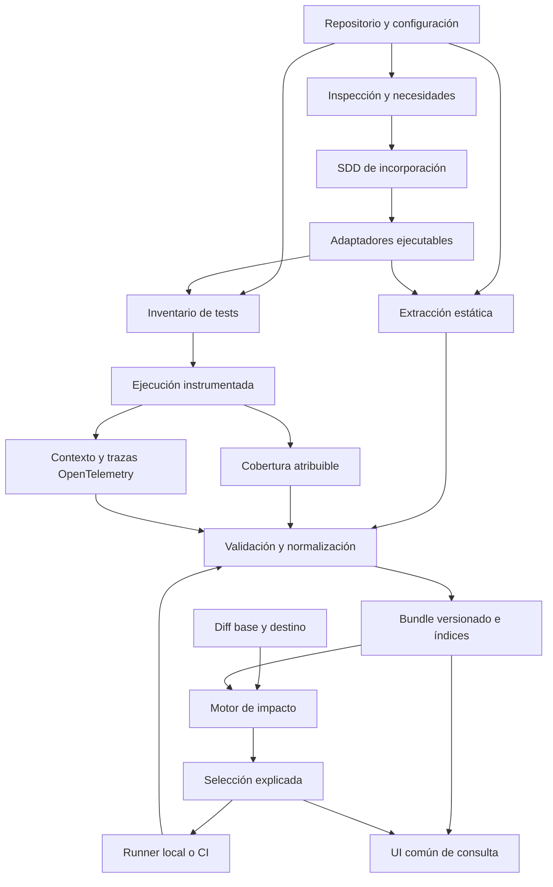

# SDD — Generación portable de grafos y selección de tests

Fecha: **2026-10-19**. Versión del diseño: **0.2**. Estado: **extracción E0 implementada; desarrollo P1–P8 pendiente**.

Este SDD define un sistema que una skill puede adaptar a cada proyecto después de inspeccionarlo. El resultado es código y configuración ejecutables en el repositorio, una CLI determinista y artefactos comunes que también consume una UI de consulta. Abarca los distintos tipos de tests y permite operar tanto localmente como en CI.

El diseño es independiente del lenguaje, framework, topología del repositorio y proveedor de CI. Cada adaptador declara un ámbito concreto; esta independencia del contrato no implica soporte implementado para todas las tecnologías.

Registro de ejecución: [IMPLEMENTATION-STATE.md](IMPLEMENTATION-STATE.md). La procedencia del laboratorio se documenta en [ORIGIN.md](ORIGIN.md). Las fases P0–P8 y la extracción E0 de este documento tienen su propio estado.

La distribución inicial implementa `inspect`, `validate`, `import-v2`, `view` e `info`, además de una skill de incorporación. El formato experimental `test-impact-view/1` sirve para inspección visual y no sustituye al contrato completo de bundles de P2. Baseline, check, ejecución seleccionada e integración CI permanecen planificados. Véase el [README](../README.md) para la experiencia de uso disponible y la prevista.

## Índice

1. [Objetivo y resultados](#1-objetivo-y-resultados)
2. [Decisiones y requisitos](#2-decisiones-y-requisitos)
3. [Alcance y límites](#3-alcance-y-límites)
4. [Determinismo y significado de la evidencia](#4-determinismo-y-significado-de-la-evidencia)
5. [Estándares y reutilización](#5-estándares-y-reutilización)
6. [Arquitectura](#6-arquitectura)
7. [Inspección y necesidades de cada proyecto](#7-inspección-y-necesidades-de-cada-proyecto)
8. [Contrato de adaptadores](#8-contrato-de-adaptadores)
9. [Identidad y modelo de datos](#9-identidad-y-modelo-de-datos)
10. [Artefactos portables](#10-artefactos-portables)
11. [Enlace de los distintos tipos de tests](#11-enlace-de-los-distintos-tipos-de-tests)
12. [Captura de cobertura por unidad de ejecución](#12-captura-de-cobertura-por-unidad-de-ejecución)
13. [OpenTelemetry y correlación distribuida](#13-opentelemetry-y-correlación-distribuida)
14. [Contratos como frontera](#14-contratos-como-frontera)
15. [Baseline inicial y mantenimiento](#15-baseline-inicial-y-mantenimiento)
16. [Vigencia e invalidación](#16-vigencia-e-invalidación)
17. [Algoritmo de impacto](#17-algoritmo-de-impacto)
18. [Actualización incremental y rendimiento](#18-actualización-incremental-y-rendimiento)
19. [Experiencia de CLI](#19-experiencia-de-cli)
20. [CI y procedencia de artefactos](#20-ci-y-procedencia-de-artefactos)
21. [UI común y grafos grandes](#21-ui-común-y-grafos-grandes)
22. [Skill y SDD de incorporación](#22-skill-y-sdd-de-incorporación)
23. [Diagnósticos y comportamiento ante fallos](#23-diagnósticos-y-comportamiento-ante-fallos)
24. [Validación y medición](#24-validación-y-medición)
25. [Relación con la implementación actual](#25-relación-con-la-implementación-actual)
26. [Fases de desarrollo y nivel de razonamiento](#26-fases-de-desarrollo-y-nivel-de-razonamiento)
27. [Aceptación global](#27-aceptación-global)
28. [Decisiones pendientes y riesgos](#28-decisiones-pendientes-y-riesgos)
29. [Operación y recuperación](#29-operación-y-recuperación)
30. [Glosario](#30-glosario)
31. [Referencias oficiales](#31-referencias-oficiales)

## 1. Objetivo y resultados

Un usuario debe poder incorporar un repositorio sin dibujar previamente su grafo ni mantener listas manuales de qué tests corresponden a cada cambio. La incorporación inspecciona el proyecto, identifica necesidades, implementa adaptadores acotados y deja un sistema que funciona sin consultar un LLM en cada ejecución.

El sistema debe responder:

- Qué archivos, símbolos, paquetes, recursos y contratos existen dentro del ámbito analizado.
- Qué dependencias están demostradas y con qué evidencia.
- Qué código ha ejecutado cada test o grupo de tests identificable.
- Qué cambia entre dos estados del código, incluidas sus dependencias anteriores y posteriores.
- Qué tests deben ejecutarse y qué reglas permiten excluir otros.
- Dónde falta evidencia, qué selección adicional provoca esa falta y qué ejecución puede mejorarla.

La primera construcción puede ser costosa: inventario completo, extracción estática y ejecución instrumentada de las suites previstas. Las consultas posteriores de impacto deben reutilizar el baseline y actualizar únicamente lo necesario, sin exigir ejecutar la suite completa para poder calcular una selección.

La UI comparte el formato de entrada entre proyectos. Debe permitir entender las relaciones y las áreas sin evidencia sin renderizar todos los nodos a la vez.

El producto entregable comprende cuatro partes: contrato común, núcleo determinista, adaptadores ejecutables y skill de incorporación. CLI, CI y UI son consumidores del mismo núcleo.

## 2. Decisiones y requisitos

Estas decisiones recogen lo acordado durante la definición. Los identificadores permiten comprobar su implementación.

| ID | Requisito |
| --- | --- |
| R01 | Inspeccionar el proyecto y extraer sus necesidades antes de elegir e implementar adaptadores. |
| R02 | Mantener el SDD general: no presuponer frontend, backend, monorepo, lenguaje, runner ni CI. |
| R03 | Priorizar relaciones deterministas, verificables y regenerables. |
| R04 | Reservar a la IA el análisis y desarrollo; generación autoritativa y selección en ejecución sin LLM. |
| R05 | Incluir unitarios, componentes, contratos, integración, E2E y categorías adicionales detectadas. |
| R06 | Crear relaciones de cobertura de E2E a código exclusivamente con instrumentación atribuible. |
| R07 | Combinar análisis estático y cobertura por unidad identificable para otros tests, distinguiendo su significado. |
| R08 | Usar cobertura por test para ejecución de código y OpenTelemetry para contexto y correlación, cuando corresponda. |
| R09 | Preferir estándares y herramientas del ecosistema a protocolos e instrumentación propios. |
| R10 | Emitir artefactos estables, documentados y validados, consumibles por una UI común. |
| R11 | Separar bootstrap costoso, consulta rápida de impacto y ejecución de la selección. |
| R12 | Integrar el flujo en CI y compartir artefactos entre jobs con identidad y procedencia comprobables. |
| R13 | Modelar contratos como fronteras explícitas, incluso sin acceso al otro repositorio. |
| R14 | Ante incertidumbre, ampliar selección; mostrar tests desconocidos o inaccesibles como tales. |
| R15 | Ofrecer filtros, agregación y navegación que funcionen en proyectos grandes. |
| R16 | Recomendar niveles de razonamiento por fase sin fijar modelos, con atención al coste. |
| R17 | Evitar mantenimiento manual de listas cambio→tests y asociaciones basadas solo en opinión. |
| R18 | Publicar resultados de validación reales y límites de soporte; no afirmar corrección universal. |

El conocimiento de QA o desarrollo puede aportar escenarios, datos, clasificación de suites y casos para el corpus. Esa información no habilita excluir tests ni crea por sí sola cobertura demostrada. Si una política añade tests obligatorios, puede ampliar la selección y debe mostrarse como política.

## 3. Alcance y límites

### 3.1 Ámbitos de proyecto

El contrato admite un repositorio de biblioteca, aplicación cliente, servicio, monolito, monorepo o un conjunto de repositorios explícitamente registrados. Un proyecto puede contener varios lenguajes y runners, siempre con soporte declarado por adaptador.

Un repositorio externo puede ser visible con código fijado, visible solo mediante un contrato o inaccesible. No se necesita disponer conjuntamente de frontend y backend. El resultado debe distinguir exhaustividad dentro del ámbito registrado de visibilidad sobre sistemas externos.

Los archivos no ejecutables también importan: estilos, plantillas, assets, migraciones, esquemas, configuración, lockfiles, generación de código, traducciones y datos de prueba. Se extraen sus dependencias cuando exista un adaptador probado; en otro caso activan reglas conservadoras de ámbito.

### 3.2 Entrega inicial obligatoria

- Contrato portable con validadores y ejemplos independientes del proyecto demo.
- Núcleo de normalización, diagnóstico, impacto y vigencia.
- Primer adaptador elegido tras la inspección, no fijado por este SDD.
- Inventario de tests y captura atribuible para los runners incluidos en ese ámbito.
- Baseline, check de impacto, ejecución, actualización y diagnóstico por CLI.
- Integración con CI mediante comandos y artefactos neutrales.
- UI de consulta común con filtros y agregación.
- Skill que inspecciona, produce un SDD de incorporación e implementa el adaptador dentro del alcance acordado.
- Validación en un proyecto real y una segunda incorporación que contraste la portabilidad.

La segunda incorporación puede usar el mismo lenguaje con una estructura o runner distintos. No permite anunciar soporte multilenguaje si solo se han implementado adaptadores de un lenguaje.

### 3.3 Extensiones posteriores

Se admiten otros lenguajes, protocolos, proveedores de CI, almacenamiento remoto y ejecución multirrepositorio. Cada extensión necesita su matriz de capacidades y pruebas. Un servicio alojado multiusuario, facturación, distribución comercial y administración de organizaciones requieren un alcance posterior.

La primera entrega no necesita base de grafos, Kubernetes, service mesh ni una plataforma de observabilidad alojada. Su incorporación debe responder a una necesidad medida del proyecto.

## 4. Determinismo y significado de la evidencia

### 4.1 Tres propiedades diferentes

**Extracción estática determinista:** mismos bytes, configuración, toolchain y adaptadores generan el mismo grafo normalizado.

**Captura de ejecución atribuible:** el mecanismo registra qué ocurrió bajo una identidad y unas condiciones concretas. Los recorridos pueden variar por datos, concurrencia, entorno, aleatoriedad o servicios externos.

**Selección determinista:** mismos snapshots, diff, conjunto de evidencia y políticas generan la misma selección y las mismas explicaciones.

Por tanto, el requisito no exige que dos ejecuciones físicas tengan iguales tiempos, trace IDs o cobertura. Exige preservar las entradas de cada medición y procesarlas de forma determinista. La ausencia de ejecución observada no demuestra ausencia de dependencia.

### 4.2 Clases de evidencia

| Clase | Afirmación permitida | Límite |
| --- | --- | --- |
| `static` | Una construcción concreta resuelve a una dependencia con el analizador declarado. | Un import no prueba ejecución ni assertions. |
| `configuration` | Una configuración registrada establece un binding o ámbito. | Una URL coincidente no demuestra proveedor ni implementación. |
| `measured-coverage` | Una unidad identificada ejecutó ciertos puntos del código en una captura. | No prueba todas sus posibles ramas ni qué comportamiento comprueba. |
| `observation` | Se observó una interacción, span o recurso correlacionado. | No equivale a cobertura de instrucciones. |
| `declaration` | Existe una declaración humana o de herramienta sobre intención o clasificación. | No habilita exclusiones ni se convierte automáticamente en coverage. |

Cada evidencia incorpora método, versión, entradas, ámbito, localizador, estado y limitaciones. Una relación puede acumular varias evidencias sin cambiar su significado.

No se usarán puntuaciones genéricas como «95 % de confianza» para autorizar exclusiones. Se emplearán condiciones comprobables: resolución única, captura completa para el ámbito declarado, mapeo de fuentes válido y vigencia.

### 4.3 Invariantes

1. Ninguna arista autoritativa carece de evidencia verificable.
2. Las sugerencias del asistente son hipótesis hasta que un adaptador las demuestre o un diagnóstico las conserve como pendientes.
3. Todos los archivos incluidos se registran en el inventario aunque estén desconectados.
4. La resolución respeta el compilador/runtime y las condiciones del build; nombres iguales no bastan.
5. Los cambios se interpretan sobre el estado anterior y el posterior.
6. Un dato desconocido no se convierte en «sin impacto».
7. Una evidencia más pobre no permite una selección más estrecha bajo la misma política.
8. Añadir un filtro de UI no modifica el grafo ni la selección.
9. Un timeout, skip, cancelación o informe ausente nunca cuenta como test pasado.
10. La unión de ejecuciones solo mezcla evidencia con compatibilidad demostrada de entradas y contexto.
11. La evidencia positiva observada puede ampliar selección; excluir exige además justificar el ámbito y la vigencia.
12. Las decisiones dependientes de versión quedan fijadas y se pueden volver a reproducir.

### 4.4 Integridad y variación operativa

El hash del grafo estático no incluye timestamps, rutas absolutas, orden de ejecución ni duración. El hash de un artefacto bruto verifica sus bytes completos, aunque contenga valores variables.

Un bundle distingue el hash semántico del grafo, el de su conjunto de evidencia y el de sus metadatos operativos. No se eliminarán datos variables de un informe original para fingir que dos capturas fueron idénticas.

## 5. Estándares y reutilización

El adaptador debe justificar con un ADR breve cualquier mecanismo propio que duplique una capacidad interoperable disponible. «Disponible» significa compatible con las versiones y condiciones del proyecto, probado en el corpus y operativo con su presupuesto.

| Necesidad | Preferencia de diseño | Aplicación y límite |
| --- | --- | --- |
| Resolución de dependencias | API del compilador o resolver oficial del ecosistema | Respetar alias, exports, condiciones y opciones reales del proyecto. |
| Trazas y propagación | OpenTelemetry y W3C Trace Context | Correlacionar actividad dentro y entre procesos. |
| Transporte de telemetría | OTLP | Mantener compatibilidad con Collector y backends; no exigir uno alojado. |
| Cobertura | Motor y formato de cobertura del ecosistema | Verificar atribución por test; el formato agregado no la garantiza. |
| Fuentes transformadas | Source maps estándar, si el stack los usa | Validar contra los bytes exactos del build y originales. |
| Validación de artefactos | JSON Schema, dialecto fijado | Propuesta inicial: Draft 2020-12. |
| Serialización para hashes | JSON Canonicalization Scheme, RFC 8785 | Ordenar además los arrays semánticos según el contrato. |
| Identidad de código | Git más hashes del contenido capturado | Git SHA por sí solo no identifica cambios locales. |
| Contratos | Formatos existentes del proyecto | Pueden ser OpenAPI, AsyncAPI, GraphQL, protobuf o contratos de consumidor. |
| Resultados de test | Informe nativo del runner y normalización común | Conservar su semántica; no asumir un único dialecto universal de JUnit XML. |

OpenTelemetry documenta la [propagación de contexto](https://opentelemetry.io/docs/concepts/context-propagation/), W3C especifica [Trace Context](https://www.w3.org/TR/trace-context/) y OTLP define el [protocolo de telemetría](https://opentelemetry.io/docs/specs/otlp/). Estas capacidades sustentan la correlación del diseño.

El contrato de artefactos fijará un dialecto de [JSON Schema](https://json-schema.org/draft/2020-12) y reglas de canonicalización basadas en [RFC 8785](https://www.rfc-editor.org/rfc/rfc8785.html). JCS no decide por sí mismo qué arrays representan conjuntos; esa decisión pertenece a este contrato.

Para JavaScript transformado, la referencia de mapeo es la [especificación ECMA-426](https://tc39.es/ecma426/). Su uso no demuestra automáticamente que todos los puntos instrumentados tengan un mapeo único.

Las versiones de estándares, SDK, convenciones y dependencias se fijarán al implementar cada adaptador. No se usará una rama `latest` o `main` como identidad reproducible.

## 6. Arquitectura



### 6.1 Responsabilidades

- **Skill:** inspecciona, redacta el plan, escribe o adapta código y documenta necesidades no resueltas.
- **Adaptador estático:** emite hechos localizados y diagnósticos; no decide qué tests ejecutar.
- **Adaptador de runner:** enumera casos, conserva identidad y traduce una selección a una ejecución soportada.
- **Adaptador de cobertura:** captura y normaliza ejecución con atribución demostrable.
- **Adaptador de correlación:** enlaza contexto, spans y recursos con identidades verificadas.
- **Núcleo:** valida, normaliza, versiona, calcula vigencia y propaga impacto.
- **Almacenamiento:** conserva bundles inmutables e índices derivados reemplazables.
- **CLI/CI/UI:** presentan o ejecutan decisiones del núcleo con las mismas reglas.

### 6.2 Separación de operaciones

La inspección inicial lee archivos y manifiestos. Algunos runners ejecutan código al cargar configuración o enumerar casos; esa operación se identifica como ejecución de código del proyecto y se realiza dentro de su entorno de trabajo previsto.

El check rápido no necesita arrancar la aplicación, ejecutar tests, descargar herramientas ni consultar un LLM. Puede utilizar índices ya preparados; si un inventario dinámico no puede actualizarse sin ejecutar el runner, debe ampliar la selección o pedir una operación explícita de actualización.

Los adaptadores se ejecutan como herramientas del proyecto, con límites de tiempo, memoria y salida documentados. Declarar un adaptador no equivale a disponer de aislamiento del sistema operativo.

## 7. Inspección y necesidades de cada proyecto

### 7.1 Inventario de entrada

La inspección debe recoger como mínimo:

- Raíces, submódulos, workspaces, proyectos anidados y límites de propiedad.
- Lenguajes, versiones, compiladores, resolución de módulos y herramientas de build.
- Entradas de la aplicación, bibliotecas internas, paquetes compartidos y código generado.
- Runners, suites, variantes, parametrizaciones, fixtures, mocks y servicios de test.
- Comandos existentes, lifecycle hooks y preparación/limpieza del entorno.
- Cobertura disponible, granularidad real, aislamiento, paralelismo y mapeo de fuentes.
- Contratos, clientes generados, bindings, servicios accesibles y revisiones externas.
- CI actual: checkout, referencia base, matrices, shards, cachés, artefactos y permisos efectivos.
- Configuración compartida, flags, variables que afectan comportamiento, datasets y versiones de mocks.
- Tamaños del proyecto, duración actual de tests y recursos disponibles.
- Exclusiones explícitas y archivos presentes que no entran en ningún ámbito conocido.

Los secretos se representan por referencias o versiones seguras del entorno; sus valores no se copian a informes ni se publican como hashes fáciles de adivinar.

### 7.2 Informe de capacidades

Cada capacidad se clasifica como `supported`, `partial`, `unsupported` o `unknown`, con evidencia de la inspección y acción conservadora.

| Capacidad | Pregunta que debe responder |
| --- | --- |
| Inventario completo | ¿Se conocen todas las raíces incluidas y lo excluido? |
| Resolución | ¿Se reproduce la resolución efectiva del build? |
| Dependencias dinámicas | ¿Qué patrones son resolubles y cuáles quedan abiertos? |
| Identidad de tests | ¿Se distinguen casos, parámetros, variantes y grupos? |
| Selección de ejecución | ¿El runner ejecuta casos exactos o solo archivo/suite? |
| Cobertura | ¿Se obtiene por caso, grupo, proceso o únicamente agregada? |
| Atribución | ¿Hay mezcla entre tests concurrentes o trabajo tardío? |
| Fuentes | ¿Se puede enlazar cada rango con bytes originales verificados? |
| Contratos | ¿Qué frontera se conoce y qué lado se puede verificar? |
| Contexto distribuido | ¿Qué procesos preservan la identidad y cuáles la pierden? |
| Incrementalidad | ¿Qué se puede invalidar localmente y qué exige reconstrucción? |

La falta de una capacidad se convierte en necesidad de implementación o límite declarado. No se rellenará la matriz con capacidades inferidas del nombre de una dependencia.

### 7.3 SDD de incorporación

Antes de implementar, producir un SDD específico con:

1. Estado observado, revisión y comandos conocidos.
2. Ámbito de código y catálogo de runners.
3. Necesidades y diferencias respecto a adaptadores existentes.
4. Matriz de resolución estática e instrumentación.
5. Entorno reproducible, variantes y unidades mínimas de ejecución.
6. Política de contratos y de incertidumbre.
7. Diseño del baseline, caché e integración CI.
8. Presupuesto de rendimiento y almacenamiento.
9. Corpus, criterios de aceptación y validación comparada.
10. Archivos a crear/modificar, fases y nivel de razonamiento recomendado.

Si falta una decisión material, se documenta y pregunta al usuario. Se continúa con las partes independientes. No se exige que el usuario diseñe el grafo ni proporcione asociaciones manuales test→código.

## 8. Contrato de adaptadores

### 8.1 Manifiesto

Cada adaptador debe declarar:

- Identificador, versión y hash del ejecutable/configuración.
- Lenguajes, framework, compiladores y runners soportados, con intervalos de versiones probados.
- Relaciones que puede emitir y patrones exactos que resuelve.
- Granularidades de cobertura y selección de tests.
- Tratamiento de mocks, hooks, procesos, navegación y concurrencia.
- Dependencias de herramientas y formatos nativos.
- Patrones sin soporte, límites de recursos e invalidación requerida.
- Versión de contrato portable producida y pruebas del corpus superadas.

Un adaptador local generado para un proyecto también cumple este contrato. No se aceptan excepciones invisibles en el núcleo para reconocer nombres de archivos o escenarios concretos.

### 8.2 Operaciones conceptuales

```text
inspect(inputs)                       -> capabilities, needs, diagnostics
inventory(sourceSet, configuration)    -> files, packages, resources
discover(inventory, toolchain)         -> facts, locators, diagnostics
listTests(runnerConfiguration)         -> catalogue, executionUnits
planCapture(executionUnits, variants)  -> instrumentationPlan
collect(instrumentationPlan)           -> rawCoverage, results, traceReferences
normalize(rawArtifacts, sourceSet)     -> evidence, completeness, diagnostics
resolveExecution(selection, catalogue) -> argvPlans, expectedResults
invalidation(changeSet, fingerprints)  -> affectedScopes, rebuildRequirements
```

Son interfaces de diseño, no una obligación de implementar todos los adaptadores en un lenguaje común. El transporte entre núcleo y adaptador debe ser validable y no depender de memoria compartida de la UI.

### 8.3 Resolución estática

Priorizar APIs de compilador y resolvers reales para imports, exports, herencia, llamadas directas y construcciones soportadas. Frameworks con plantillas, inyección, rutas o plugins requieren reglas explícitas y pruebas.

Un import dinámico literal puede ser resoluble. Una cadena calculada o un registro abierto solo permite una relación acotada si se demuestra el conjunto completo de destinos. Si existen varios candidatos, conservarlos como diagnóstico o conjunto conservador, sin escoger uno por similitud.

### 8.4 Conformidad

Para incorporarse, cada adaptador supera positivos y negativos de su corpus: alias, reexports, nombres homónimos, ciclos, módulos desconectados, configuración, altas/bajas, mocks, casos dinámicos y condiciones no soportadas. La salida debe ser idéntica con caché fría y caliente.

Si la extracción incremental no está implementada, el adaptador declara reconstrucción completa y publica mediciones reales. No se denomina incremental a un watcher que reconstruye todo.

## 9. Identidad y modelo de datos

### 9.1 Identidad del proyecto y del código

`projectId` y `repositoryId` son namespaces estables configurados. No se derivan del basename del checkout ni de rutas absolutas.

Un estado de fuentes incluye revisión Git cuando exista, hash del árbol capturado y hashes de todos los archivos/configuraciones relevantes. El contenido local sin commit se representa mediante ese hash y una marca explícita de working tree.

Los archivos usan rutas relativas POSIX. Deben rechazarse colisiones, rutas que escapen de raíces y diferencias de mayúsculas ambiguas en el entorno. La política de enlaces simbólicos debe resolverlos dentro de raíces permitidas o rechazarlos con diagnóstico.

Los símbolos usan una clave cualificada derivada de su declaración y ámbito. Las posiciones son localizadores, no la única identidad. Si no puede demostrarse continuidad tras un renombrado, se representa baja y alta.

### 9.2 Identidad de tests

La identidad se obtiene del runner cuando sea estable o de una clave normalizada:

```text
repository + runnerProject + testFile + suitePath + caseKey + parameterKey + variant
```

El ordinal de aparición y el número de línea no bastan como identidad estable. La parametrización debe ofrecer una clave reproducible; si no existe, usar una unidad de grupo. Los títulos duplicados requieren desambiguación validada o diagnóstico.

Un ID anotado explícitamente es opcional y sirve para identidad, nunca para declarar cobertura. No se obliga a reescribir todos los títulos con el patrón de IDs del catálogo legacy.

Las **unidades de selección** pueden ser caso, archivo o suite. Las **unidades de medición** pueden ser distintas. Si el runner ejecuta un archivo completo para seleccionar un caso, el plan debe mostrar la ampliación y exigir resultados de todos los casos ejecutados.

### 9.3 Nodos y relaciones

Nodos comunes: repositorio, paquete, archivo, símbolo, asset, test, grupo de tests, contrato y recurso. Endpoints, servicios, eventos o consumidores son extensiones tipadas con identidad explícita.

| Relación | Dirección semántica | Uso en impacto |
| --- | --- | --- |
| `imports`, `calls`, `renders`, `reads-resource` | Consumidor → dependencia | Propagación inversa según condiciones del adaptador. |
| `resolves-to`, `injects` | Uso/binding → destino | Aplicar conjunto completo de candidatos o ampliar ámbito. |
| `contains` | Contenedor → contenido | Agrupación; no propaga automáticamente a todo el contenedor. |
| `test-depends-on` | Test/grupo → dependencia estática | Candidatos conservadores; no afirma ejecución medida. |
| `executes` | Test/grupo → punto de código | Evidencia positiva de cobertura atribuible. |
| `uses-contract` | Consumidor → contrato | Propagación y evaluación de frontera explícitas. |
| `implements-contract` | Implementación → contrato | Requiere evidencia del lado accesible. |
| `observed-interaction` | Actor → recurso/actor | Evidencia contextual; no elimina dependencias no observadas. |

Las políticas de propagación se versionan por relación. Compartir archivo, paquete, broker o nombre no crea por sí solo una llamada o cobertura.

### 9.4 Entidades mínimas

| Entidad | Campos obligatorios conceptuales |
| --- | --- |
| `Node` | ID, tipo, namespace, clave lógica, atributos, localizadores. |
| `Edge` | ID, tipo, origen, destino, calificadores, referencias a evidencia y política. |
| `Evidence` | ID, clase, productor/versión, inputs, ámbito, localizador, estado, limitaciones. |
| `TestCase` | ID, runner, localizador, variante, unidad seleccionable, disponibilidad y fingerprint. |
| `CoverageRecord` | Unidad, intento, contexto, código/build, puntos ejecutados, integridad de captura y procedencia. |
| `Diagnostic` | Código, causa, ámbito afectado, acción conservadora, evidencia y posible recuperación. |
| `Analysis` | Base/destino, baseline usado, entradas/políticas, seleccionados, excluidos, no disponibles y causas. |
| `RunResult` | Plan, unidad, intento, estado, resultados nativos, cobertura, tiempo y errores de infraestructura. |

El esquema común debe separar tipo lógico de test —unitario, contrato, etc.— del runner que lo ejecuta. Un runner puede ejecutar varias categorías.

### 9.5 Localizadores

La fuente se identifica con ruta, hash y revisión/árbol. Un rango especifica base, unidad de columnas y si el extremo final es exclusivo. Se preserva la unidad nativa cuando haga falta y se normaliza mediante un adaptador probado.

Los JSON Pointers localizan configuración; los mapas de cobertura identifican puntos de ejecución originales; los spans se referencian por dataset y trace/span ID. No se genera un enlace a una línea actual para explicar una evidencia histórica de bytes distintos.

### 9.6 Estado de evidencia

La resolución puede ser `resolved`, `ambiguous` o `unresolved`; la vigencia, `current`, `inherited-valid`, `stale` o `incompatible`; la captura, `complete`, `partial` o `unknown`.

Son dimensiones diferentes. Una captura completa significa que se recogió el ámbito que el plan prometía; no que se hayan ejecutado todas las ramas posibles de la aplicación.

## 10. Artefactos portables

### 10.1 Estructura propuesta

La configuración de incorporación se versiona en Git. Los datos pesados y las capturas se guardan como artefactos inmutables fuera del historial ordinario de código.

```text
test-impact.config.json
test-impact/
  project-profile.json
  adapters.lock.json
  policies.json
  adapters/                         # adaptadores locales, cuando existan
  docs/
    ONBOARDING-SDD.md
    IMPLEMENTATION-STATE.md

.test-impact/                       # datos generados; normalmente ignorados por Git
  bundles/<bundle-id>/
    manifest.json
    graph.json
    catalogue.json
    evidence.json
    diagnostics.json
    coverage/
      index.json
      records/<partition-id>.json
    observations/
      index.json
    sources/
      index.json
    raw/
      index.json
    indexes/
      index.json
  analyses/<analysis-id>/
    impact.json
    execution-plan.json
    summary.md
  runs/<run-id>/
    results.json
    capture-manifest.json
  refs/
    baseline.json
```

Los nombres son la propuesta de interfaz para P2; no son archivos o comandos implementados al crear este SDD. Una revisión de contrato puede ajustarlos antes de publicar la versión 1.

Los archivos de índice obligatorios existen aunque su lista esté vacía. Los payloads referenciados se materializan según el manifiesto. «No capturado» se distingue de una captura válida con cero puntos ejecutados.

### 10.2 Manifiesto

Debe contener:

- Versión de esquema y del productor.
- Identidad del proyecto, repositorios y árbol de fuentes.
- Versiones/hashes de adaptadores, políticas, configuración y toolchain.
- Matriz de variantes y entorno que afectan al resultado.
- Hash, tamaño, tipo y ruta de cada artefacto.
- Hash semántico del grafo y referencia exacta al conjunto de evidencia.
- Estado del catálogo y de la captura por ámbito.
- Padres y certificados de reutilización, cuando se hereda evidencia.
- Procedencia de CI o ejecución local, distinta de la integridad de bytes.
- Capacidades mínimas requeridas al lector.

El ID del bundle se calcula sobre un manifiesto canónico sin su propio campo de ID. Los artefactos se hashean antes. Los ciclos de autorreferencia en hashes quedan prohibidos.

Los metadatos de código conservan bytes y finales de línea originales. La canonicalización se aplica al JSON del contrato; no modifica fuentes para hacer coincidir sus hashes.

### 10.3 Compatibilidad de lectura

Cada archivo incluye su versión de esquema o está bajo una versión de bundle que la fija inequívocamente. Los lectores rechazan versiones mayores incompatibles y relaciones o políticas desconocidas que afecten a una exclusión.

Los campos adicionales se introducen mediante extensiones con namespace. Una UI puede indicar que no sabe representar una extensión; el motor no puede ignorarla silenciosamente si altera propagación o vigencia.

Se publicarán esquemas, fixtures mínimos y ejemplos con varias tecnologías. La UI no debe importar metadatos particulares del proyecto para entender el significado de un archivo.

### 10.4 Datos brutos e índices

Conservar cobertura y resultados nativos cuando sea viable, junto a su normalización. Los índices invertidos —punto→tests, dependencia→consumidores y test→closure— son reconstruibles y no sustituyen la evidencia original.

Los sources pueden archivarse completos, parcialmente o quedar disponibles desde un checkout por hash. El manifiesto declara cuál de estos modos usa. Si falta la fuente histórica, el inspector muestra el localizador y la limitación.

Una exportación de telemetría de un exporter en JSONL conserva su formato declarado; no se anunciará como un formato JSONL universal de OTLP.

### 10.5 Publicación

Construir en una ubicación temporal, validar hashes, esquema y referencias, y publicar de forma atómica. Actualizar el puntero al baseline únicamente cuando el bundle esté completo y cumpla su política de promoción.

Un fallo conserva el baseline anterior y deja visible que no representa las entradas actuales. El último artefacto existente no equivale automáticamente al baseline adecuado.

## 11. Enlace de los distintos tipos de tests

| Tipo lógico | Evidencia anterior a ejecutar | Evidencia de ejecución | Regla inicial |
| --- | --- | --- | --- |
| Unitario | Imports, llamadas, fixtures, mocks y configuración resolubles. | Cobertura del cuerpo y hooks atribuibles. | La dependencia estática puede seleccionar; medir permite explicar ejecución y afinar dentro de límites probados. |
| Componente | Componente montado, módulos, plantillas, assets y configuración. | Renders, eventos, hooks y ramas ejecutados. | Considerar recursos y dependencias de framework; un import no demuestra un render. |
| Contrato | Asociación a un contrato mediante el test real, cliente, esquema y binding verificados. | Operaciones/casos ejecutados y resultado del verificador. | Separar contrato consumido, proveedor real y proveedor simulado. |
| Integración | Composición y dependencias explícitas del fixture, módulos y recursos. | Cobertura de procesos instrumentados más interacciones correlacionadas. | Si solo hay identidad por suite, seleccionar la suite. |
| E2E | Dependencias de infraestructura del test; no asociación inferida al código de producto. | Cobertura atribuida de navegador y procesos accesibles. | Crear enlaces E2E→código de producto solo con instrumentación. |
| Arquitectura, snapshots, visuales u otros | Entradas declaradas y accesos demostrables del runner. | Lecturas/ejecución observadas cuando exista soporte. | Seleccionar de forma amplia o permanente cuando no pueda demostrarse un ámbito estrecho. |

### 11.1 Dependencias estáticas de tests

El grafo puede mostrar que un unitario importa un módulo o que un test utiliza un fixture. Esto no permite asumir que cada símbolo importado se ejercita ni que un mock ejecuta la implementación real.

El selector inicial usa las dependencias de archivo/paquete como sobreaproximación cuando no existe un análisis más preciso demostrado. La instrumentación aporta la evidencia de los puntos efectivamente alcanzados.

Para E2E se permiten enlaces a su propia infraestructura, por ejemplo un helper o configuración de runner. Esos enlaces no se convierten en cobertura del producto ni en asociaciones deducidas de selectores DOM, títulos, URLs o nombres parecidos.

### 11.2 Atribución limitada

Si solo se puede demostrar «esta suite ejecutó este código», el nodo de evidencia es la suite. Todos sus casos pueden incluirse mediante la unidad de ejecución, sin repartir artificialmente esa cobertura entre ellos.

Un reporte agregado de toda la suite sirve para cobertura global y diagnósticos. No se divide por heurísticas en supuestos reportes por test.

### 11.3 Categorías y variantes

Clasificar por configuración de runner, ubicación verificada o metadatos, con origen explícito. El sistema debe admitir una clasificación desconocida. La categoría no decide por sí sola el nivel de precisión.

Browsers, runtimes, plataformas, flags y datasets son variantes cuando alteran los recorridos o la compatibilidad. No se aplica sin más la cobertura de una variante a otra.

## 12. Captura de cobertura por unidad de ejecución

### 12.1 Estrategia de elección

Elegir, en orden práctico:

1. Soporte nativo del ecosistema para contextos o cobertura por caso, si satisface aislamiento y granularidad.
2. Ejecución aislada por caso, archivo o suite, recogiendo cobertura del proceso y sus hijos.
3. Instrumentación adicional con contexto de ejecución, solo si el adaptador demuestra su atribución.
4. Cobertura por grupo y selección de ese grupo completo si la precisión individual no resulta viable.

La selección no obliga a usar un único proveedor de cobertura. Como ejemplos de capacidades del ecosistema, [Vitest documenta proveedores V8 e Istanbul](https://vitest.dev/guide/coverage.html) y [Coverage.py documenta contextos de medición](https://coverage.readthedocs.io/en/latest/contexts.html). Es necesario probar las versiones y los hooks elegidos; disponer de coverage no garantiza automáticamente captura por caso.

### 12.2 Protocolo de captura

Cada ejecución debe:

1. Fijar catálogo, código, build, variantes, fixtures y plan de instrumentación.
2. Declarar qué procesos, páginas, workers y recursos entran en el ámbito.
3. Crear identidad de unidad, ejecución, shard e intento.
4. Preparar contexto y cobertura antes de las partes relevantes del setup.
5. Registrar cuerpo, hooks y trabajo derivado dentro del ámbito definido.
6. Esperar una condición de finalización observable o marcar trabajo pendiente.
7. Volcar cobertura y cerrar procesos/targets con confirmación o fallo explícito.
8. Validar los informes esperados, integridad y atribución.
9. Mapear a fuentes originales y emitir estado de captura.

Si un proceso termina antes del volcado o un target desaparece, el resultado es parcial o desconocido aunque el runner muestre un test pasado.

### 12.3 Concurrencia

Propagar un test ID en el contexto no vuelve por sí solo contextuales unos contadores globales de cobertura. Dos tests concurrentes pueden incrementar el mismo contador y mezclar evidencias.

El adaptador debe elegir aislamiento por proceso/instancia o un mecanismo de contadores asociado al contexto con pruebas de intercalado. Si no lo demuestra, agrupa la unidad de medición o desactiva concurrencia solo para la captura afectada.

No atribuir cobertura restando snapshots globales entre `beforeEach` y `afterEach` cuando hay concurrencia, resets no fiables, acumulación o trabajo asíncrono tardío. Tampoco inferirla por coincidencia de ventanas temporales.

### 12.4 Hooks y recursos compartidos

El código de importación y bootstrap ejecutado antes de un caso se registra como cobertura de inicialización o de su grupo. La selección conserva las dependencias de ese grupo.

Los hooks compartidos no se asignan arbitrariamente al primer test. Un caso que no se ejecute no hereda cobertura de otro. Si el entorno reutiliza estado que depende del orden, la captura debe reproducir ese grupo o declarar esa limitación.

### 12.5 Reintentos y fallos

Separar intentos, resultados y datasets. La unión de puntos observados entre intentos compatibles puede usarse como evidencia positiva, sin ocultar que el test es inestable.

Una captura de un intento fallido puede conservar ejecución observada, pero no certificar por ausencia qué no ejecutaría un intento completo. Los fallos no eliminan enlaces históricos válidos. Un intento exitoso tampoco borra un fallo previo del informe.

### 12.6 Navegador

El adaptador debe resolver navegación completa, SPA, iframes, popups, workers y cierre de página según su soporte real. No asumirá que un contexto nuevo garantiza que el backend o los workers estén aislados.

La [API de cobertura de Playwright](https://playwright.dev/docs/api/class-coverage) está limitada a navegadores basados en Chromium y documenta limitaciones de navegación y scripts/estilos. El SDD del proyecto debe escoger esa vía u otra instrumentación compatible y validar cada target incluido. No se extrapola su resultado a Firefox o WebKit sin evidencia.

### 12.7 Fuentes, estilos y otros recursos

La cobertura se asocia al build instrumentado y al original exacto. Si un sourcemap mezcla fuentes, omite contenido o produce rangos ambiguos, degradar a archivo/paquete o ampliar ámbito.

Las líneas, instrucciones, funciones y ramas son métricas distintas. Si solo se observan funciones, no se presenta cobertura de ramas.

CSS, plantillas y assets pueden depender del producto sin ofrecer coverage equivalente. Las dependencias estáticas, los recursos cargados y la ejecución medida se conservan como evidencias distintas. Un estilo no observado en un recorrido sigue siendo una posible dependencia.

### 12.8 Mocks y datos

Registrar bindings de mocks, fixtures y datos relevantes. Ejecutar una función mock no enlaza coverage a la implementación sustituida.

Un cambio en fixture, configuración de mock, generador de datos o semilla selecciona sus consumidores; si su alcance no es resoluble, amplía al grupo/runner correspondiente.

## 13. OpenTelemetry y correlación distribuida

### 13.1 Función dentro del sistema

OpenTelemetry correlaciona el test, sus peticiones, procesos y servicios. La cobertura procede del mecanismo del runtime o de instrumentación específica, identificado por separado.

Un span de un endpoint puede asociarse al recurso endpoint. Solo se asocia ejecución de una función o rango si existe instrumentación/localización que lo demuestre. No se inventa cobertura de todo un servicio a partir de un span HTTP.

### 13.2 Identidades

Cada intento crea una referencia a la unidad del catálogo. El contexto incluye o referencia proyecto, árbol de fuentes, ejecución, intento y variante. Se favorece un span raíz por intento y la correlación mediante trace/span IDs.

Usar convenciones semánticas existentes donde correspondan. El [registro de atributos de test de OpenTelemetry](https://opentelemetry.io/docs/specs/semconv/registry/attributes/test/) incluye atributos en estado Development; las versiones y su estabilidad deben fijarse. Los identificadores propios que falten tendrán un namespace documentado, por ejemplo `testimpact.*`, sin presentarlos como estándar.

La identidad de código por proceso no se infiere del nombre del servicio. Debe enlazarse al build o imagen y al árbol de fuentes instrumentado.

### 13.3 Propagación

Usar propagadores OTel compatibles con W3C en HTTP y los carriers disponibles en mensajería. Propagar contexto por metadata de transporte cuando sea posible, conservando el contrato funcional del mensaje.

Para trabajo asíncrono y fan-out se mantienen parents o links según el patrón y sus convenciones. Compartir broker o ventana temporal no identifica qué test provocó un handler. Las correlaciones con varios posibles causantes se conservan como múltiples si están demostradas o como ambiguas.

Baggage es opcional. No se presume que se copie automáticamente a atributos de spans; ese comportamiento debe implementarse y validarse cuando haga falta. Su alcance y exposición se documentan, conforme a las características descritas por [OpenTelemetry Baggage](https://opentelemetry.io/docs/concepts/signals/baggage/).

### 13.4 Cobertura de backend compartido

Si varios E2E usan el mismo proceso de backend, OTel puede separar trazas y aun así dejar mezclada la cobertura global del proceso.

La captura debe aislar instancias, usar instrumentación de cobertura contextual validada o medir el grupo completo. No se anunciará cobertura por E2E del backend solo porque sus trazas llevan identidades diferentes.

### 13.5 Muestreo y pérdida

Si se pretende usar el conjunto de trazas para razonar sobre integridad de una captura, el entorno de captura debe evitar muestreo y comprobar recepción/cierre de las señales previstas. Incluso sin muestreo pueden perderse datos.

Las trazas muestreadas o incompletas sirven como evidencia positiva. Su ausencia no autoriza una exclusión. Un fallo de Collector no rompe el flujo funcional del producto, pero puede invalidar el certificado de captura y ampliar tests.

Las decisiones de sampler y exportación se basarán en la [especificación del SDK de trazas](https://opentelemetry.io/docs/specs/otel/trace/sdk/) y se registrarán en el plan. El sistema no necesita trazar cada función cuando el proveedor de cobertura ya obtiene esa información.

## 14. Contratos como frontera

### 14.1 Identidad y visibilidad

Una frontera identifica consumidor, contrato, versión, operaciones y binding. Puede existir sin código del proveedor. El informe mostrará que la visibilidad termina en esa frontera.

Un mock de proveedor verifica lo modelado por ese mock; no certifica al proveedor desplegado. La verificación de consumidor y proveedor se registra por separado, con sus versiones y disponibilidad.

### 14.2 Condiciones para acotar propagación

La política debe declarar:

- Qué operación o superficie contractual está cubierta.
- Qué versiones y variantes se comparan.
- Qué comprobaciones de compatibilidad existen: estructura, tipos, generación, ejemplos, semántica verificable o contratos de consumidor.
- Qué evidencia permite acotar a un lado y qué comprobaciones siguen siendo obligatorias.
- Qué incertidumbre invalida el acotamiento.

Un schema sin cambios no demuestra compatibilidad de comportamiento. El sistema puede detener propagación hacia código externo inaccesible como límite de análisis, pero debe expresarlo como falta de visibilidad, no como ausencia demostrada de impacto externo.

### 14.3 Reglas iniciales

1. Cambio local interno: seleccionar por grafo y coverage locales; ejecutar los contratos locales alcanzados o exigidos por política.
2. Cambio en contrato o cliente generado: seleccionar sus tests y consumidores; ampliar a variantes pertinentes y producir un aviso de compatibilidad externa cuando no haya proveedor verificable.
3. Cambio de binding, ruta, autenticación, timeout o serialización: evaluar la frontera aunque el schema permanezca igual.
4. Evidencia contractual ausente o caducada: no usar la frontera para excluir tests locales potencialmente afectados.
5. Proveedor inaccesible: registrar verificación no disponible; no contar sus tests como ejecutados.

Un proyecto exclusivamente de frontend puede así analizarse hasta sus contratos. Sus E2E locales conservan la cobertura observada del cliente; no heredan coverage interna de backend.

## 15. Baseline inicial y mantenimiento

### 15.1 Bootstrap

```text
Inspección → SDD de incorporación → adaptadores/configuración
    → inventario + grafo estático → catálogo/variantes
    → suite instrumentada → validación de captura
    → bundle inmutable → referencia de baseline
```

La ejecución masiva recorre todas las unidades previstas de las suites y variantes registradas. «Toda la suite» significa todo ese catálogo, no todos los tests posibles del producto ni todos sus recorridos.

La captura puede distribuirse por shards, con identificadores únicos y un manifiesto de unidades esperadas. El agregador comprueba faltantes, duplicados y compatibilidad de entradas.

### 15.2 Estados de baseline

- `building`: construcción sin publicación.
- `partial`: hay ámbitos sin capturar, tests no disponibles o capturas inválidas.
- `reference`: catálogo y capturas exigidos completos y comprobaciones requeridas superadas para el ámbito declarado.
- `superseded`: sustituido como referencia activa; conservado para análisis históricos.

Un baseline parcial puede utilizarse para mostrar evidencia y ampliar selección. No habilita exclusiones sustentadas en los ámbitos faltantes.

La promoción a referencia registra qué tests quedaron fuera por disponibilidad y qué ámbitos quedan abiertos. Si una suite necesaria para certificar el ámbito no se ejecuta o falla, dicho ámbito no queda certificado. El estado global no oculta estados por suite.

### 15.3 Actualización posterior

Un cambio ordinario no obliga a repetir la captura completa antes del check. Se extrae su nuevo grafo y se usa la evidencia anterior para seleccionar de forma conservadora.

Después de ejecutar, se incorporan nuevas evidencias con identidad de destino. Las de unidades no ejecutadas solo se heredan si se demuestra compatibilidad de sus inputs y closure. El certificado de herencia explica esa comprobación.

Una colección de ejecuciones seleccionadas no se convierte automáticamente en un baseline completo. Debe cubrirse el catálogo requerido o justificarse la herencia de cada unidad pendiente.

### 15.4 Frecuencia

Durante la adopción se recomienda suite completa en la rama principal y checks de PR en modo sombra. Después pueden configurarse actualización por cambios relevantes, barridos completos periódicos y ejecución completa en cambios de alto alcance.

La frecuencia se fija con mediciones del proyecto y riesgo aceptado. No se impone reconstrucción masiva por cada commit ni se presupone que una captura antigua siga válida solo por su fecha reciente.

## 16. Vigencia e invalidación

### 16.1 Fingerprints

El fingerprint por unidad incluye, según corresponda: fuente del test, hooks/fixtures compartidos, resolución de mocks, variantes, datos relevantes, configuración de runner, instrumentación, build, runtime y closure de dependencias demostrada.

Los hashes del código cubierto se guardan junto a sus rangos. Si cambian esos bytes, la cobertura histórica puede servir para seleccionar consumidores, pero sus posiciones no se presentan como coverage actual.

La vigencia es estructural además de temporal. La edad puede activar un barrido por política; no demuestra por sí sola compatibilidad ni incompatibilidad.

### 16.2 Matriz mínima

| Cambio | Acción inicial |
| --- | --- |
| Implementación local con ámbito resoluble | Seleccionar consumidores antes/después y tests observados; recapturar lo ejecutado. |
| Dependencia, export, inyección o ruta | Actualizar consumidores/resolución; considerar nuevos recorridos y ampliar más allá de los hits antiguos. |
| Nuevo archivo conectado | Analizar su conexión y consumidores; no exigir que tuviera coverage anterior. |
| Nuevo archivo desconectado | Inventariar y marcar alcance desconocido; ampliar al ámbito demostrado o catálogo disponible. |
| Eliminación | Usar grafo/cobertura de base; no perder los tests por ausencia del nodo de destino. |
| Renombrado ambiguo | Baja+alta con las ampliaciones correspondientes. |
| Test nuevo o modificado | Ejecutarlo y revisar su grupo/fixtures; obtener nueva evidencia. |
| Test eliminado | Actualizar catálogo y señalar pérdida de evidencia; no ejecutar una identidad inexistente. |
| Configuración de runner/setup o instrumentación | Invalidar y ampliar a las suites que la usan. |
| Lockfile, resolver, compilador o build | Aplicar diff de dependencia demostrado; si no existe ese análisis, invalidar el ámbito completo afectado. |
| Contrato o generación de cliente | Seleccionar contratos y consumidores; reconstruir artefactos generados de forma reproducible. |
| Flags, dataset o servicios de prueba | Invalidar las variantes dependientes; si no se conocen, ampliar. |
| Sourcemaps, targets o cobertura sin atribución | Conservar evidencia positiva bruta; no usarla para exclusión precisa. |
| Cambio de política/núcleo | Recalcular y, si cambia la interpretación de evidencia, exigir validación o nueva captura. |
| Identidad de base o ancestro desconocida | No asumir equivalencia; recuperar base adecuada o ejecutar suite completa disponible. |

### 16.3 Reutilización de evidencia no ejecutada

Un certificado de herencia incluye bundle padre, unidad, fingerprints comparados, closure usada, hashes iguales y diagnósticos evaluados.

Si el adaptador no puede demostrar una closure suficientemente completa, no hereda evidencia como vigente para excluir. Puede heredar la medición como histórica y mantener selección más amplia.

El fingerprint de herencia no depende solo de los archivos que aparecieron en coverage. Una dependencia no ejecutada anteriormente puede alterar un recorrido futuro.

### 16.4 Contratos y evidencia externa

Fijar separadamente la revisión del proveedor y del consumidor, así como el contrato. No combinar resultados de un proveedor distinto solo porque comparta nombre o URL.

Un baseline de una rama diferente no se considera válido por ser el más reciente. La relación entre base, destino y artefacto debe verificarse mediante Git/contenido y las reglas de compatibilidad.

## 17. Algoritmo de impacto

### 17.1 Entradas y salida

Entradas: snapshot base y destino, diff capturado, catálogo antes/después, baseline de referencia, evidencia heredable, políticas y capacidades de adaptadores.

Salida: selección por unidades reales de ejecución, razones causales, exclusiones justificadas dentro del ámbito, ampliaciones conservadoras, tests no disponibles, estado de confianza operativa y plan fijado.

No se etiqueta un subset como «seguro universalmente». El informe explica el ámbito soportado y las condiciones bajo las que se ha calculado.

### 17.2 Pasos

1. Validar integridad, procedencia requerida, compatibilidad y relación del baseline con la base.
2. Capturar diff completo: altas, modificaciones, bajas, permisos relevantes y configuración; incluir cambios locales si se pidió working tree.
3. Actualizar inventario y resolver dependencias afectadas en el destino.
4. Mapear cambios a rangos/símbolos en ambos estados; ampliar a archivo o paquete cuando la precisión no sea demostrable.
5. Formar una vista de impacto que preserve relaciones de base y destino, sin convertir la unión en un grafo que se afirme existente en una sola revisión.
6. Propagar por cada tipo de relación y política, manteniendo camino y origen temporal.
7. Seleccionar tests con evidencia estática o cobertura positiva alcanzada; incluir siempre tests nuevos/modificados y consumidores de infraestructura cambiada.
8. Evaluar nuevos destinos, comportamiento dinámico, recursos y variantes que la cobertura histórica podría no haber observado.
9. Aplicar diagnósticos: ampliar al ámbito comprobable o a todo el catálogo disponible.
10. Aplicar fronteras contractuales válidas y políticas que añaden comprobaciones obligatorias.
11. Convertir casos a unidades que el runner ejecuta realmente, ampliando archivos/suites si hace falta.
12. Emitir exclusiones solo cuando todas sus condiciones de ámbito, resolución y vigencia se cumplen.
13. Ordenar y hashear el resultado, junto con el plan de ejecución y las entradas.

### 17.3 Precisión inicial y refinamientos

La política por defecto combina evidencia estática y observada conservadoramente. El análisis de símbolos no elimina automáticamente todos los demás tests de un archivo si hay efectos de módulo, closures compartidas o condiciones no modeladas.

Para E2E, la cobertura histórica ofrece enlaces positivos; no ofrece un inventario completo de todos los futuros recorridos. Si el cambio introduce rutas, bindings o despacho no acotables con el modelo, seleccionar los E2E del ámbito comprobado o todos los disponibles.

Una optimización basada solo en «tests que cubrieron líneas modificadas» puede existir como modo experimental de medición, separado del modo conservador y sin sustituir su gate de CI.

### 17.4 Regla de exclusión

Excluir un test requiere identificar su unidad, sus variantes y el ámbito de cambios, demostrar la validez de las dependencias usadas para acotar, resolver los diagnósticos pertinentes y comprobar vigencia suficiente.

Cuando una de esas condiciones falta, el test se incluye por ampliación o queda como no disponible requerido. «No tiene camino en el grafo» solo justifica exclusión si el grafo demuestra que su ámbito está suficientemente representado.

### 17.5 Casos de referencia

| Caso | Comportamiento esperado |
| --- | --- |
| Cambio local en función usada por un unitario | Selección por dependencia/coverage y explicación al símbolo o archivo. |
| Cambio en función llamada indirectamente | Seguir dependencia demostrada; ampliar si el despacho queda abierto. |
| Nueva rama que redirige a otro módulo | Usar topología posterior y consumidores; no limitarse a coverage anterior. |
| E2E sin captura atribuible | Ampliar E2E pertinentes o todos; no enlazarlo por su título. |
| Cambio de CSS de componente | Seguir dependencia del recurso o ampliar paquete/suite. |
| Contrato externo incompatible | Contratos locales y consumidores seleccionados; proveedor inaccesible visible. |
| Cambio solo en test | Ejecutar test/grupo y revisar infraestructura compartida. |
| Cambio aparentemente documental | Excluir solo si las reglas verifican que no es entrada de build, docs ejecutables o tests. |
| Ningún cambio efectivo | Resultado vacío válido si entradas, catálogo y baseline están verificados. |
| Archivo cambiado sin ámbito probado | Selección completa disponible, con motivo. |

### 17.6 Propiedades del motor

Orden de entrada, duplicados de evidencia equivalentes y orden de shards no alteran la selección. Los ciclos terminan. La explicación conserva al menos un camino causal completo y permite consultar los demás.

Con catálogo y política fijos, eliminar evidencia necesaria para excluir no puede reducir la selección. La versión incremental y la reconstrucción completa deben ser equivalentes en su salida normalizada.

### 17.7 Condiciones para aprovechar ausencia de hits

El proyecto debe declarar las hipótesis bajo las que una medición anterior sirve para acotar una futura ejecución: entradas identificables, aislamiento suficiente, cobertura de las unidades de código pertinentes y tratamiento de cambios estructurales.

Si el test depende de estado externo no fijado, hora, aleatoriedad sin control o efectos concurrentes no modelados, no se puede convertir «no lo ejecutó antes» en una exclusión precisa. Se acumula evidencia positiva y se amplía la unidad o ámbito.

Los cambios insertados en posiciones sin cobertura anterior se mapean al contenedor ejecutable o dependencia pertinente, no a un supuesto conjunto vacío de hits. La carga de módulos, inicialización, lectura de recursos y preparación del build deben estar modeladas o provocar ampliación.

Los cambios pueden romper compilación, resolución o carga sin alcanzar una instrucción medida. El check no sustituye los gates de build, tipos o arquitectura que el proyecto ya requiera.

## 18. Actualización incremental y rendimiento

### 18.1 Tres niveles de reutilización

- **Artefactos inmutables:** reutilizar bundles y resultados por hash.
- **Extracción estática:** recalcular archivos modificados y consumidores cuya resolución/semántica pueda variar.
- **Evidencia de tests:** recapturar unidades ejecutadas y heredar las demás solo cuando sea demostrable.

La invalidación de un archivo puede alcanzar otros archivos no editados: reexports, resolución por configuración, APIs públicas, tipos y generación de código. El adaptador debe modelar ese alcance.

### 18.2 Índices

Mantener índices de hashes de archivo, grafo inverso, pertenencia a paquete, localizadores, coverage invertida y dependencias de configuración.

Los índices incluyen versiones de esquema, extractor y políticas que afectan a su interpretación. Una caché incompatible se descarta; nunca se convierte en un grafo vacío válido.

### 18.3 Camino rápido

El objetivo es que un check con baseline local, caché caliente y un cambio acotado use lectura/hash, resolución afectada y recorrido de índices. No requiere instrumentación física ni servicios externos.

La sincronización remota de artefactos y la preparación de caché se miden por separado del tiempo del núcleo. Una CLI debe indicar si reconstruyó todo y por qué.

### 18.4 Presupuesto y medidas

P1 fija un presupuesto medible para el piloto: tamaño, variantes, hardware, latencia de check, memoria, overhead de captura y almacenamiento. Como objetivo inicial de producto, evaluar checks calientes de cambios pequeños en unos segundos; no es una cifra de rendimiento ya demostrada.

Los ensayos publican mediana, p95, tamaño de entradas, caché fría/caliente y tiempo de I/O. Incluyen un proyecto grande o un corpus sintético claramente identificado como tal.

Si se agota el presupuesto de análisis, se amplía selección o se informa error recuperable según se pueda conservar corrección. No se devuelve un subset truncado.

## 19. Experiencia de CLI

### 19.1 Contrato de comandos propuesto

`impact` es un nombre conceptual de CLI. Su distribución y nombre definitivo se deciden en P6. Estos comandos describen comportamiento futuro y no deben confundirse con los comandos de la demo actual.

| Comando | Función |
| --- | --- |
| `impact inspect` | Leer proyecto y emitir perfil, capacidades, necesidades y decisiones pendientes. |
| `impact init` | Materializar configuración a partir del perfil y adaptadores ya implementados; no ejecutar IA. |
| `impact doctor` | Comprobar herramientas, versiones, catálogo, evidencia, permisos operativos y baseline. |
| `impact graph build` | Construir grafo estático completo. |
| `impact baseline create` | Enumerar y ejecutar la matriz instrumentada prevista, validar y construir baseline. |
| `impact check` | Calcular impacto y plan; no ejecutar tests. |
| `impact explain` | Mostrar la causa de selección/exclusión de una unidad o diagnóstico. |
| `impact run` | Validar y ejecutar un análisis fijado con los runners declarados. |
| `impact baseline update` | Incorporar resultados de una ejecución y verificar herencia de otras unidades. |
| `impact baseline publish` | Promover un bundle que cumpla la política; sin transporte remoto implícito. |
| `impact artifacts export/import` | Transportar bundles verificando esquema, hashes y procedencia exigida. |
| `impact view` | Abrir UI de consulta sobre bundle/análisis. |
| `impact gc` | Aplicar retención sin borrar artefactos referenciados por políticas de conservación. |

### 19.2 Primera incorporación

La skill comienza con inspección y un SDD de incorporación. Una vez implementado el adaptador:

```sh
impact doctor
impact graph build
impact baseline create
impact view
```

El baseline prepara explícitamente su entorno; no reutiliza de forma invisible un servidor de desarrollo cuyo código o datos no puede verificar.

### 19.3 Uso diario local

```sh
impact check --base origin/main --working-tree
impact explain --analysis <analysis-id> --test <test-id>
impact run --analysis <analysis-id> --collect-coverage
impact baseline update --run <run-id>
```

El modo working tree incluye cambios staged, unstaged y archivos nuevos dentro de raíces registradas, sin contar dos veces el mismo cambio. Las exclusiones y archivos ignorados relevantes se muestran según la política de inventario.

Un análisis fija los bytes usados. Si el usuario modifica el árbol entre check y run, se recalcula o se ejecutan bytes capturados en un entorno aislado; nunca se aplica silenciosamente el plan anterior al código nuevo.

### 19.4 Uso para commits

```sh
impact check --base <base-sha> --head <target-sha> --baseline auto
impact run --analysis <analysis-id> --collect-coverage
```

Las referencias simbólicas se resuelven a SHAs antes de analizar. `auto` solo elige artefactos cuya compatibilidad esté demostrada; no elige el fichero más reciente de una carpeta.

### 19.5 Resultado

La salida humana debe resumir: base/destino, tests conocidos y disponibles, seleccionados, unidades adicionales por granularidad, exclusiones justificadas, fallback y tests requeridos no disponibles. Los conteos proceden del catálogo real.

La salida JSON conserva IDs, caminos, fingerprints, diagnósticos y plan. Un ejemplo conceptual de resumen es:

```text
Base/destino: estados fijados
Baseline: referencia compatible o motivo de fallback
Selección: casos y unidades reales de ejecución
Ampliaciones: ámbito y diagnóstico causante
No disponibles: unidades requeridas y consecuencia para el gate
Siguiente operación: ejecutar el análisis identificado
```

### 19.6 Estados y códigos de salida

El resultado de check distingue `selective`, `expanded`, `full`, `no-change` y `blocked`. El origen de una ampliación se expone en diagnósticos.

Contrato mínimo que P6 debe fijar en números:

- Análisis válido, incluso con fallback completo: éxito técnico y modo explícito.
- Configuración inválida, entrada ilegible o artefacto incompatible sin recuperación: error de análisis.
- Selección vacía solo válida cuando se demuestra por qué no hay tests afectados dentro del ámbito.
- Test requerido no disponible: estado que bloquea la aceptación, salvo una excepción explícita registrada por el proyecto.
- Ejecución: separar fallo de test, infraestructura, resultado incompleto y plan desactualizado.

Un código de salida cero del proceso runner no basta si faltan casos o reportes esperados. El adaptador compara plan y resultados.

## 20. CI y procedencia de artefactos

### 20.1 Núcleo neutral

La integración usa CLI, archivos y códigos de salida. El primer wrapper se elige después de inspeccionar la CI real. Los wrappers no incorporan una segunda implementación del selector.

El pipeline debe poder operar en GitHub Actions, GitLab, Jenkins u otros sistemas que proporcionen checkout, ejecución y artefactos. Esa portabilidad contractual no equivale a que todos los wrappers estén entregados en P6.

### 20.2 Bootstrap de la rama de referencia

1. Checkout de revisión fijada y preparación reproducible del entorno.
2. Instalación según lockfile y versiones registradas.
3. Restauración de caché de herramientas compatible, separada de la autoridad del baseline.
4. Inventario, grafo y catálogo.
5. Captura instrumentada de suites/variantes requeridas, con shards cuando proceda.
6. Agregación y validación de resultados y evidencia.
7. Publicación de bundle inmutable como artefacto.
8. Promoción de referencia únicamente si cumple los criterios.

### 20.3 Pull request

1. Resolver commits base/destino y la estrategia de comparación.
2. Recuperar un baseline autorizado y compatible con la base.
3. Comprobar hashes, procedencia, versiones y catálogo.
4. Ejecutar check con el código de destino.
5. Ejecutar selección ampliada si es necesario; capturar resultados y coverage de las unidades ejecutadas.
6. Verificar que se ejecutó todo lo requerido.
7. Publicar informe, análisis y evidencia como artefactos del job.

La publicación de comentarios o estados mediante API requiere la integración y permisos del proyecto; no es necesaria para que el informe sea útil. El JSON y un resumen de job bastan para el primer wrapper.

### 20.4 Base, merge y carreras

P1 debe fijar si se analiza contra merge-base, punta actual de la rama destino o commit de merge simulado. El informe conserva la elección y los SHAs.

Si la rama destino avanza después del análisis, el gate necesita recalcular en el nuevo merge o dejar explícito que validó otra combinación. En repositorios con cola de merges, integrar el check sobre el estado que la cola va a incorporar.

Si el historial es superficial y no permite hallar la base, ampliar fetch de manera explícita en CI o ejecutar la suite completa sobre el destino. No declarar diff vacío.

### 20.5 Fallback

Si no hay baseline utilizable pero sí catálogo/configuración de ejecución fiables, el sistema ejecuta toda la suite disponible requerida y recoge evidencia. La ausencia de baseline no pasa el gate por omisión.

Si ni siquiera se puede conocer o ejecutar el catálogo requerido, el job falla con diagnóstico. No se intenta «salvar» el pipeline ejecutando una lista parcial antigua como si fuera completa.

### 20.6 Refresco tras integración

El job de rama principal puede hacer captura completa o actualización con herencia demostrada, según la política de adopción. Publica una referencia para el commit realmente integrado.

Un resultado de PR no se promueve por cambiarle la etiqueta a `main`. El merge puede cambiar código, resolución o contexto; se verifica la equivalencia del árbol y entradas o se vuelve a ejecutar.

Las ramas de larga duración y releases pueden mantener referencias propias. Retención y elección de baseline respetan ese namespace.

### 20.7 Integridad y confianza

Un hash acredita que los bytes no cambiaron respecto al manifiesto; no acredita quién los produjo ni que la evidencia sea honesta.

Los artefactos autorizados para excluir tests deben proceder del canal de referencia configurado: por ejemplo jobs de la rama protegida, identidad de workflow y revisión comprobadas. La política debe impedir que una PR reemplace el baseline compartido con un dataset arbitrario.

Los cambios de adaptador o política que afectan exclusiones requieren sus comprobaciones de conformidad y el mecanismo de revisión que el proyecto ya utilice. Los checks de PR pueden generar bundles de candidato, separados de las referencias promovidas.

### 20.8 Concurrencia y shards

Cada job tiene directorio, namespace, puertos y datasets propios cuando arranca servicios. No limpia recursos de otro job.

El agregador comprueba que todos los shards corresponden a las mismas fuentes/configuración y cubren las unidades esperadas. Un shard perdido, repetido o de otra revisión impide certificar el ámbito.

Las actualizaciones de punteros usan compare-and-swap o mecanismo equivalente para impedir que un job antiguo sobrescriba una referencia más reciente de la rama.

### 20.9 Adopción progresiva

- **Observación:** construir evidencia y medir sin cambiar el conjunto de tests que exige la CI.
- **Sombra:** calcular selección, ejecutar la suite completa y contrastar resultados/casos afectados.
- **Aplicación:** ejecutar selección conservadora, fallback y barridos completos según política.

El paso a aplicación requiere criterios de P8. Un resultado satisfactorio de una única PR no es suficiente. La vuelta a suite completa debe poder activarse mediante configuración sin borrar el historial.

### 20.10 Secuencia neutral ilustrativa

```text
prepare:
  checkout(base y target fijados)
  prepare(toolchain y dependencias fijadas)
  restore(reference bundle autorizado)

analyze:
  impact check --base BASE_SHA --head TARGET_SHA --baseline auto
  export(analysis-id y execution-plan)

execute:
  impact run --analysis ANALYSIS_ID --collect-coverage
  assert(expected results completos)

report:
  upload(impact, results, coverage, diagnostics)

refresh-on-reference-branch:
  verify(promoción y compatibilidad del estado integrado)
  update-or-rebuild(baseline)
  publish(artefacto y referencia)
```

Es pseudocódigo de responsabilidades. La implementación fijará sintaxis, versiones y mecanismo de descarga del proveedor escogido.

### 20.11 Comprobaciones independientes de la selección

La inspección identifica gates existentes de compilación, tipos, lint, seguridad, arquitectura u otras comprobaciones globales. La primera integración conserva su ejecución según la política del proyecto.

Reducir esos gates necesita un adaptador o análisis de alcance propio y una aceptación específica. El hecho de que no aparezcan en coverage de tests no permite omitirlos.

Las reglas que exigen ejecutar siempre una suite o gate son políticas visibles de ampliación. No se presentan como cobertura ni como asociaciones inferidas.

## 21. UI común y grafos grandes

### 21.1 Función y fuente

La UI consulta los bundles y análisis. Reutiliza el contrato; no recalcula impacto con reglas distintas ni necesita conocer el stack del proyecto.

Puede servirse localmente o empaquetarse como reporte de CI. Un reporte que incluya fuentes o datos de ejecución debe respetar la visibilidad configurada del artefacto. El modo inicial es de lectura.

### 21.2 Vistas mínimas

1. **Resumen:** ámbito, revisión, capacidades, estado del baseline, evidencia faltante y tests disponibles.
2. **Dependencias:** grafo por paquete/archivo y navegación hacia símbolos, recursos y contratos.
3. **Tests y cobertura:** unidades conocidas, código observado y áreas sin evidencia.
4. **Impacto:** diff, seleccionados/excluidos, causas y ampliaciones.
5. **Evidencia:** fragmento/localizador, revisión, productor, captura, vigencia y diagnósticos.

Se puede reutilizar la presentación del explorador actual si supera la compatibilidad y las necesidades de escala. No se importa su catálogo fijo ni su flujo de escenarios de demo.

### 21.3 Filtros y agregación

Filtros por repositorio, workspace/paquete, ruta, lenguaje, tipo de nodo, tipo de relación, categoría de test, runner, variante, clase de evidencia, vigencia, cambios e incertidumbre.

El grafo abre en una agregación legible de paquetes/ámbitos. Permite expandir vecinos a profundidad limitada, buscar cualquier nodo, aislar un camino causal y volver a la vista anterior.

La agregación muestra cuántos nodos/aristas representa y permite consultar sus miembros. Un filtro indica cuántos hechos oculta. Limitar el canvas nunca borra hechos del modelo.

### 21.4 Datos y rendimiento

El navegador no debe descargar todas las capturas brutas ni hacer layout de todo un grafo grande para mostrar un resumen. Usar índices, búsqueda, paginación y consultas por vecindario con límites explícitos.

Un servidor local puede leer el bundle completo o mantener índices; la UI solo recibe lo solicitado. Un reporte estático puede incorporar particiones precomputadas y un índice de búsqueda.

Las tablas de muchos tests se virtualizan. Los layouts son derivados y no afectan IDs ni hashes semánticos. Se preservan zoom, selección y filtros durante la navegación.

### 21.5 Presentación de cobertura

Separar:

- Cobertura de líneas/instrucciones, funciones y ramas cuando se mida.
- Cobertura atribuible a un caso frente a una suite.
- Archivos/puntos sin ejecución observada.
- Archivos fuera del ámbito o sin instrumentación.
- Evidencia histórica, heredada, actual, parcial o incompatible.
- Dependencias estáticas que no constituyen ejecución medida.

Un porcentaje de coverage usa un denominador conocido de puntos instrumentables; no solo los archivos que aparecieron en el reporte. Si el denominador es desconocido, se indica y no se muestra un «100 %» de todo el proyecto.

### 21.6 Accesibilidad y aceptación

Cada relación y motivo debe ser consultable mediante una tabla o lista, además del canvas. Navegación por teclado, etiquetas comprensibles y ausencia de dependencia exclusiva del color.

La aceptación incluye un bundle ajeno a la demo, filtros combinados, búsqueda de nodos no renderizados, locators históricos, una captura parcial y un grafo de tamaño acordado en P1.

## 22. Skill y SDD de incorporación

### 22.1 Responsabilidad de la skill

La skill es el mecanismo para aplicar este método a un proyecto y producir herramientas repetibles. La IA puede escribir un nuevo extractor o fixture, pero la corrección de sus hechos se demuestra con el corpus y los checks.

El resultado instalado funciona desde CLI y CI sin sesión de chat, acceso al modelo ni intervención de la skill para cada commit.

### 22.2 Flujo de incorporación

1. Leer reglas del repositorio y ubicar su estado de trabajo.
2. Inspeccionar sin asumir tecnología ni modificar el producto.
3. Reutilizar adaptadores compatibles y documentar diferencias.
4. Crear perfil de necesidades y SDD de incorporación.
5. Preguntar solo decisiones materiales que el repositorio no resuelva.
6. Implementar adaptadores/configuración por fases, con evidencias de conformidad.
7. Ejecutar baseline en el entorno previsto y revisar integridad/atribución.
8. Incorporar CLI, wrapper de CI y UI común.
9. Validar selección frente a ejecución completa y cambios controlados.
10. Entregar operación, límites, actualización y estado reanudable.

Si el usuario autoriza toda la incorporación, esa autorización puede abarcar sus fases. Si limita la instrucción a una fase, se respeta ese alcance. El SDD de incorporación debe expresar el modo elegido.

### 22.3 Contenido del paquete

`SKILL.md` con flujo e invariantes; referencias por ecosistema cargadas a demanda; esquemas y ejemplos del bundle; plantillas de SDD/perfil/estado; corpus común; herramientas para generar o validar adaptadores; guía de CI y recuperación.

Las referencias no se cargan todas en cada turno. La skill debe localizar primero el stack y leer únicamente los recursos pertinentes. La distribución de núcleo/UI se fija en P8 y debe poder actualizarse sin copiar implementaciones divergentes por proyecto.

### 22.4 Límites de generación asistida

- No reemplazar una construcción desconocida por un enlace plausible.
- No crear una lista fija de tests esperados para que una demo parezca correcta.
- No modificar lógica del producto para obtener una selección más pequeña.
- No introducir instrumentación funcionalmente intrusiva sin justificarla y comprobar equivalencia.
- No declarar soporte de versión por haber instalado el paquete.
- No reducir el fallback para cumplir un objetivo de ahorro.

La misma inspección capturada debe alimentar de forma determinista el núcleo. La redacción libre del informe o el código propuesto por la skill pueden variar; esa variación no forma parte del algoritmo autoritativo de producción.

### 22.5 Mantenimiento

Una nueva versión de adaptador, esquema o policy publica migración, corpus superado y regla de invalidación. Los proyectos fijan su versión; no cambian de comportamiento por una actualización silenciosa de la skill.

La instalación repetida debe reconocer los archivos administrados y cambios locales. Si hay divergencias, produce un diff y una migración concreta; no sobrescribe trabajo ajeno de forma ciega.

## 23. Diagnósticos y comportamiento ante fallos

Todo diagnóstico debe incluir: código estable, mensaje, localizador cuando exista, capacidad afectada, ámbito, acción de selección y recuperación sugerida.

| Código conceptual | Ejemplo | Consecuencia |
| --- | --- | --- |
| `unsupported-pattern` | Registro dinámico no soportado. | Ampliar ámbito demostrable o catálogo. |
| `ambiguous-resolution` | Varios destinos sin conjunto cerrado. | No elegir uno; ampliar. |
| `parse-failed` | Archivo que el adaptador no puede analizar. | No conservar silenciosamente extracción antigua como actual. |
| `source-unavailable` | Proveedor o fuente histórica ausente. | Declarar límite y tests no disponibles. |
| `catalogue-incomplete` | Enumeración parcial o parametrización no identificable. | Grupo más amplio o ejecución completa del runner. |
| `capture-incomplete` | Falta un worker, shard o volcado. | No certificar exclusiones de ese ámbito. |
| `attribution-ambiguous` | Contadores compartidos entre casos. | Medir/seleccionar grupo o aislar captura. |
| `source-map-invalid` | Build y source map no coinciden. | Cobertura sin precisión de origen; ampliar. |
| `stale-evidence` | Cambió test/setup/dependencia relevante. | Selección por histórico más ampliación; recaptura. |
| `baseline-incompatible` | Otra base, versión o entorno. | Recuperar compatible o suite completa. |
| `artifact-untrusted` | Procedencia no autorizada para exclusión. | No usarlo como referencia; fallback o error. |
| `required-test-unavailable` | Suite seleccionada sin servicio necesario. | Gate incompleto, nunca pasado. |
| `execution-mismatch` | Resultados no corresponden al plan. | Ejecución inválida. |
| `resource-limit` | Presupuesto de análisis agotado. | Ampliar si puede hacerse correctamente o fallar. |

Un diagnóstico puede tener ámbito de nodo, paquete, suite, runner, repositorio o catálogo. Acotarlo requiere evidencia; el tamaño conveniente de un subset no es una justificación.

Los fallos operativos también se conservan en los reportes. Reintentar con éxito no elimina la explicación del intento fallido.

## 24. Validación y medición

### 24.1 Tres capas

**Conformidad del adaptador:** comprobar que los hechos y diagnósticos emitidos corresponden al corpus y las versiones declaradas.

**Corrección del núcleo:** invariantes, normalización, vigencia, unión temporal, propagación y equivalencia incremental/completa.

**Validación empírica del proyecto:** comparar selección y suite completa sobre las mismas entradas y condiciones, con cambios reales o controlados.

Ninguna capa por sí sola demuestra que todos los comportamientos del producto estén cubiertos por tests.

### 24.2 Corpus obligatorio

Como mínimo: imports y reexports; alias/exports condicionales; símbolos homónimos; ciclos; archivos desconectados; altas/bajas/renombres; errores de parseo; llamadas dinámicas; efectos de módulo; recursos; fixtures; mocks; tests parametrizados; duplicados de identidad; variantes; generación de código; límites de contrato.

La instrumentación añade: hooks comunes, concurrencia intercalada, procesos hijos, worker tardío, retry, fallo antes del flush, pérdida de telemetría, navegación, sourcemap inválido y agrupación por suite.

Cada caso define el hecho esperado o el diagnóstico conservador esperado. Un negativo no puede aprobar porque el extractor inventó un enlace que casualmente selecciona más tests.

### 24.3 Comparación selected/full

Para cada cambio de ensayo:

1. Fijar base, destino, baseline, catálogo, variantes y entorno.
2. Calcular selección antes de ver el resultado de la suite completa.
3. Ejecutar selected y full sobre el mismo código, con entornos de datos independientes y equivalentes.
4. Comparar resultados por unidad y conservar los reportes.
5. Investigar diferencias, flakiness y fallos previos.

Un fallo relevante detectado por full cuyo test quedó fuera de selected es una omisión que impide cerrar aceptación hasta corregir el sistema o ampliar el ámbito. Un fallo de infraestructura se clasifica y no se convierte en evidencia de corrección.

### 24.4 Cambios controlados

Usar mutaciones o defectos representativos de comportamiento, resolución y configuración. Deben incluir cambios que alteren rutas antes no observadas, borrados, contratos, estilos/recursos y condiciones dinámicas.

Registrar mutantes que full no detecta: revelan límites de los tests, no aciertos del selector. Los resultados del selector se evalúan sobre defectos detectables por la suite completa.

No diseñar solo mutantes triviales dentro de líneas que ya aparecen en coverage ni introducir reglas de producción para sus nombres.

### 24.5 Métricas

- Tests/casos/unidades conocidos, disponibles y medidos.
- Evidencia por clase, vigencia y completitud.
- Referencias no resueltas y porcentaje de cambios que causan fallback.
- Omisiones observadas y fallos detectados por full que selected habría perdido.
- Tests y tiempo seleccionados frente a full.
- Coste total: análisis, descarga, preparación, ejecución, captura y refresco.
- Overhead de instrumentación y variación de comportamiento.
- Latencia de check, memoria, tamaño de artefactos y caché.
- Áreas instrumentables sin ejecución observada y áreas no instrumentadas.

Los porcentajes deben mostrar denominadores y ámbito. «Cero omisiones» se informa sobre un corpus y periodo concretos, con su tamaño; no es una garantía universal.

### 24.6 Equivalencia y reproducibilidad

Dos reconstrucciones de las mismas entradas producen el mismo grafo normalizado. Replay de los mismos artefactos produce el mismo análisis. Caché caliente/fría y orden de shards no alteran resultado.

La actualización incremental se compara con reconstrucción completa en secuencias de ediciones. Si difieren, se bloquea esa optimización y se usa reconstrucción completa hasta resolverlo.

### 24.7 Validación de UI y CI

UI: búsqueda global, filtros, conteos ocultos, locators históricos, teclado y rendimiento del tamaño acordado.

CI: baseline ausente, artefacto incompatible, procedencia inválida, merge base ausente, destino avanzado, shard perdido, resultado parcial y test requerido no disponible.

Cada fase ejecuta las comprobaciones pertinentes a su cambio; no repite todas las suites por una edición documental.

## 25. Relación con la implementación actual

El laboratorio de origen aporta patrones que deben evaluarse antes de reutilizar. Estas rutas describen el antecedente y no son dependencias de la distribución:

- `packages/impact-engine/src/schema-v2.ts`: clases de evidencia, localizadores, snapshots y diagnósticos.
- `scripts/graph`: inventario/extracción, normalización, archivos y persistencia.
- `scripts/graph/analyze.ts`: análisis anterior/posterior y fallback conservador.
- `packages/impact-engine/src/index.ts`: propagación y explicaciones.
- `packages/telemetry/src`: contexto y spans.
- `apps/demo/src/components/DiscoveryExplorer.tsx`: navegación de evidencia.
- `docs/G9-FINAL-AUDIT.md`: límites y evidencias de la demo.

La arquitectura actual usa una proyección de compatibilidad y sujetos revisados de tests. El schema admite coverage, pero esa representación no prueba que haya captura por test implementada. G7 describe trazas y deja explícito que no equivalen a coverage.

El diseño portable elimina la dependencia obligatoria del catálogo de login, sus títulos con IDs y las relaciones manuales de sujetos como base de exclusión. La identidad de los nuevos catálogos se deriva del runner o de claves reproducibles.

P1 comprobará qué componentes se reutilizan sin arrastrar supuestos de la demo; P2 fijará si el contrato portable es una evolución o un formato nuevo con importador. No se modifica `impact/graph.json` ni se reetiquetan sus declaraciones como cobertura medida por haber escrito esta especificación.

La UI puede reutilizar diseño y componentes, conservando solo lo que funcione con los artefactos comunes y sus filtros. Las restricciones del SDD de demo sobre presentación o tamaños no se transfieren automáticamente al producto portable.

E0 extrae canonicalización/hash y añade una interfaz de consulta independiente. El importador v2 conserva evidencia y localizadores, pero no importa políticas legacy como garantía de selección. No se ha extraído todavía el motor de selección ni el descubridor completo porque dependen de sujetos revisados y configuración específica del laboratorio.

## 26. Fases de desarrollo y nivel de razonamiento

### 26.1 Protocolo de trabajo

La petición inicial autorizó redactar el SDD y su estado inicial. La instrucción posterior de empaquetarlo en la rama disponible autoriza E0: preparar una raíz independiente exportable, una interfaz común y su forma de uso. P1–P8 se ejecutan cuando el usuario indique una fase o un alcance mayor.

Una instrucción «sigue» sin otro alcance inicia la siguiente fase pendiente, con sus correcciones, validación y documentación. Una autorización más amplia del usuario prevalece y permite continuar dentro de ese alcance. No se repiten solicitudes de permiso para trabajo ya autorizado.

Cada fase debe:

1. Leer este SDD y el estado vigente, identificar entradas y dependencias.
2. Registrar decisiones, archivos, límites y criterios concretos del ámbito.
3. Implementar y comprobar lo autorizado.
4. Registrar comandos y resultados reales, incluidos fallos e incidencias.
5. Declarar completa solo si cumple aceptación; documentar pendientes sin convertirlos en éxitos.
6. Entregar cambios, evidencia, limitaciones y siguiente acción.

El registro debe permitir continuar en otro hilo sin depender del historial de chat. Las correcciones a una fase pertenecen a esa fase.

El agente no cambia automáticamente de modelo ni crea subagentes. El usuario elige la herramienta y su capacidad. Los niveles siguientes son recomendaciones de razonamiento, no requisitos de un proveedor.

### 26.2 Coste y niveles

- **Bajo:** cambios mecánicos con contrato y ejemplos ya definidos: documentación, plantillas, filtros simples y wiring.
- **Medio:** implementación acotada, uso de APIs documentadas, adaptación de un runner conocido y corrección con corpus disponible.
- **Alto:** decisiones sobre identidad/vigencia, atribución concurrente, reglas que excluyen tests y diagnóstico de omisiones.

Usar nivel medio como punto de partida de implementación. Reservar nivel alto para la decisión o revisión concreta que lo requiera; no implica mantenerlo durante toda la fase. Reducir contexto a interfaces, evidencia y archivos pertinentes.

| Fase | Entrega | Nivel recomendado |
| --- | --- | --- |
| P0 | Este SDD y estado inicial | Medio; revisión alta puntual de invariantes. |
| E0 | Raíz exportable, CLI de inspección, visor y skill inicial | Medio; bajo para empaquetado mecánico. |
| P1 | Inspección, necesidades y selección del primer ámbito | Medio. |
| P2 | Contrato portable, corpus y núcleo de validación | Medio; alto en identidad, vigencia y compatibilidad. |
| P3 | Grafo estático y catálogo del primer adaptador | Medio. |
| P4 | Cobertura atribuible y correlación OTel necesaria | Medio; alto si hay atribución concurrente/distribuida. |
| P5 | Motor de impacto, exclusión e incrementalidad | Medio; revisión alta puntual de las condiciones de exclusión. |
| P6 | CLI operativa, mantenimiento y primer wrapper CI | Medio; bajo para plantillas ya definidas. |
| P7 | UI común, filtros y escala | Medio; bajo para presentación mecánica. |
| P8 | Skill, segunda incorporación y auditoría de salida | Medio; revisión alta de omisiones y límites antes de aplicación. |

No es necesario aumentar capacidad para errores de sintaxis, ajustes de formato o tareas con solución conocida. Escalar cuando haya ambigüedad semántica no resuelta, resultados contradictorios, nueva política de exclusión o una omisión que el corpus no explique.

### P0 — Especificación general

**Entrada:** conversación de definición y autorización de generar el SDD.

**Trabajo:** recoger decisiones, estándares, invariantes, interfaces, operación local/CI, fases y aceptación. Revisar antecedentes y documentación oficial pertinente.

**Entregables:** este documento, registro inicial y enlace desde README.

**Aceptación:** requisitos R01–R18 trazables; determinismo y límites diferenciados; flujo de baseline/check/CI definido; fases con nivel de razonamiento sin modelos concretos. No se exige implementación para cerrar P0.

**Siguiente:** P1 necesita uno o varios repositorios de referencia accesibles. La propuesta no los presupone.

### E0 — Extracción y empaquetado independiente

**Entrada:** autorización posterior a P0 para preparar una base exportable desde la rama de trabajo.

**Trabajo:** crear una raíz autocontenida, mover SDD/estado, documentar uso final, separar UI genérica de escenarios/servicios, incorporar puente de datos v2 y empaquetar una skill inicial. Añadir un exportador a directorio vacío y comprobar que la copia funciona sin el laboratorio.

**Entregables:** paquete Node sin dependencias de la demo, CLI de inspección/consulta, visor con filtros y paginación, skill y exportador. Los comandos no implementados deben fallar explícitamente.

**Aceptación:** exportación completa a directorio vacío; ninguna importación de runtime fuera de la raíz; ejemplo señalado como ilustrativo; declaraciones v2 preservadas como declaraciones; UI sin servicios del laboratorio; documentación y skill autocontenidas. Validación de exportación, API/CLI, filtros y contratos de integridad.

**Nivel:** medio para separar interfaces; bajo para estructura y documentación. No habilita declarar P1–P8 completas.

### P1 — Inspección y necesidades

**Entrada:** P0 y un repositorio/checkout que el usuario designe. Si aún no está disponible, se puede auditar la reutilización interna, pero no completar la inspección de un piloto inexistente.

**Trabajo:**

- Auditar capacidades reales del código actual que se pretenda reutilizar.
- Inspeccionar el repositorio piloto conforme a la sección 7.
- Identificar rutas estáticas, zonas dinámicas, categorías de tests y variantes.
- Verificar cómo enumera, selecciona y reporta cada runner.
- Evaluar mecanismos nativos de cobertura y posibilidades de atribución.
- Identificar contratos y disponibilidad de proveedores.
- Medir baseline operativo de duración/tamaño con las comprobaciones autorizadas.
- Elegir el primer adaptador y definir ámbito soportado.
- Acordar presupuesto de rendimiento y almacenamiento.
- Redactar SDD de incorporación, matriz de capacidades y ADR de herramientas.

**Entregables:** perfil de proyecto, necesidades, alcance, plan de adaptador, diseño de entorno y criterios cuantificables.

**Aceptación:**

- Las capacidades se sustentan en archivos/documentación o ensayos identificados.
- Se conoce qué se puede medir por caso y qué queda a nivel de grupo.
- No hay dependencias obligatorias del ejemplo frontend de esta conversación.
- La elección de herramientas se justifica por compatibilidad, precisión y coste.
- Las preguntas materiales pendientes tienen efecto y siguiente acción explícitos.

**Nivel:** medio; alto puntual si varias alternativas requieren cambiar las garantías de exclusión.

### P2 — Contrato, corpus y validación

**Entrada:** P1, salvo partes del contrato común que puedan desarrollarse sin detalles del piloto.

**Trabajo:**

- Publicar esquemas de bundle, grafo, catálogo, evidencia, diagnósticos, análisis y resultados.
- Fijar identidad, rangos, canonicalización y cálculo de hashes.
- Definir versionado, extensiones, compatibilidad y rechazo de capacidades desconocidas.
- Implementar validador de hashes, referencias, duplicados y estados.
- Crear corpus común y corpus inicial del adaptador, con negativos.
- Establecer certificados de captura e herencia.
- Definir propagación por tipo de relación y precondiciones de exclusión.
- Resolver mediante ADR si se evoluciona el contrato v2 o se introduce formato portable con importación explícita.
- Crear bundles de ejemplo independientes del login, al menos uno con coverage parcial y otro con frontera externa.

**Entregables:** esquemas, normalizador/validador, fixtures, contrato de adaptadores y ADR.

**Aceptación:**

- Un bundle válido se lee sin conocimiento de su proyecto.
- Se rechazan colisiones, hashes incorrectos, referencias colgantes y versiones incompatibles.
- Artefactos equivalentes producen identidad semántica igual.
- Una declaración humana no puede presentarse como measured coverage.
- Un conjunto de observaciones no puede hacerse pasar por captura completa sin sus comprobaciones.
- Existe representación explícita de unidad de ejecución más gruesa que caso.

**Nivel:** medio para esquemas y código mecánico; alto para cerrar identidad, herencia y condiciones de compatibilidad.

### P3 — Grafo estático y catálogo

**Entrada:** contrato validable y adaptador elegido.

**Trabajo:**

- Inventariar todas las raíces, incluidos archivos desconectados.
- Implementar resolución con herramientas del stack, conservando localizadores.
- Emitir relaciones de módulos/símbolos/recursos soportadas y diagnósticos del resto.
- Descubrir tests desde el runner o un mecanismo comprobado.
- Modelar parametrización, grupos, mocks, hooks y variantes.
- Asociar dependencias estáticas de tests sin convertirlas en ejecución.
- Implementar reconstrucción completa reproducible y caché por contenido.
- Medir la construcción; declarar si la actualización inicial es completa o incremental.

**Entregables:** primer adaptador estático, catálogo, snapshots y resultados del corpus.

**Aceptación:**

- Altas, bajas, reexports, alias y archivos desconectados se representan.
- Los negativos generan diagnósticos, sin enlaces autoritativos falsos.
- No se necesitan listas manuales de sujetos de tests ni IDs del login.
- Un E2E no obtiene coverage de producto por lectura de título/selectores/URL.
- Reconstrucciones equivalentes producen el mismo grafo.
- Los hechos permiten navegar a bytes/rangos o configuración verificables.

**Nivel:** medio. Escalar solo decisiones de resolución que alteren las garantías.

### P4 — Instrumentación y evidencia por test

**Entrada:** catálogo y fuentes/build identificables.

**Trabajo:**

- Implementar captura con mecanismo nativo o instrumentación mínima justificada.
- Fijar protocolo de unidad, intento, hooks, procesos y cierre.
- Verificar atribución con casos intercalados y trabajo tardío.
- Implementar aislamiento o agrupación cuando no haya contadores contextuales fiables.
- Normalizar puntos y sourcemaps, preservando reportes originales.
- Vincular coverage con el catálogo y la revisión exacta.
- Incorporar OTel donde haya una necesidad de contexto/observación real.
- Validar pérdida de contexto, pérdida de exportación y revisión externa incompatible.
- Generar baseline instrumentado con estados completos/parciales por ámbito.
- Medir overhead y equivalencia funcional respecto al entorno habitual.

**Entregables:** adaptadores de captura/runner, datasets reales, informe de atribución y baseline.

**Aceptación:**

- Código exclusivo de dos tests no aparece atribuido al contrario en el corpus de aislamiento.
- Una captura global mezclada degrada a grupo o provoca diagnóstico.
- Retry, skip, fallo y flush perdido tienen estados diferentes.
- La cobertura apunta al original correcto o declara degradación.
- Las trazas no se presentan como coverage de funciones sin evidencia adicional.
- En los tipos de test presentes y soportados se obtiene medición real; el resto queda con fallback visible.
- No se exige infraestructura distribuida si el piloto no la necesita.

**Nivel:** medio. Alto para diseñar o revisar atribución concurrente/distribuida que no resuelva el ecosistema.

### P5 — Impacto e incrementalidad

**Entrada:** grafo, catálogo, evidencia e invariantes disponibles.

**Trabajo:**

- Implementar diff de commits y working tree.
- Analizar rangos base/destino, nuevas dependencias y eliminaciones.
- Implementar propagación, ampliaciones, fronteras y explicaciones.
- Incluir tests modificados/nuevos y dependencias de fixtures/configuración.
- Validar exclusiones con alcance y vigencia.
- Implementar herencia con certificados.
- Añadir índices y extracción incremental cuando el adaptador pueda demostrar su invalidación.
- Mantener reconstrucción completa como referencia de equivalencia.
- Validar casos de cambio de flujo no observado por coverage anterior.

**Entregables:** núcleo de impacto, índices, análisis reproducibles y validación selected/full inicial.

**Aceptación:**

- Cada seleccionado tiene causa o regla conservadora explícita.
- Cada exclusión identifica las condiciones que la permiten.
- Pérdida de evidencia no reduce indebidamente selección.
- Eliminaciones y rewiring no pierden consumidores anteriores.
- Un cambio sin ámbito probado no devuelve vacío.
- Check no ejecuta tests ni requiere modelo/servicios.
- Incremental y full producen el mismo resultado en secuencias de edición.
- Se publican medidas de rendimiento sobre el presupuesto de P1.

**Nivel:** medio para implementación; alto para revisar la lógica de exclusión y cualquier omisión.

### P6 — CLI, ciclo de baseline y CI

**Entrada:** núcleo y adaptadores operativos.

**Trabajo:**

- Materializar los comandos de la sección 19 y códigos de salida.
- Fijar planes, entradas y validación frente a cambios entre check/run.
- Traducir selección a argv de runner con matching exacto o ampliación explícita.
- Implementar agregación de shards y verificación de resultados esperados.
- Implementar create/update/publish, export/import, procedencia y retención.
- Añadir un primer wrapper de CI elegido por evidencia de P1.
- Resolver merge-base, merges simulados, baselines ausentes y carreras de publicación.
- Mantener modos observación/sombra/aplicación.
- Documentar operación local y CI en un checkout limpio.

**Entregables:** CLI distribuible, wrapper, pipeline de ejemplo del piloto y guía operativa.

**Aceptación:**

- El usuario obtiene un baseline, calcula impacto y ejecuta el plan sin sesión de IA.
- El plan no se ejecuta sobre bytes distintos sin recalcular/capturar.
- Un runner que ejecuta más casos de los pedidos lo muestra y valida sus resultados.
- Baseline ausente/incompatible conduce a fallback completo o fallo explicado.
- Shard o reporte faltante impide un éxito falso.
- Artefactos de candidato no sustituyen una referencia autorizada.
- El job completo se ha ejecutado en el proveedor elegido o queda explícitamente pendiente de aceptación; un YAML sin ejecutar no cuenta como integración validada.

**Nivel:** medio; bajo para plantillas y documentación con contrato cerrado.

### P7 — UI común

**Entrada:** bundle/análisis y acceso a sus fuentes o localizadores.

**Trabajo:**

- Implementar resumen, grafo, tabla de tests/cobertura e impacto.
- Añadir inspector de evidencia y causas.
- Incorporar filtros y agregación de la sección 21.
- Implementar consultas paginadas/por vecindario e índices para búsqueda global.
- Reutilizar componentes de la demo solo si consumen el contrato común.
- Medir tamaño acordado, navegación y accesibilidad.
- Generar modo local y formato de reporte de CI según alcance.

**Entregables:** UI mínima portable y evidencia de navegación/rendimiento.

**Aceptación:**

- Se abren bundles de al menos dos estructuras de proyecto sin cambiar código de UI.
- Se encuentran nodos que no están renderizados y se explican conteos filtrados.
- Se distingue cobertura medida, alcance estático, observación y evidencia caducada.
- No se muestra cobertura total cuando el denominador o la instrumentación son desconocidos.
- El resultado del motor no cambia por filtros o layout.
- Consulta por teclado y rendimiento cumplen el presupuesto.

**Nivel:** medio; bajo para ajustes visuales mecánicos. No hace falta nivel alto por defecto.

### P8 — Skill, segunda incorporación y auditoría

**Entrada:** CLI/UI/adaptador y validación funcional del piloto.

**Trabajo:**

- Empaquetar skill, referencias, plantillas y herramientas compartidas.
- Probar incorporación desde inspección hasta CI sobre otro proyecto designado.
- Documentar necesidades nuevas y generalizar sin reglas por nombre de proyecto.
- Ejecutar corpus final y casos selected/full con defectos controlados.
- Medir latencia, ahorro, fallback, overhead y coste de mantenimiento.
- Revisar omisiones, procedencia, vigencia y afirmaciones de soporte.
- Publicar matriz de compatibilidad real y criterios para pasar a aplicación.
- Entregar guías de actualización, rollback y recuperación.

**Entregables:** skill reutilizable, informe de portabilidad, auditoría y decisión de adopción por proyecto.

**Aceptación:**

- La skill parte de un repo sin grafo predefinido y genera un plan específico.
- El output cumple los mismos esquemas y la UI común lo consume.
- El sistema posterior funciona sin IA en CI.
- No se detectan omisiones sin resolver en el corpus y ensayos acordados.
- Los defectos que full no detecta se separan de la evaluación del selector.
- Se conocen las limitaciones de los stacks realmente implementados.
- Hay una ruta operativa para ejecutar siempre full si se desactiva selección.
- Si falta una segunda incorporación o CI real, la fase permanece incompleta en esos criterios.

**Nivel:** medio para empaquetado/segundo proyecto conocido; alto en la revisión final de omisiones y límites.

P8 cierra este alcance. La ampliación a nuevas tecnologías o un servicio alojado requiere una nueva instrucción y un plan de extensión.

## 27. Aceptación global

### 27.1 Trazabilidad

| Requisitos | Fases principales | Evidencia de cierre |
| --- | --- | --- |
| R01–R02 | P1, P8 | Perfiles/SDD de incorporación y segundo proyecto. |
| R03–R04 | P2, P3, P5 | Replay determinista, corpus y CI sin LLM. |
| R05–R07 | P1, P3, P4 | Catálogo por categorías, atribución y agrupación explícita. |
| R08–R09 | P1, P4 | ADR de herramientas, cobertura y correlación con límites probados. |
| R10 | P2, P7 | Validadores y bundles abiertos por UI común. |
| R11 | P5, P6 | Bootstrap/check/run separados y medidas de latencia. |
| R12 | P6 | Job real, artefactos autorizados y fallbacks. |
| R13 | P3, P5 | Casos contract-only y verificación de compatibilidad acotada. |
| R14 | P2, P5, P6 | Negativos, degradación y no disponibles. |
| R15 | P7 | Filtros, agregación y medición a escala acordada. |
| R16 | P0–P8 | Niveles recomendados y escalado por decisión, sin modelos fijados. |
| R17 | P3, P5, P8 | Generación sin listas de sujetos manuales ni escenarios codificados. |
| R18 | P4, P6, P8 | Datos y ensayos reales, incidencias y matriz de soporte. |

### 27.2 Condiciones de salida

El alcance se considera implementado cuando un usuario puede:

1. Entregar un repositorio sin grafo predefinido.
2. Obtener inspección, necesidades y SDD de incorporación verificables.
3. Generar un grafo estático y catálogo mediante adaptadores cuyo soporte esté documentado.
4. Obtener cobertura atribuible de las categorías/variantes incluidas o ver un límite conservador explícito.
5. Calcular impacto rápidamente sin ejecutar tests para obtener la selección.
6. Ejecutar el plan real, sin resultados simulados ni identidades ambiguas.
7. Llevarlo a CI con referencias reproducibles y fallback operativo.
8. Consultar los mismos artefactos desde la UI común.
9. Incorporar un segundo proyecto con las mismas interfaces.
10. Conocer los límites de la evidencia y volver a full sin rediseñar el pipeline.

Ningún ahorro mínimo justifica cerrar con omisiones conocidas. La precisión de selección y el ahorro se evalúan dentro del ámbito probado y se presentan conjuntamente.

## 28. Decisiones pendientes y riesgos

### 28.1 Decisiones que P1 debe resolver

| Decisión | Suposición inicial | Cuándo reconsiderar |
| --- | --- | --- |
| Primer stack/piloto | Se elige tras inspección de un repo designado. | Si su coverage/runner no permite un piloto de coste razonable. |
| Unidad de cobertura | Caso cuando es demostrable; grupo cuando no. | Si aislamiento o overhead hacen inviable el nivel individual. |
| Distribución del núcleo | Herramienta local versionada con formatos comunes. | Al preparar instalación y actualización en P6/P8. |
| Primer wrapper CI | El que utilice el piloto. | Si no puede validar procedencia, artefactos o base. |
| Reutilización de v2 | Evaluación antes de migrar. | Si la compatibilidad legacy impide identidad o evidencia portable. |
| Política de refresco | Full en rama principal durante adopción. | Tras medir herencia, coste y omisiones en sombra. |
| Retención de fuentes | Configurable; local/CI con acceso previsto. | Si políticas del proyecto impiden adjuntar código. |
| Almacenamiento inicial | Bundles de archivos e índices reconstruibles. | Si tamaño y tiempos medidos justifican otro backend. |
| Repositorios externos | Contract-only o código/revisión fijados explícitamente. | Si se pide ejecución coordinada entre repositorios. |

Estas decisiones no bloquean redactar el SDD general; sí pueden limitar el cierre de fases de implementación.

### 28.2 Riesgos y respuesta

- **Coverage histórica incompleta:** complementar con dependencias, invalidación y fallback; validar cambios de recorrido.
- **Atribución falsa por concurrencia:** aislamiento o grupo; nunca suponer que trace ID separa contadores.
- **Resolución diferente al build:** usar herramientas y configuración reales y comparar en corpus.
- **Configuración y recursos invisibles:** inventariar entradas y ampliar cuando no exista extractor.
- **Contratos tratados como garantía semántica:** declarar comprobaciones y límites; mantener desconocido lo externo.
- **Baseline equivocado o manipulado:** comprobar relación con base, fingerprints y procedencia.
- **Instrumentación demasiado costosa:** medir unidades y variantes, agrupar cuando sea necesario y evitar tracing de cada función si coverage ya la mide.
- **Skill que copia demasiada lógica:** núcleo y esquemas compartidos, adaptadores versionados y migraciones.
- **UI saturada:** agregación inicial y consultas acotadas, con búsqueda sobre el conjunto completo.
- **Promesa universal:** publicar matriz de soporte y tamaño de ensayos; nuevos patrones empiezan como diagnósticos.

## 29. Operación y recuperación

### 29.1 Información de diagnóstico

`doctor` debe explicar: configuración efectiva, versiones, referencia seleccionada, raíz/base/destino, catálogo, variantes, estado de captura, incompatibilidades y recuperación posible.

Los informes distinguen «hay que recapturar esta suite» de «hay que reconstruir todo». Cuando no se puede acotar esa diferencia, lo indican y usan la acción conservadora.

### 29.2 Recuperación

| Incidencia | Acción |
| --- | --- |
| Caché corrupta | Eliminar índice derivado y reconstruir desde artefactos verificados. |
| Bundle incompleto | Conservarlo como fallo de captura; mantener referencia anterior sin llamarla actual. |
| Baseline ausente | Recuperar referencia autorizada o ejecutar full y crear evidencia. |
| Extractor defectuoso | Fijar versión anterior compatible o desactivar optimización afectada. |
| Cambio de schema | Migración explícita con validador o reconstrucción. |
| Omisión detectada | Volver a full en el ámbito; añadir caso de corpus y corregir antes de reactivar selección. |
| Coste excesivo de captura | Medir agrupación/shards/variantes; mantener los límites de atribución visibles. |

### 29.3 Retención

Los bundles son inmutables; los punteros activos y los manifiestos de análisis mantienen sus referencias. La recolección no debe borrar evidencia requerida para un análisis que la política conserva.

Definir por proyecto periodo, cuota, conservación de fallos y baselines de release. La retención nunca cambia un resultado histórico para que apunte al baseline actual.

### 29.4 Ejecución reproducible

Los comandos del runner se construyen como ejecutable y argv, con cwd y entorno fijados. Los identificadores y filtros se escapan según el runner; un match ambiguo amplía al grupo verificable o falla.

Se conservan las entradas de build, dependencias fijadas y preparación de servicios. La herramienta ejecuta código del repositorio con las capacidades del entorno CI/local; cualquier aislamiento adicional debe proporcionarlo ese entorno y documentarse.

Los endpoints de recolección o consulta local se limitan al uso previsto. La ejecución desde la UI, si se añadiese, requeriría un alcance posterior; la UI mínima de este SDD es de consulta.

## 30. Glosario

| Término | Significado en este SDD |
| --- | --- |
| Grafo estático | Dependencias obtenidas sin medir una ejecución de tests. |
| Coverage | Evidencia de puntos de código ejecutados bajo un plan concreto. |
| Aserción/assertion | Comprobación que realiza un test; coverage no demuestra su sensibilidad. |
| Observación | Actividad medida, por ejemplo un span o recurso solicitado. |
| Baseline | Bundle de referencia con ámbito, catálogo y evidencia fijados. |
| Bundle | Unidad portable e inmutable de artefactos verificables. |
| Closure | Conjunto transitivo de entradas/dependencias relevantes bajo el modelo soportado. |
| Unidad de ejecución | Menor conjunto que el runner puede ejecutar y reportar fiablemente. |
| Variante | Entorno, plataforma, browser, flags o datos que cambian condiciones relevantes. |
| Captura completa | Se recibieron las señales prometidas por el plan para su ámbito; no exhaustividad de recorridos posibles. |
| Vigencia | Compatibilidad demostrada entre evidencia y entradas analizadas. |
| Fallback | Ampliación de selección por falta de evidencia suficiente. |
| Contract-only | Visibilidad del contrato sin acceso verificable a la implementación externa. |
| Modo sombra | Calcular selección y ejecutar full para contrastarla sin reducir el gate. |
| Determinismo | Igualdad de salida normalizada dadas las mismas entradas fijadas. |

## 31. Referencias oficiales

Consultadas al redactar esta versión el 2026-10-19. Las implementaciones deben volver a verificar las páginas/versiones pertinentes y fijar las dependencias que utilicen.

- [OpenTelemetry: especificación](https://opentelemetry.io/docs/specs/otel/): arquitectura y APIs.
- [OpenTelemetry: propagación de contexto](https://opentelemetry.io/docs/concepts/context-propagation/): correlación entre componentes.
- [W3C Trace Context](https://www.w3.org/TR/trace-context/): formato y procesamiento de contexto de trazas.
- [OpenTelemetry Protocol](https://opentelemetry.io/docs/specs/otlp/): transporte interoperable.
- [OpenTelemetry: Tracing SDK](https://opentelemetry.io/docs/specs/otel/trace/sdk/): muestreo y procesamiento de spans.
- [OpenTelemetry: Baggage](https://opentelemetry.io/docs/concepts/signals/baggage/): propagación de valores de contexto y sus límites.
- [OpenTelemetry: atributos de test](https://opentelemetry.io/docs/specs/semconv/registry/attributes/test/): convenciones y estabilidad declarada.
- [Vitest: coverage](https://vitest.dev/guide/coverage.html): proveedores nativos e instrumentados del ecosistema JavaScript.
- [Playwright: Coverage](https://playwright.dev/docs/api/class-coverage): captura de JS/CSS y límites de navegador/targets.
- [Coverage.py: measurement contexts](https://coverage.readthedocs.io/en/latest/contexts.html): contextos de medición en el ecosistema Python.
- [JSON Schema Draft 2020-12](https://json-schema.org/draft/2020-12): dialecto propuesto para artefactos.
- [RFC 8785: JSON Canonicalization Scheme](https://www.rfc-editor.org/rfc/rfc8785.html): serialización para hashes reproducibles.
- [ECMA-426: source map format](https://tc39.es/ecma426/): mapeo de código transformado a fuentes.
